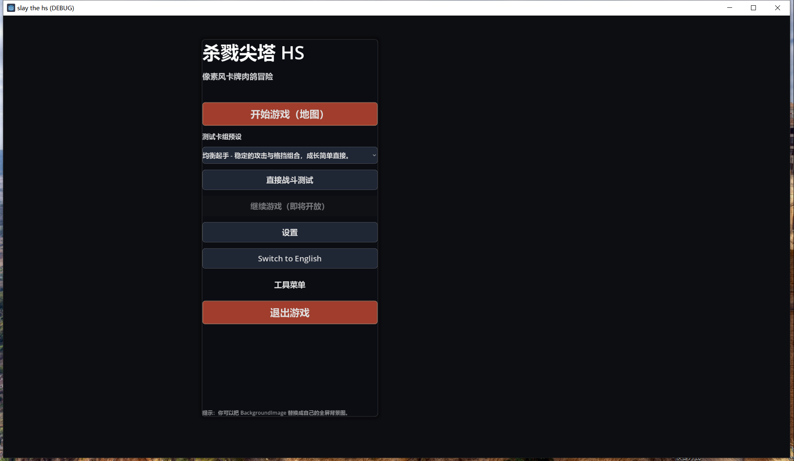
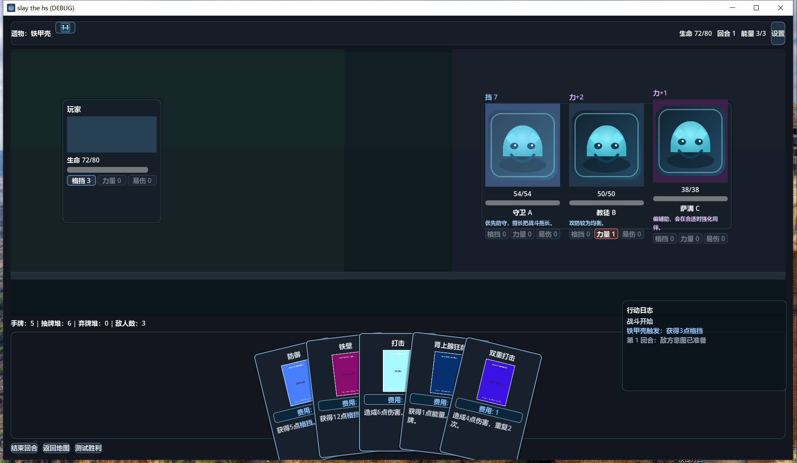

# FishEatFish（千夜）

> 回合制卡牌 roguelike（《杀戮尖塔》玩法参考）。**Godot 4.6.1 + C#**。
> 四名角色组队 → 抽卡出牌 → 探索六边形地图 → 遭遇敌人 / 商店 / 事件 → 带回奖励再出发。




| | |
|---|---|
| 引擎 | Godot 4.6.1-stable **mono**（.NET 8.0 / `net8.0`） |
| 仓库 | <https://github.com/yutuer/shalujianta.git>（分支 `main`） |
| 规模 | 172 个 C# 脚本 / 31,462 行（非空行） · 58 个 `.tscn` · 16 张 JSON 数据表 |
| 原始需求 | [`docs/原始策划案.md`](docs/原始策划案.md) |
| 当前迭代 | [`docs/开发计划.md`](docs/开发计划.md) · 68 个条目 |

---

## 📖 给后来者：按这个顺序读

| # | 文件 | 什么时候看 |
| :-: |---|---|
| 1 | **本文** | 主干：现状、架构、下一步、文档地图 |
| 2 | [`.trae/rules/project_rules.md`](.trae/rules/project_rules.md) | **动手前必读**——写代码的铁律 |
| 3 | [`docs/开发计划.md`](docs/开发计划.md) | **正在做什么**——本轮迭代条目 + 三步流程 |
| 4 | [`tasks.md`](tasks.md) | 134 行任务清单，带依赖关系与状态 |
| 5 | [`GameDesign.md`](GameDesign.md) | 完整策划案（18 章 + ✅/🔄/❌ 标记） |
| 6 | [`docs/踩坑记录.md`](docs/踩坑记录.md) | **踩过什么坑**——改代码前扫一眼 |
| 7 | [`docs/调试场景准备器.md`](docs/调试场景准备器.md) | 怎么带着「选人已完成」的状态进场景 |
| 8 | [`CODE_WIKI.md`](CODE_WIKI.md) | 技术档案（自动生成，**已滞后，以源码为准**） |
| 9 | [`checklist.md`](checklist.md) | 12 大类验收清单 |

> ⚠️ **文档会失同步。** 本项目历史上至少 4 处文档与代码脱节（见 [`docs/踩坑记录.md` §1](docs/踩坑记录.md)）。**源码是唯一真相**，冲突时以源码为准，并顺手把文档修掉。

> 📌 **本文是主干**，只回答五个问题：这是什么 / 怎么跑 / 架构长啥样 / 现在啥进度 / 下一步做什么。
> 一切细节都外链到 `docs/` 专题文档，**不在这里展开**——需要时点进去看。

> 📖 **术语口径**（D54 起）：「怒气满了能释放的技能」本项目**统一叫「狂气爆发」**（照参考游戏《终末前夜 Morimens》）。
> 「必杀技」「大招」是旧称，**只在本文的「变更记录」与 `docs/` 里的历史记录中保留原样**。
> 代码里的英文标识符（`UltimateSkill` / `ultimates.json`）不动。

---

## 1. 快速上手

### 1.1 环境

| 依赖 | 版本 | 备注 |
|---|---|---|
| Godot | 4.6.1-stable **mono** | 必须带 .NET 版 |
| .NET SDK | 8.0+ | 本机实测 10.0.201 可用（`net8.0` 目标框架） |
| 显卡 | D3D12 | `project.godot` 已锁定 `rendering_device/driver.windows="d3d12"` |

> 🖥️ **本机 Godot 编辑器不在 PATH**，常见目录也搜不到。所以：
> - **编译** → 用 `dotnet build`（不依赖 Godot 可执行文件）
> - **跑起来看** → 用 `godot-runtime` MCP 的 `run_project` / `take_screenshot`
> - **改场景/布局** → 需要编辑器，目前只能手工编辑 `.tscn` 文本

### 1.2 构建

```powershell
cd E:\trae_Projects\FishEatFish
dotnet build          # 输出到 .godot/mono/temp/bin/Debug/
```

### 1.3 运行（MCP 方式）

```powershell
# 通过 godot-runtime MCP 启动（会自动构建并注入 MCP 桥）
run_project(projectPath="E:/trae_Projects/FishEatFish")
take_screenshot()
```

导出配置见 `export_presets.cfg`（预设名 `Windows Desktop`，输出到 `dabao/qianye.exe`）。

### 1.4 常用命令速查

```powershell
cd E:\trae_Projects\FishEatFish
```

| 目的 | 命令 |
|---|---|
| 编译 | `dotnet build` |
| 清理后重编 | `dotnet clean; dotnet build` |
| **校验任务统计表** | `powershell -ExecutionPolicy Bypass -File tools\check-task-stats.ps1` |
| **文档一致性回读测试** | `powershell -ExecutionPolicy Bypass -File tools\check-doc-consistency.ps1` |
| ↑ 含远端回读比对 | 同上加 `-CheckRemote`（拉 GitHub 上的文件与本地做 SHA256 比对） |
| **卡牌数据一致性校验** | `powershell -ExecutionPolicy Bypass -File tools\check-card-data.ps1`（每个角色两张独立基本卡 / id 唯一 / 引用存在 / 按百分比配数值） |
| 导出 Windows 版 | `godot --headless --export-release "Windows Desktop" dabao/qianye.exe` |
| 提交（多行信息） | `git commit -F <消息文件>` ← 多行信息别用 `-m`，PowerShell 会拆参数 |
| 推送 | `git push origin main` |
| GitHub 认证状态 | `gh auth status` |
| 看 CI / PR / Issue | `gh run list` · `gh pr list` · `gh issue list` |
| 查仓库 API | `gh api repos/yutuer/shalujianta` |
| 压参考图入库 | `powershell -ExecutionPolicy Bypass -File tools\convert-reference-images.ps1` |
| **地图校验模块可移植性验证** | `powershell -ExecutionPolicy Bypass -File tools\verify-mapvalidation-portability.ps1` |

> 导出产物（`dabao/`、`qianye.*`、`*.tpz`、`*.rar`）已在 `.gitignore` 中，不会误入版本库。

**跑起来看**（本机无 Godot 编辑器，用 MCP）：
`run_project(projectPath=...)` 启动 · `take_screenshot()` 截图 · `simulate_input(...)` 模拟输入 · `run_script(...)` 注入 GDScript

### 1.5 调试场景准备器（速查）

改完 bug 要验证时，**不必走「主菜单 → 选关卡 → 选角色 → 进地图」那一大段**。

```powershell
dotnet build
$godot = 'K:\Godot_v4.6.1-stable_mono_win64\Godot_v4.6.1-stable_mono_win64.exe'
& $godot --path 'E:\trae_Projects\FishEatFish' 'res://Scenes/Dev/DevScenario.tscn' -- --scenario=battle
```

内置 16 个预设：`default` `battle` `near_shop` `half_hp` `elite_battle` `near_boss` `step_on_boss` `boss_battle` `jialun_team` `pollux_team` `pollux_sinmark` `jialun_pollux` `jialun_pollux_boss` `sanga_team` `thais_team` `sanga_thais_team`。

> ⚠️ **别直接跑 `HexMapScene.tscn`** —— 会跳过选人流程，战斗回退到默认阵容「鼠牛虎兔」而不是你选的队伍。

**预设表、命令行参数、加新预设的方法** → [`docs/调试场景准备器.md`](docs/调试场景准备器.md)

---

## 2. 目录地图

```
FishEatFish/
├─ Data/            15 张 JSON 数据表（卡牌/角色/刻印/造物/buff/效果/狂气爆发/敌人波次…）
│                   + dev_scenarios.json —— 调试场景预设表
├─ Scenes/          58 个 .tscn
│  ├─ MainMenu / LevelMap / CharacterSelection / CharacterGallery / BattleScene / HexMapScene
│  ├─ Dev/           DevScenario.tscn —— 调试场景准备器入口
│  └─ UI/           50 个 UI 组件场景
├─ Scripts/         172 个 .cs，按职责分层
│  ├─ Scenes/       场景驱动（BattleManager 是战斗主循环核心）
│  ├─ Dev/          DevScenario.cs —— 调试场景准备器逻辑
│  ├─ Battle/       战斗核心
│  │  ├─ Core/          Player / Enemy / IUnit / 敌人波次加载
│  │  ├─ Card/          卡牌数据、等级、描述生成
│  │  ├─ CharacterSystem/ 波吕克斯 / 珈伦 / 珊 / 泰旖丝定义（+ 12 星座 BOSS）、Attacker、终极技能
│  │  ├─ Effects/       效果注册表、效果实现、Buff/Debuff
│  │  ├─ HexMap/        坐标、格子、地图、生成器、事件
│  │  ├─ MapSystem/     MapManager / 地图定义 / 奖励
│  │  ├─ ArtifactSystem/ EngravingSystem/ SilverKeySystem/ BattleRewardManager/
│  │  └─ CardLayoutManager / RageManager / BattleTransitionManager …
│  ├─ AI/           敌人 AI（激进/均衡/防守）
│  ├─ Shop/         黑印商店
│  ├─ MapValidation/ 地图可达性与死锁校验（**8 个文件不依赖 Godot，整目录可拷走**）
│  └─ UI/           61 个 UI 组件脚本
├─ docs/            专题文档（见 §9 文档索引）+ 原始策划案 + 参考图
├─ tools/           check-task-stats.ps1 校验任务统计表是否漂移
│                   check-doc-consistency.ps1 文档一致性回读测试（链接/换行符/编码/术语/统计/**数字回读**）
│                   check-card-data.ps1 卡牌数据校验（每个角色两张独立基本卡 / id 唯一 / 引用存在）
│                   convert-reference-images.ps1 压参考图入库
│                   verify-mapvalidation-portability.ps1 校验地图校验模块可整体拷走
├─ .trae/           Trae 的项目规则与历史计划
└─ project.godot    工程配置（含 [autoload]）
```

---

## 3. 架构要点

### 3.1 场景流转

```
MainMenu
  ├→ CharacterGallery（角色一览：查看角色属性 / 卡组 / 狂气爆发）
  ├→ LevelMap（选关卡）
  │    └→ CharacterSelection（选 4 角色 + 1 钥令）
  │         ├→ HexMapScene（六边形地图探索）⇄ BattleScene（战斗）
  │         └→ BattleScene（直接进战斗，测试用）

战斗胜利后的两段收尾（D18）：
  BattleScene → BattleRewardUI（三选一：造物 or 刻印）
              → BattleResultUI（调查完成结算）
              → HexMapScene（回地图）
  刻印奖励会多一段：BattleRewardUI → EngravingRewardCardSelectionUI（选一张卡镶嵌）
```

跨场景数据靠两套机制：

- **`GlobalData`**（`Scripts/Scenes/LevelMap.cs` 末尾的静态类）— 已选角色、钥令、当前地图
- **autoload**（见下）— 需要跨场景存活的运行时状态

### 3.2 autoload（跨场景存活，`project.godot`）

| 名称 | 脚本 | 职责 |
|---|---|---|
| `MapManager` | `Scripts/Battle/MapSystem/MapManager.cs` | 当前关卡、进度、造物数量上限 |
| `BattleTransitionManager` | `Scripts/Battle/BattleTransitionManager.cs` | 地图↔战斗切换、**地图存档**（地图对象/位置/生命/黑印）、敌人波次键 |
| `BlackMarkShopManager` | `Scripts/Shop/BlackMarkShopManager.cs` | 黑印余额、商店物品、已购造物、已刻印卡牌 |
| `EngravingManager` | `Scripts/Battle/EngravingSystem/EngravingManager.cs` | **刻印的唯一真相源**：卡牌↔刻印映射（跨战斗存活）、出牌触发 |
| `BattleRewardManager` | `Scripts/Battle/BattleRewardManager.cs` | 战斗奖励候选生成（造物/刻印三选一）与发放 |

> 这三个**必须是 autoload**。历史上它们分别是场景节点 / 子节点，切场景就销毁，导致黑印清零、地图存档丢失。

### 3.3 六边形地图坐标（唯一权威常量）

写在 `.trae/rules/project_rules.md`，实现在 `HexMapUI.HexToWorld/WorldToHex` 与 `HexTileView.UpdateHexShape`：

```
尺寸      180 × 156（Control），多边形本体 x∈[15,165] y∈[0,156]
顶点      V0(90,0) V1(165,39) V2(165,117) V3(90,156) V4(15,117) V5(15,39)
转换      x = 150*Q + 75*R     y = 117*R
反解      R = round(y/117)     Q = round((x - 75*R)/150)
边↔方向   a↔North  b↔NorthWest  c↔SouthWest  d↔South  e↔SouthEast  f↔NorthEast
```

> `docs/六边形地图算法.md` 曾长期停留在旧的 120×104 尺寸，**已于 2026-10-20 对齐**。改尺寸要同步改：规则文件 + `HexTileView.UpdateHexShape()` + `HexMapUI` 两个转换函数 + 该文档，**四处**。

### 3.4 敌人波次配置

`Data/enemies.json` → `Scripts/Battle/Core/EnemyConfigLoader.cs` → `BattleManager.InitializeEnemies()`

| 波次键 | 来源 | 敌人 |
|---|---|---|
| `normal_wave` | 普通战斗格子 | 守卫 / 游兵 / 斥候 |
| `elite_wave` | 精英战斗格子 | 精锐·虎 / 精锐·蛇 |
| `boss_wave` | 终点 BOSS 格子 | 千夜之主 |

格子上的 `EnemyConfig` 字段 → `BattleTransitionManager.CurrentEnemyConfig` → 战斗场景按此加载。**新增敌人只改 JSON，不改代码。**

### 3.5 地图生成与「能不能通关」的保证

地图是**参数化生成**的（`Data/level_specs.json`：每关一份配额 + 种子 → 同一规格逐格相同），
生成后由 `Scripts/MapValidation/` 的**通用校验器**兜底（8 个文件不依赖 Godot，整目录可拷到别的项目）：

```
配额 + 种子 → 生成（挖空洞 / 铺事件 / 放传送门）→ 校验 → 不过就重生成（最多 20 次）
                                       ↑ 校验查：起点→终点有通关走法吗？软锁？不可达区域？死路？孤岛？
```

| 保证 | 不保证 |
| :--- | :--- |
| **无论怎么走都能到终点** —— 没有任何可达状态是死局（D22 全称判定：枚举洞的所有消耗状态 + 反向 BFS 找死局） | 战斗层面：打得过 BOSS 吗、血够不够、牌打得对不对 |
| 起点→终点**存在一条通关走法**（老口径也仍然成立） | 迷雾（只影响可见性，不影响可达性） |
| 传送门按**有向边**建模（单向门只进不出） | 不可达区域（地图上有永远去不了的格子）—— 只警告不阻断 |
| 每个**事件格都可达**、空洞不产生孤岛 | — |

细节 → [`docs/开发计划.md`](docs/开发计划.md) 的 D13 / D20 / D21 / D22。

---

## 4. 开发铁律（摘要，完整版见规则文件）

1. **逻辑与页面分离** —— 布局/尺寸/颜色进 `.tscn`，业务逻辑/动态数据/事件绑定进 `.cs`
2. **UI 优先建独立 `.tscn`**，禁止在代码里硬编码 `PanelContainer` 之类的布局
3. **事件回调首尾必须有日志**：
   ```csharp
   GD.Print($"[类名] 方法名 called");
   // ... 逻辑 ...
   GD.Print($"[类名] 方法名 completed");
   ```
4. **改完代码必须 `dotnet build` 通过**再让用户测
5. **六边形坐标常量见 §3.3**

> 这 5 条之外，历史上踩过的 119 个坑（`.tscn` 漏绑脚本、无头环境模拟点击失效、git push 上传大文件、PowerShell 编码……）都记在 [`docs/踩坑记录.md`](docs/踩坑记录.md)。

---

## 5. 当前进度基线

> **本表是快照，不是活数据。** 权威来源是 [`tasks.md`](tasks.md) 的任务行；下表由脚本实算后同步。
> 统计于 **2026-10-31**，口径：按 `tasks.md` 一~五节任务行逐行实算（共 **134** 行）。

| 分类 | 总数 | ✅ | 🔄 | ⬜ |
|---|:-:|:-:|:-:|:-:|
| 高优先级 | 73 | 67 | 1 | 5 |
| 中优先级 | 15 | 0 | 1 | 14 |
| 低优先级 | 13 | 0 | 0 | 13 |
| 商店系统（已完成） | 28 | 28 | 0 | 0 |
| Bug 修复 | 5 | 3 | 2 | 0 |
| **合计** | **134** | **98** | **4** | **32** |

📌 **改完任务状态别只改表**——跑校验脚本，它一次核对四处（`tasks.md` 实算 / `tasks.md` 统计表 / 本表 / `docs/开发计划.md`）：

```powershell
powershell -ExecutionPolicy Bypass -File tools\check-task-stats.ps1
```

退出码 `0` = 一致；非 `0` = 有漂移，脚本会逐条列出该改哪几个数字。

**已跑通的主循环**：主菜单 → 选图 → 选角色 → 六边形地图 → 踩战斗格子 → 按波次配置生成敌人 → 战斗结束 → 回到地图且地图/位置/生命/黑印完整恢复。

**血量是同一份**：玩家血量 = 队伍总血量（鼠牛虎兔 = 125），战斗胜利写回地图，战败不写回。

**尚未打通的**：地图迷雾的**云雾状有机边缘**（纯黑遮罩与战争迷雾本体已做，见 D5） · 造物装备界面（2.1） · 金币系统（2.2） · 地图胜利结算界面（2.3） · 角色羁绊 / 怒气溢出 / 技能升级 / 外观皮肤（3.x） · 存档持久化到磁盘（跨场景状态已放 autoload，**重启仍丢**）。

> 上一迭代（对标参考图 D1~D14）已全部完成；本轮（战斗机制闭环 D15~D19）把**刻印 / 狂气爆发 / 钥令 / 战斗奖励选择 / Buff-Debuff UI** 这 5 组从「写了但没接线」变成了真正可用 —— 详见 [`docs/开发计划.md`](docs/开发计划.md)。

---

## 6. 已知陷阱与经验

完整的 119 条记在 **[`docs/踩坑记录.md`](docs/踩坑记录.md)**，改代码前建议扫一眼。最要命的几条：

| 坑 | 一句话 | 详见 |
|---|---|---|
| 文档失同步 | 改了任务行忘改统计表 → 数字骗人 | §1 |
| `.tscn` 根节点漏绑 script | 组件一直是空的，但**不崩所以没人发现** | §8 |
| 无头环境模拟点击失效 | 依赖 `GetLocalMousePosition()` 的路径测不到 → 改用临时 C# 集成测试 | §4 |
| `git push` 上传大文件 | 推的是「远端缺失的对象」，不是增量 diff | §5 |
| MCP 污染 `project.godot` | 跑测试期间 `git add .` 会把 `McpBridge` autoload 带进仓库 | §12 |

> 规矩：**跑测试期间只 `git add` 具体文件**。

---

## 7. 下一步做什么

**最新一轮（D63「删掉 12 生肖测试角色」）已完成** ✅ —— 主人 2026-11-04：「现在已经有了4个角色了, 可以把12生肖的测试角色都删除了」。
**整根拔**：12 个角色定义 + **60 张卡** + **12 条狂气爆发** + **168 个美术文件**（12 立绘 / 12 头像 / 60 卡面，含 `.import`）
+ 2 个美术生成脚本的生肖条目 + 13 个调试预设的队伍（默认队伍改 4 个真角色）。
**12 星座 BOSS 不动**（它们是敌人 BOSS，不属于生肖）。角色一览 / 选人界面现在只列**可玩角色**（4 名）。
详见 [`docs/开发计划.md`](docs/开发计划.md) 的 D63。

**上一轮（D61「灵知觉醒卡永远显示在 5 张卡的正中间」）已完成** ✅ —— 主人一句话规则：「灵知觉醒的卡牌永远显示在 5 张卡牌的中间」。
参考图实证：珈伦「技能」页 = 打击 / 防御 / **凸月之舞（灵知觉醒）** / 蟾蜍炖菜 / 静默守望 → **觉醒卡在第 3 张**。
→ 珊 / 泰旖丝 原先落在**第 5 位**，已重排到第 3 位；波吕克斯 / 珈伦 本来就对、不动。
`tools/check-card-data.ps1` 加了规则 5b 守着这条「永远」。详见 [`docs/开发计划.md`](docs/开发计划.md) 的 D61。

**上一轮（D60「用 wiki 数据重现珊 / 泰旖丝」）已完成** ✅ —— 主人 2026-11-01 给了三条：
①「**卡牌也是有的, 在wiki的技能里面**, 狂气爆发 / 打击卡 / 防御卡 / 灵知觉醒 / 技能卡1 / 技能卡2
分别对应卡牌 1-5 的页面说明, **取 6 级的说明**并用相应的属性计算结果替换掉上面的动态数字即可」；
②「**波吕克斯的先不要改成 60 级**」；③「**尝试使用wiki的数据重现2个角色**, 一个叫 珊, 一个叫 泰旖丝」。
→ 珊（Sanga，防御型 / 深海）**100 攻 / 152 防 / 128 体** + 黑印掉落 12.3% + 死亡抵抗 61.6%；
泰旖丝（Thais，辅助型 / 血肉）**135 攻 / 126 防 / 140 体** + 狂气回充 2.4 + 银钥充能 29.4；
**11 张卡**（含 2 张灵知觉醒 + 1 张衍生卡）+ **2 条狂气爆发**（失落的艺术 / 丰穰之仪）全部落地并实机跑通。
→ **可玩角色数：波吕克斯 / 珈伦 / 珊 / 泰旖丝 = 4 名**（23 张卡 = 4×5 + 3 张衍生卡）。
   ⚠️ 12 生肖测试角色已于 2026-11-04（D63）整体删除（角色 / 60 张卡 / 12 条狂气爆发 / 168 个美术文件）。
⚠️ 实现不了的机制（余波狂气、给自己加力量、吞噬、胚胎转化、首领战额外伤害等 **18 条**）逐条登记在
卡 / 狂气爆发的 `pendingMechanics[]` 里。详见 [`docs/开发计划.md`](docs/开发计划.md) 的 D60。

**上一轮（D59「属性统一用 wiki 60 级 0 命」）已完成** ✅ —— 珈伦 12 项属性全部对齐 wiki 裸值。

**再上一轮（D35「角色一览」）已完成** ✅ —— 之前**游戏里没有任何查看角色信息的入口**，
现在主菜单有「角色一览」按钮 → 可玩角色列表（现为 **4 名**：波吕克斯 / 珈伦 / 珊 / 泰旖丝）→ 点单个角色看详情
（立绘 + 属性 + 狂气爆发 + 5 张卡）。详见下方「战斗这条线」与
[`docs/开发计划.md`](docs/开发计划.md) 的 D35。

**上一轮（D34「卡牌详情界面」）已完成** ✅ —— 点手牌打开**卡牌详情面板**（属性系数口径 /
当前值 / 下一级预览 / 升级入口占位），**长按手牌就地放大 2.2 倍**看详情（松手复原），
拖拽出牌不受影响（详见下方「战斗这条线」与
[`docs/开发计划.md`](docs/开发计划.md) 的 D34）。

**上一轮（D33「每角色两张独立基本卡」）已完成** ✅ —— 打击/防御**不能被角色共用**：
13 角色 × 2 = 26 张独立条目（数值暂用同一套 10% 模板，**词条与运行时实例各自独立**），
配两道防回归守卫 + 一个数据校验脚本（详见下方「战斗这条线」与
[`docs/开发计划.md`](docs/开发计划.md) 的 D33）。

**上一轮（D32「卡牌特色化」第一阶段）已完成** ✅ —— 卡牌数值改成「角色属性 × 百分比」、
新增可玩角色「波吕克斯」；同时从主人补的「技能升级」参考图里把**系数口径**全部量了出来
（等级系数与我们一致；参考游戏**向上取整**；怒气是 `5+每级×(级−1)`）→ 待主人拍板。

**再上一轮（D31「右下角牌堆面板」）已完成** ✅ —— 原来的纯文字「手牌: 8 | 抽牌堆: 12 | 弃牌堆: 0」换成参考图 R-08 那样的「数字 + 图标」。

**再上一轮（D30「战斗界面排版对齐」）已完成** ✅ —— 血量数字进血条、盾 0 隐藏徽标、
玩家血条右移 + 立绘铺满、3 个敌人等比例（详见下方「战斗这条线」与
[`docs/开发计划.md`](docs/开发计划.md) 的 D30）。

**上一轮（D29「卡牌数据链修复」）已完成** ✅ —— 卡牌数据表真正进了战斗，
「卡牌生效 → 状态图标」这条链第一次跑通（详见下方「战斗这条线」与
[`docs/开发计划.md`](docs/开发计划.md) 的 D29）。

**上一轮迭代（战斗机制闭环）—— 5 个条目已全部完成** ✅
再上一轮（UI 对标参考图 D1~D14）也已完成。各轮清单与逐条实现回写见 [`docs/开发计划.md`](docs/开发计划.md)。

**战斗这条线**
- **D35「角色一览」** ✅ —— 主菜单加「角色一览」按钮 → **左角色网格 + 中大立绘 + 右侧信息栏**（名称 / 类型 / 等级 / 卡牌等级 / 天赋 / 三属性 + 详细信息 + 详情）；「详细信息」弹属性详情面板；「详情」进**卡牌总览**（左边一竖列头像切换 + 右侧狂气爆发 + 5 张卡）。照参考游戏《终末前夜》三张图重排。
- **D34「卡牌详情界面」** ✅ —— **点手牌**打开详情面板（大卡面 + 属性**系数口径**「攻击力×N%」+ 当前值 + 下一级预览 + 词缀 + 升级入口占位，参考参考图的卡牌详情页）；**长按手牌**就地放大 2.2 倍把详情放大出来（松手复原）。长按与拖拽用**移动容差**区分，出牌不受影响。
- **D33「每角色两张独立基本卡」** ✅ —— 打击/防御**不许被角色共用**（主人 2026-10-24 明确）：13 角色 × 2 = **26 张独立条目**，数值暂用同一套 10% 模板、**词条与运行时实例各自独立**；顺带修掉百分比化后「绝对值字段恒为 0」导致的 6 处静默失效（防御卡配色 / 刻印列表数值 / 升级预览 / 复制刻印 / 遗留结算路径 / 卡组日志）。
- **D32「卡牌特色化」** 🔄 —— 卡牌数值改「角色属性 × 百分比」+ 新增角色「波吕克斯」✅；**下一步**：狂气爆发「无罪的圣裁」改百分比（300% = 546）+ 衍生卡「圣心」（规格已量全，等开工）。
- **D31「右下角牌堆面板」** ✅ —— 原来的纯文字「手牌: 8 | 抽牌堆: 12 | 弃牌堆: 0」换成参考图 R-08 那样的「数字 + 图标」：手牌 **x/x**、抽牌堆（**图标可点**，点开看抽牌池里还剩哪些牌）、弃牌堆；新增 3 个图标素材 + 2 个独立 `.tscn` 组件。
- **D30「战斗界面排版对齐」** ✅ —— 血量数字写进血条（玩家 + 敌人）、盾 0 不显示徽标、玩家血条右移且 4 个立绘铺满、3 个敌人**等比例**（状态图标行固定高度，不再把立绘挤扁）。
- **D29「卡牌数据链修复」** ✅ —— 修掉**队伍卡组根本没读数据表**这个根因：20 张队伍卡里 12 张是**空牌**（卡面「使用特殊能力」、无伤害无护盾、照样扣算力）。改为以 `Data/character_cards.json` 为准（每场战斗一份副本），并把增益减益接到 `EffectRegistry`（图标 / 名称 / 时长）、把卡面文案与实际效果对齐（数值 / 作用对象 / 怒气三处口径统一）。
- **D28「手牌间距 + 拖拽放大 + 血条承载盾量与预扣血」** ✅ / **D26「手牌交互重做（拖拽出牌）」** ✅ —— 拖拽出牌、按住上移越阈值松手、命中检测按牌的真实变换判定。
- **D23~D25「战斗场景排版 / 美术补齐 / 按参考图 R-08 对齐」** ✅ —— 五区锚定、专属卡插画、装备栏 2 排 × 8、左下角大号算力、绿填充血条 + 深红预扣血段 + 末端盾牌徽标。
- **D19 Buff/Debuff UI** ✅ —— 敌人侧补上状态图标行；玩家侧改**差集刷新**；状态变化实时刷新。

**战斗界面剩余（未进迭代）** —— P5 总伤害大字 / P7 通用 tooltip / 中央剧情文本层；
**AUTO 自动战斗主人已拍板不做**（2026-10-21，见 [`docs/战斗场景改造计划.md`](docs/战斗场景改造计划.md)）。

**这轮修的是「写了但没接线」的 5 组**（D15~D19）：
- **D15 刻印触发** ✅ —— `EngravingManager` 升为 **autoload**（刻印必须跨战斗存活）；卡组每场重建 → 新增 `ApplyToDeck` 回填；出牌时真正触发 6 种刻印效果；卡面右上角加刻印角标。
- **D16 怒气狂气爆发** ✅ —— 根因是 `UltimateSkill.Execute` 只跑空的 `EffectIds`（狂气爆发实际效果为零），且读的是字段更少的 `characters.json`。改为 **`ultimates.json` 为唯一权威源** + 新增 `UltimateExecutor` 真正结算伤害/减益/治疗/护盾/抽牌；点击角色槽位释放狂气爆发。
- **D17 钥令效果** ✅ —— 修掉**双重计数 bug**（管理器与调用方各记一次 → 「每回合 2 次」实际只能用 1 次）；限额改由管理器**守门**（超限直接拒绝、不执行效果）。
- **D18 战斗奖励选择界面** ✅ —— 新增 `BattleRewardUI` 三选一（造物 or 刻印，50/50）；刻印走独立选卡界面；胜利流程改为「奖励三选一 → 调查完成结算 → 回地图」。
- **D19 Buff/Debuff UI** ✅ —— 敌人侧补上状态图标行；玩家侧改**差集刷新**（消失的只淡出那一个）；状态变化实时刷新。

**地图这条线（🔺 核心资产）**
- **D13「地图可达性与死锁校验」** ✅ —— 通用算法模块 `Scripts/MapValidation/`（8 个文件**不依赖 Godot**，整目录可拷走）。9 类结构化诊断：通不了关 / 软锁 / 不可达区域 / 关键格不可达 / 死路 / 孤岛 / 状态死锁 / 旁支必需格不可达 / 多簇。可移植性有可重复脚本 `tools/verify-mapvalidation-portability.ps1` 守着。
- **D14「按配额生成关卡地图」** ✅ —— `Data/level_specs.json` 声明每关的配额 + 种子；**同规格同种子 → 逐格相同**；`MapManager` 按 mapId 缓存，同关卡重复进入拿同一张图。
- **D12「地图簇结构」** ✅ —— 初始多簇（靠传送门连）+ 洞消耗再分裂。每簇 = 两块子区域 + 一个「窄口」（窄口是割点，洞放这里）；洞的时序：**进入禁回退、离开即从地图删除**，已消耗的洞进存档。

**界面这条线**
- **D5「地图迷雾系统」** ✅ —— 战争迷雾（未照亮 = 纯黑 + 隐藏图标）+ 相邻格青色描边 + 探照灯事件（驱散半径 3 格）+ 已照亮状态进存档。
- **D6「地图左侧评分项面板」** ✅ —— 三态（✓ 已达成 / ✗ 已失效 / • 未触发），文案与条件全在 `Data/score_items.json`。
- **D3「关卡详情弹窗」** ✅ —— 关卡号 / 描述 / 星级 / 推荐等级 / 难度档 / 敌方预览 / 奖励预览 / 取消-调查-记录。
- **D10「关卡展示界面升级」** ✅ —— 章节切换 + 关卡卡片 + 难度档 + UID + 共鸣/星级评分/关卡进度。
- **D1「顶部公共 HUD 外壳」** ✅ —— 4 个角色圆环 + 当前钥令 + **16 格收集品（8 列 × 2 排）** + 右上 4 个统计位。
- **D4「战斗胜利结算界面」** ✅ —— 星级评价 / 唤醒体同调率 / 调查奖励。
- **D7「事件弹窗统一」** ✅ —— 通用 `EventDialog`，文案与图全在 `Data/events.json`。
- **D8「战斗敌人意图显示」** ✅ / **D9「Buff/Debuff 图标层」** ✅ —— 战斗信息补全。
- **D11「商店刷新/购买二次确认」** ✅ —— 通用 `ConfirmDialog`（标题 + 正文 + 取消/确认）。
- **D2「视觉主题资源」** ✅ —— `Assets/Themes/MainTheme.tres`（深蓝灰 + 细金线）+ 衬线中文标题字体。

**功能缺口** —— `tasks.md` 高优先级的 5 组（战斗奖励**选择**界面 / 刻印触发 / 狂气爆发 / 钥令 / Buff-Debuff UI）**已在本轮全部完成**（D15~D19），进度见 §5。

**其他待办**（散落在 `tasks.md` 与 `.trae/plans/`，未进本轮迭代）：

- 点击远距离格子移动 —— 现在悬停会高亮整条路径，但点击只接受相邻格子（`HexMapUI.OnTileClicked`）
- 存档持久化到磁盘 —— 跨场景状态已放 autoload（`MapManager` / `BattleTransitionManager` / `BlackMarkShopManager` / `EngravingManager` / `BattleRewardManager`），**但重启仍丢**
- `HexMapUI.cs` 拆分 —— `.trae/plans/hexmapui-refactor-plan.md` 阶段 6（目标 802 行 → <400 行）

---

## 8. 变更记录

> 📌 **本表按时间倒序追加，早期条目里的结论与术语若与后续条目冲突，以最新条目为准。**
> 已被后续修正的早期结论：①「洞 = 桥（cut edge）」—— 洞是**顶点**，要找的是**割点**；
> ②「簇只由洞消耗产生」—— 簇还有**初始多簇**（靠传送门）这个来源；
> ③「地图结构是三层」—— 完整是**四层**（还有单向门）；④「桥树」这个说法已统一改为**簇图**。

| 日期 | 内容 |
|---|---|
| 2026-11-04 | **D64 补充：推后复测结果** —— commit `1f1249e` 推上远端**之后**再跑一遍（`res://Scenes/CharacterGallery.tscn`，background）：GDScript 探针读回 4 张卡片 **超维界域/伤害型 · 混沌界域/辅助型 · 深海界域/防御型 · 血肉界域/辅助型** ✅；点泰旖丝 → 详情栏「血肉界域 / 辅助型」+ 属性面板「界域 血肉界域 / 定位 辅助型 / 银钥充能等级 29.4 / 狂气回充等级 2.4」✅；回归 `res://Scenes/Dev/DevScenario.tscn` 默认预设 → 「队伍=波吕克斯,珈伦,珊,泰旖丝 钥令=银光斩 关卡=森林深处」→ `HexMapScene` 正常（血量上限 120 / map_01 生成成功）✅；`finalErrors: []`；**三级回读 L1/L2/L3 全 PASS**（L1 远端 SHA == 本地 `1f1249e12d167aa3d76e7c313c8810d87bf62f87`；L2 整棵文件树 blob SHA 零差异；L3 12 个改动文件字节级 SHA256 全一致）。 |
| 2026-11-05 | **D66 登记：死亡抵抗「复活触发链」根本没接上（零调用点）—— 一行代码都没写** —— 主人 2026-11-05 批准 D65 的两处口径（「**这 2 点就按照你说的执行**」），我在执行前顺手 grep 了一下调用点，结果 `grep -r "DeathResistanceSystem\|TeamReviveSystem" --include=*.cs` **只命中定义它自己的那个文件** → **零调用点**：没有任何地方 new 这两个类、没有地方在角色死亡时调 `TryRevive` / `OnRevive`。**推论**：D65 刚拍板的「减半 → 30.8」代码写对了，但**运行时永远不会发生**；死亡抵抗目前**唯一活着的链路只有 HUD 显示**（`HexMapUI.GetCurrentDeathResistance()`）。**根因**：这类「机制类」代码和「工具类」代码长得一模一样 —— 都有完整 public API + 注释 + 配套数据表，但**没有调用方** → 玩家看不到、测不到、也**不会报错**（与 §108「狂气回充等级零调用点」同型）。**本轮做的是登记规格，不是实现**：开 **D66** 条目，逐条列了参考图 `战斗4_死亡抵抗.jpg` 挖出的**官方机制 5 条**（① 致命伤害时按概率保留 1 血 ② 触发后下回合 +2 算力 + 抽 2 张牌 ③ **队伍**的死亡抵抗减半 ④ **后续获得**的死亡抵抗减半 ⑤ 队伍有混沌界域唤醒体 → 初始 **+100%**）与本项目现状的逐条差异 + 7 步实现规格（接线点 / 实例化归属 / 队伍减半 / 下回合挂载点 / 减半乘区 + 「获得死亡抵抗」的来源 / 混沌界域 +100% 依赖 D64 界域效果）+ 6 条验证点。⚠️ **第 ④ 条连带一个设计问题**：本项目目前**根本没有「获得死亡抵抗」的途径**；第 ⑤ 条**依赖 D64 未实现的界域战斗效果**。新增踩坑 **§119**（改对了机制 ≠ 机制会触发；判据是**搜类名**，搜方法名会漏）。**没动一行代码**。 |
| 2026-11-04 | **D65 修正副属性精度（珊死亡抵抗 62 → 61.6）+ 副属性统一小数点后 1 位显示** —— 主人 2026-11-04 引用了我上一轮报告里的一句偏差（原话：「珊的死亡抵抗 wiki 是 61.6%，但 C# 里 `BaseDeathResistance = 62`」），说「**改, 顺便检查其他的副属性, 基本都是小数点后1位显示.**」。**先对 wiki 真值表**（`wiki-domain/*.json` 的 `attributes`，60 级 0 命口径）→ **查出两处真实偏差**：① **珊的死亡抵抗 62 ≠ 61.6** —— 根因是**字段声明成 `int`**，赋值 `61.6` 的那一刻就被四舍五入成 62，**误差在赋值时就产生了**，后面调显示格式也回不去（踩坑 **§118**）；⚠️ 顺带查出 `Data/characters.json` 里珊本来就写的是 **61.6** —— **错的一方一直是 C#**。② **`BaseRageReturn` 的默认值 `2f` 不是 wiki 值**（wiki 通用值 **0**）→ 那是老代码遗留，**凡是没显式赋值这个字段的角色都吃到 2**（珊面板显示「狂气回充等级 2.0」，wiki 是 0）→ **默认值也是数据**，改成 `0f` + 珊显式写 `0f`。**改法**（6 个文件）：`CharacterDefinition` 的 `BaseCritDamage` / `BaseDeathResistance` / `BaseDomainMastery` **int → float** + `BaseRageReturn` 默认值 **2f → 0f** + 珊 `61.6f`；`CharacterAttributes` 镜像属性 `CritDamage` / `DeathResistance` **int → float**；`DeathResistanceSystem` 地图存量 `Dictionary<int,int>` → **`Dictionary<int,float>`**、复活概率**不取整**（61.6 就按 61.6% 判定 → 61/100）、复活后减半**保留小数**（61.6 → **30.8**，原来 floor 成 31）、存档方法签名改 float、日志加 `:F1`；`HexMapUI` 死亡抵抗显示改 float + `:F1`；`CharacterGallery` **8 项副属性统一 `:F1`**（整数也补成 `15.0` —— 宁可多一位零，也不要让人以为「15.0 其实是 15.04」）。**两处口径等主人拍板**：**死亡抵抗减半不再 floor**（61.6 → 30.8，因为参考游戏里死亡抵抗本身就带小数：地图 HUD 17%、属性面板 36.4%）／**基础狂气保持整数显示**（`100` 不是 `100.0` —— 它是狂气**点数上限**，wiki 恒为 100，字段是 `int` 且被 `AddRage`/`UseRage` 消费）。**实测**：`dotnet build` 0 错 0 警告；三个校验脚本全 PASS；属性面板探针读回 **4 人全对**（波吕克斯 14.6% / 0.0 / 15.0 / 4.8% ／ 珈伦 5.6 / 28.0% ／ 珊 0.0 / 12.3% / **61.6%** ／ 泰旖丝 2.4 / 29.4）；`finalErrors: []`。**推后复测**（commit `1b60f1d` 推上远端后重跑）：属性面板 4 人仍全对；**地图 HUD 实测右上角「死亡抵抗 61.6%」**（临时把 `dev_scenarios.json` 的 `default.team` 换成珊队首，**跑完还原不提交**）；浮点探针 `61.6f` 实际 = 61.5999984741211 → 减半 = 30.7999992370605 → `:F1` 显示 **30.8**（旧 int 行为 `floor(62/2)` = 31）；DevScenario default 回归正常进 HexMapScene；`finalErrors: []`；**三级回读 L1/L2/L3 全 PASS**。**口径已拍板**（主人 2026-11-05：「**这 2 点就按照你说的执行**」）—— 两点代码本就如此，本轮**零代码改动**；⚠️ 但执行前 grep 出**死亡抵抗的复活触发链零调用点**（见 **D66**）→ 减半 30.8 这条规则**永远不会发生**，已开 D66 登记规格。**没做的**：**死亡抵抗机制本身没按参考游戏重做**（参考图挖出的官方机制有 4 处差异：①**队伍**减半 ②触发后下回合 +2 算力 +抽 2 张牌 ③后续获得的减半 ④队伍有混沌界域唤醒体 → **初始 +100%**—— ④ 正是 D64 未实现的界域效果之一）。新增踩坑 **§118**。 |
| 2026-11-04 | **D64 给 4 个可玩角色加「界域（职业）」区分** —— 主人 2026-11-04：「现在给这4个人加上职业的区分, 也就是wiki里面说的界域. 珊是 深海职业, 防御型, 珈伦是混沌职业, 辅助型, 波吕克斯是超维, 伤害型, 泰旖丝是血肉职业, 辅助型. 至于每种职业有什么样子的特性. **wiki你先看能查到不**」。**先查 wiki**：角色页字段与主人口径**完全一致**（`|界域=超维/混沌/深海/血肉` + 唤醒体类型 伤害型/辅助型/防御型/辅助型）；界域的**机制**不在角色页，在「其它剧情」分类下的四个**教学页**里（`其它剧情·超维之域` / `·混沌之念` / `·血肉之殖` / `·深海之触`，踩坑 **§117**）—— 超维=超维回合把卡牌重新取回 / 混沌=界域精通让全队释放钥令后获得狂气 / 深海=触腕双姿态（静海防守 / 怒涛加伤）/ 血肉=猩红熔炉能量转生命 + 狂气爆发可吞噬胚胎；另有通用规则「至纯界域 = 队伍同界域 → 无法同时获得两种界域效果，界域精通双倍」。**口径**（`ask_user` 问过）：**A 档**（修正 Race 值 + 界面显示界域，**不碰战斗数值**）+ 显示名用 **wiki 口径**「超维界域 / 混沌界域 / 深海界域 / 血肉界域」。**改法**（12 个文件）：`CharacterRace.GetDisplayName()` 改 wiki 口径（⚠️ 原先是「混沌之域 / 深海之遗 / 血肉之沼 / 超维之旅」——**这 4 个名字 wiki 里根本不存在**）；4 个真角色补对 `Race`（波吕克斯**原来压根没设**、吃默认 Chaos；珊 Chaos→Abyss；泰旖丝 Chaos→Flesh；珈伦本来就对）；角色一览**列表项**加界域标签（金色，卡片高 164 → 192）、**右侧详情栏**加界域行、**属性面板**加「界域」「定位」两行（7 行 × 2 列）；`Data/characters.json` 的 `race` 同步修正。**定位不用改**：`GetRoleType()` 早就能把 Archetype 映射成三分类，4 人结果与 wiki 逐字一致（波吕克斯 Striker→伤害型 / 珈伦 Debuffer→辅助型 / 珊 Tank→防御型 / 泰旖丝 Healer→辅助型）→ **不必新增枚举值**。**实测**：`dotnet build` 0 错；`check-card-data` / `check-task-stats` / `check-doc-consistency` 全 PASS；实机（CharacterGallery，background）4 张卡片界域/定位全对、点珊/泰旖丝 → 详情栏与属性面板同步刷新；`finalErrors: []`。**没做的**：`RaceAttributeConfig.GetConfig()` 仍是**空壳** → 界域的战斗效果（上面那 4 条机制）**一行都没实现**，等主人决定要不要开下一轮。新增踩坑 **§116**（`emit_signal("gui_input")` **不触发** C# 的 `_GuiInput`，要发真实鼠标点击）。 |
| 2026-11-04 | **D63 补充：推后复测结果** —— commit `1b9a406` 推上远端**之后**再跑一遍（`res://Scenes/CharacterSelection.tscn`，background）：角色卡 **4 张**（波吕克斯 / 珈伦 / 珊 / 泰旖丝，圆形头像正常渲染）→ 槽位名字首字 **波 / 珈 / 珊 / 泰** → 选钥令 → 开始战斗 → 「`Attacker created with characters: 波吕克斯, 珈伦, 珊, 泰旖丝`」→ 卡组 **20 张**（觉醒卡仍在第 3 位）、战斗开始正常 ✅；运行时属性 182/156 · 96/108 · 100/152 · 135/126 ✅；`finalErrors: []`；**三级回读 L1/L2/L3 全 PASS**（L1 远端 SHA == 本地 `1b9a406778a6a3d63beac3b032ae87d348603501`；L2 849 个 blob 零差异；L3 193 个改动文件全 OK）。 |
| 2026-11-04 | **D63 删掉 12 生肖测试角色 —— 主人一句话指令** —— 主人 2026-11-04：「现在已经有了4个角色了, 可以把12生肖的测试角色都删除了」。**口径**（`ask_user` 问过）：**美术一起删**（12 张精修立绘可从 git 历史一条命令找回）。**整根拔 5 层**（踩坑 **§115**）：① **数据**：`characters.json` 12 条 + `character_cards.json` **60 张** + `ultimates.json` 12 条；② **代码**：12 个 `Create*()` 工厂方法 + `GetAllCharacters()` 列表 + `UltimateSkill` 12 个兜底分支 + 2 处 `switch` + 默认队伍 + 造物随机池 + 选人界面 emoji 表（6 个文件）；③ **工具脚本**：2 个美术生成脚本的生肖条目；④ **美术**：**168 个文件**（12 立绘 + 12 头像 + 60 卡面，含 `.import`）；⑤ **文档**：9 份 md。**不动的（同名陷阱）**：`$Enemies['elite_tiger'/'elite_snake']` 是**敌人**美术（精锐·虎 / 精锐·蛇），名字像生肖但无关；**12 星座 BOSS**（牡羊座·穆 …）全部保留。**顺手修的（不修就会坏）**：选人界面角色列表 `GetAllCharacters()` → **`GetPlayableCharacters()`**（原列表里还有 12 个**没有卡组**的星座 BOSS）；角色图标动物 emoji → **圆形头像** `avatar_<id>.svg`，槽位改用**名字首字**；默认队伍「鼠牛虎兔」→ **波吕克斯 / 珈伦 / 珊 / 泰旖丝**；造物随机池 → 4 个真角色；`MainMenu.tscn` 副标题「十二生肖卡牌冒险」→「千夜卡牌冒险」、页脚「鱼吃鱼 - 十二生肖版」→「鱼吃鱼 - 千夜版」；`dev_scenarios.json` **13 个预设**的队伍全换。**现状**：角色 **4** / 卡 **23**（4×5 + 3 衍生）/ 狂气爆发 **16**（12 星座 BOSS + 4 可玩）。**实测**：`dotnet build` 0 错 1 警告；`check-card-data.ps1` PASS（4 角色 / 8 基本卡 / 23 卡）；全仓 grep 生肖 id（`*.cs`/`*.json`/`*.tscn`/`*.ps1`）**零命中**；角色一览只列 4 名；战斗能开打；`finalErrors: []`。 |
| 2026-11-03 | **D62 补充：推后复测结果** —— commit `91840f8` 推上远端**之后**再跑一遍（`res://Scenes/CharacterGallery.tscn`，background）：**泰旖丝 属性面板「银钥充能等级 29.4」** ✅（截图留档）；回归 波吕克斯 **15.0** ✅（暴击率 14.6% / 伤害强效 4.8% 未变）；`finalErrors: []`（游戏侧零报错）；**三级回读 L1/L2/L3 全 PASS**（L1 远端 SHA == 本地 `91840f8c8aabdb16c4c9b39359c43fb4027cec61`；L2 1017 个 blob 零差异；L3 8 个改动文件字节级 SHA256 全一致）。 |
| 2026-11-03 | **D62 银钥充能等级 float 化 + 属性面板显示成小数点后一位** —— 主人 2026-11-03 引用 D59 时的原话：「泰旖丝的『银钥充能等级』wiki 是 29.4，但 C# 字段 `BaseSilverKeyCharge` 是 int → 面板显示 29（D59 时 `BaseRageReturn` 已经 float 化过，这个字段漏了）。要不要跟 `BaseRageReturn` 一样改成 float？」→ 主人：「**修改，显示成小数点后一位**」。**口径**：字段 `int → float`（与 `BaseRageReturn` 对称）+ 面板 `{value:F1}` **固定小数点后一位**（⚠️ 参考图珈伦写的是「银钥充能等级 15」不补尾零，本项目按主人口径显示 15.0；对齐参考图只需去掉 `:F1` 一处）。**改法**：`CharacterDefinition.BaseSilverKeyCharge` → `float`（默认 `15f`；波吕克斯 / 珈伦 / 珊 三处 `15f`，泰旖丝 `29.4f`）+ `CharacterAttributes.SilverKeyCharge` → `float` + `CalculateSilverKeyFromPower` 仍返回 `int`（**double + 减 epsilon + `CeilToInt`**，项目口径向上取整）+ `CharacterGallery.FillAttributePanel` 改 `:F1`。**取整口径的坑**（记为踩坑 **§114**）：`ceil` 的 epsilon 方向与 `floor` **相反** —— 照抄 §107 的 `+ 0.0001` 会把 `ceil(15.0)` 顶成 **16**（`15×3` → 46），必须**减** epsilon。**风险面**：`Player.cs:207` 的 `silverKeyGain` 是**死变量**（算出来就丢，全项目零消费点，同 §108）→ 本次只影响面板显示，无战斗数值风险。**实测**（`res://Scenes/CharacterGallery.tscn`，background）：泰旖丝面板「银钥充能等级 **29.4**」✅（狂气回充等级 2.4 不受影响）；回归 珈伦 **15.0**、波吕克斯 **15.0**（狂气回充 5.6 / 暴击率 14.6% / 伤害强效 4.8% 均未变）；取整探针（GDScript 用 `PackedFloat32Array` 还原 C# float 的真实表示）`29.4f` = **29.3999996185303** → `ceil(×1)` = **30**、`15f` = 15.0 → `ceil(×1)` = **15** / `ceil(×3)` = **45** ✅；`dotnet build` 0 错 1 警告；`check-card-data.ps1` PASS；跑测日志 `finalErrors: []`。 |
| 2026-11-01 | **D61 补充：推后复测结果** —— commit `fb5219d` 推上远端**之后**再跑一遍（`res://Scenes/CharacterGallery.tscn`，background）：**珊 = 打击 / 防御 / 忘我之境（灵知觉醒）/ 美的怜悯 / 封闭创作** ✅（截图留档）；`finalErrors: []`（游戏侧零报错）；**三级回读 L1/L2/L3 全 PASS**（L1 远端 SHA == 本地 `fb5219d`；L2 1017 个 blob 零差异；L3 8 个改动文件字节级 SHA256 全一致）。 |
| 2026-11-01 | **D61 灵知觉醒卡永远显示在 5 张卡的正中间 —— 主人一句话规则** —— 主人 2026-11-01：「**灵知觉醒的卡牌永远显示在 5 张卡牌的中间**」。这句话能读成「要改成中间」也能读成「怎么又在中间」，方向相反 → **先找硬证据**：参考图 `docs/screenshots/人物_珈伦/卡牌总览_珈伦.jpg` 的「技能」页 = 打击 / 防御 / **凸月之舞（灵知觉醒）** / 蟾蜍炖菜 / 静默守望 → **觉醒卡在第 3 张（正中间）**；而 wiki 上珈伦是「技能卡1 = 蟾蜍炖菜 / 技能卡2 = 静默守望 / 灵知觉醒 = 凸月之舞」——**wiki 把灵知觉醒列成独立小节，游戏里它占第 3 位**。**根因**：D60 录入时照 wiki 小节顺序填 `specialCardIds[]`，而**数组顺序 = 显示顺序**（`CharacterGallery.GetDeckCardIds` = 打击 + 防御 + `specialCardIds[]` 原序）→ 珊 / 泰旖丝的觉醒卡落到**第 5 位**。**改法**：珊 → `["sanga_special3", "sanga_special", "sanga_special2"]`、泰旖丝 → `["thais_special3", "thais_special", "thais_special2"]`（`Data/characters.json` + `CharacterDefinition.cs` 两处同步，后者才是运行时真值）；波吕克斯 / 珈伦**本来就对，不动**。**让「永远」成立**：`tools/check-card-data.ps1` 新增**规则 5b**（有觉醒卡的角色，觉醒卡必须在 `specialCardIds[0]`，否则报错；12 个属相角色无觉醒卡不受约束）+ **反向验证**（故意改坏 → 脚本当场报错 → 还原 → PASS）。**实测**（`res://Scenes/CharacterGallery.tscn`，background）：珊 = 打击 / 防御 / **忘我之境** / 美的怜悯 / 封闭创作；泰旖丝 = 打击 / 防御 / **目见母亲** / 古老的爱抚 / 圣血的本能；**回归**珈伦 = 打击 / 防御 / **凸月之舞** / 蟾蜍炖菜 / 静默守望（与参考图逐字一致）、波吕克斯 = 打击 / 防御 / **净世之路** / 明灯灼魂 / 离垢的审判 → **4 个有觉醒卡的角色全部在正中间** ✅；卡面数值同步复核（珊 打击20/防御31/忘我之境50/美的怜悯73/封闭创作92；泰旖丝 打击27/防御26/目见母亲50/古老的爱抚20/胚胎融合+40）全是 wiki 6 级值 ✅；跑测日志 `finalErrors: []`。记为踩坑 **§113**（外部数据的「列出顺序」≠ 游戏里的「显示顺序」）。 |
| 2026-11-01 | **D60 补充：推后复测结果** —— commit `d36d6f8` 推上远端**之后**再跑一遍实测（`background: true`，预设 `sanga_thais_team`）：**运行时属性** 珊 `atk 100 / def 152 / con 128 / deathRes 62 / blackMark 12.3 / silver 15`、泰旖丝 `atk 135 / def 126 / con 140 / rageReturn 2.4 / silver 29` → **与 wiki 60 级 0 命值一致** ✅；**卡组加载** `[CharacterCardLoader] Loaded 83 character cards` + `Attacker created with characters: 珊, 泰旖丝, 牛, 虎` ✅；**失落的艺术** 全敌 **60** 伤（守卫 80→22 / 游兵 70→11 / 斥候 60→0）+ `获得 38 点护盾（护盾 0 → 38）` ✅；**丰穰之仪** 全敌 **183** 伤（守卫 22→0 / 游兵 11→0）+ `为 守卫 附加减益 Bleed（数值 273，持续 99 回合）` → 敌人 UI `debuff = 1` ✅；**战斗结束 `胜利:True`**；**游戏侧零报错**（`finalErrors: []`）；**三级回读 L1/L2/L3 全 PASS**（L1 远端 SHA == 本地 `d36d6f84881584b33b073c937214fb058d8d0fd0`；L2 1017 个 blob 零差异；L3 46 个改动文件字节级 SHA256 全一致）。 |
| 2026-11-01 | **D60 用 wiki 数据重现「珊 / 泰旖丝」两个角色（卡牌数据取 wiki「技能」小节的 6 级说明）—— 主人 3 条口径全部落地** —— 主人 2026-11-01 一条消息给了 3 条：①「**卡牌也是有的, 在wiki的技能里面**, 狂气爆发 / 打击卡 / 防御卡 / 灵知觉醒 / 技能卡1 / 技能卡2 分别对应卡牌 1-5 的页面说明, **取 6 级的说明**并用相应的属性计算结果替换掉上面的动态数字即可」；②「**波吕克斯的先不要改成 60 级**」；③「**尝试使用wiki的数据重现2个角色**, 一个叫 珊, 一个叫 泰旖丝」。**本轮拍板口径**（`ask_user` 问过主人）：范围 =「**数据全落地 + 能实现的实现，新机制留 TODO 登记**」；数值 =「**wiki 60 级 0 命裸值**」。**① wiki 抓取**：`tools/wiki-character.ps1`（D58 固化的 Cloudflare 破法，**别重造轮子**）抓 珊 35,870 字符 / 泰旖丝 41,610 字符 + 词缀主表 44,613 字符 → ⚠️ **卡牌数据在角色页的「技能」小节里**（`打击 / 防御 / 技能1（右）/ 技能2（左）/ 灵知觉醒 / 狂气爆发`，每张卡 `效果1~6` 六档），**不在独立卡牌页**（记为踩坑 **§109**）。**② 属性（wiki 60 级 0 命裸值）**：珊 100 攻 / 152 防 / 128 体 + 黑印掉落 **12.3%**（升格5）+ 死亡抵抗 **61.6%**（升格5）；泰旖丝 135 攻 / 126 防 / 140 体 + 狂气回充 **2.4** + 银钥充能 **29.4**；**内在灵格不叠加**（泰旖丝的 16/15/14 未计入）；生命/能量/抽牌 wiki 与参考图都没有 → 暂用 30/2/2。**③ 卡牌 11 张**（数值按 wiki **6 级百分比**换算成本项目的 **1 级百分比**，等级系数 ×2 → 面板 6 级正好还原 wiki 值）：珊 打击 20 / 防御 31 / **美的怜悯 73**（+1 触腕）/ **封闭创作 92** / **忘我之境**（觉醒）；泰旖丝 打击 27 / 防御 26 / **古老的爱抚**（狂气 20 + 力量 9）/ **圣血的本能**（胚胎融合 +40）/ **目见母亲**（觉醒）/ **圣洁之子**（衍生卡）。**④ 狂气爆发 2 条**：珊 **失落的艺术**（攻击力×60% → **60** 伤 + 防御力×25% → 护盾 **38**，面板 76）；泰旖丝 **丰穰之仪**（攻击力×135% → **183** 伤 + **出血 273** 层）。**⑤ 引擎改动 3 处 + 脚本 3 处**：`CharacterDefinition.CreateSanga/CreateThais`（属性运行时真值，§106）；`UltimateExecutor.CreateDebuff` + `case "bleed"`（复用既有 `BleedDebuff`）；`CardEffect.CardStackIds` + 触腕/胚胎融合显示名；`DevScenario.CreateCharacter` switch；`check-card-data.ps1` 加 `$rageWhitelist`（**「专属指令卡不给怒气」是项目自己定的规则，与 wiki 冲突时给脚本加白名单、别改数据迁就约定** → §111）；`generate-placeholder-svg.ps1` 加 `-Only`（**原来会覆盖全部立绘，主人精修过的 12 生肖立绘会被吃掉** → §112）。**⑥ 实测通过**（godot-runtime MCP，`background: true`，预设 `sanga_thais_team`，队伍 珊+泰旖丝+牛+虎）：封闭创作 → 护盾 46；防御 → 62；打击 → 守卫 72→14；圣血的本能 → **胚胎融合 40 层**；目见母亲 → 觉醒激活 + 狂气 25；失落的艺术 → 怒气 100→0、护盾 62→**100**、全敌 **60** 伤；丰穰之仪 → 全敌 **183** 伤 + 日志「附加减益 Bleed（数值 **273**，持续 99 回合）」+ 敌人 UI `debuff=1`；美的怜悯 → 护盾 100→**137**、珊 **触腕 1 层**；古老的爱抚 → 泰旖丝狂气 **15**（L1 值）。**⑦ `dotnet build` 0 错 1 警告**；`check-card-data.ps1` PASS（16 角色 / 83 张卡）。⚠️ **18 条未实现机制**逐条登记在 `pendingMechanics[]`（余波狂气 / 给自己加力量**（`buff` 只能挂敌人 → §110）** / 吞噬 / 胚胎转化 / 首领战额外伤害 / 启灵系统…）。⚠️ **遗留等主人拍板**：**卡面文案仍照抄 wiki 原文** → 未实现的句子在游戏里会「说假话」，要不要摘掉（选项 ①照原样 ②只写已实现 ③标「暂不可用」）／**波吕克斯本体 3 项**（wiki 140/158/135 vs 现值 162/182/156，主人本轮明说先不要改）／**「狂气回充等级」机制要不要实现**（§108）／**属性真值源要不要改成 json**（§106）／**12 个属相角色的暴击伤害 150~200 要不要统一到 50**／**珊泰旖丝的生命/能量/抽牌**（等主人补参考图）。新增踩坑 **§109 / §110 / §111 / §112**。 |
| 2026-11-01 | **D59 属性统一用 wiki「60 级 0 命」数据（珈伦落地）+ 狂气回充等级 float 化 + 修 float 精度掉一格 —— 主人「所以你现在通过 wiki 的数据来修改珈伦的数据」** —— 主人 2026-11-01 定了最终口径：「**先不要管命座的值, 只使用 60 级 0 命的数据**。因为现在 wiki 的数值应该有点落后于游戏, 但先不管, 使用 wiki 的数值来, 这样以后如果能找到其他正确数值的数据, 也好更新」→ **属性数据源正式定为 wiki「60 级 0 命」**，参考图降级为「wiki 规则是否成立」的验证证据、不再当数值来源。**① 数据修正（珈伦）**：`CreateJialun()` 的 `BaseRageReturn 10 → 5.6f`、`BaseDeathResistance 36 → 28`（改前的 10 / 36 是**参考图**的值 = wiki 值 + 珈伦独有的 10 命 +4.8 / +8.4 → 10.4 / 36.4；主人明说「先不要管命座的值」→ 改用 wiki 裸值），`Data/characters.json`（jialun）同步；攻击 / 防御 / 体质 96 / 108 / 112 与 wiki 60 级行**本就一致**，不动。**② `BaseRageReturn` / `CharacterAttributes.RageReturn` int → float**：wiki 升格5 的原值是 **5.6**，int 存不下会截断成 5；连带 12 个属相角色默认值 `2` → `2f`（行为不变）。**③ 跑测抓到 float 精度掉一格**：`5.6f` 的实际值是 **5.59999990463257** → `floor(100 × 5.59999990463257 / 10)` = **55**（应为 56）→ `UseRage()` 改成「先按 double 算 + 加 1e-4 的 epsilon」→ **56** ✅（记为踩坑 **§107**）。**④ 顺带查实「狂气回充等级」根本没在算**：`Player.UseRage()` / `CharacterAttributes.UseRage()` **全项目零调用点**，狂气爆发走 `BattleManager.OnUltimateSlotClicked → RageManager.UseUltimate → CharacterPosition.TryUseUltimate → skill.Execute → CurrentRage = 0` **直接清零、没有任何回冲**；实测日志里**没有** `[RageReturn] 怒气回冲` 行 → **本轮改动对战斗行为零影响**，只是把属性面板显示值对齐 wiki，epsilon 修复是**防御性**的（记为踩坑 **§108**）。**⑤ 实测通过**（godot-runtime MCP，`background: true`）：属性面板 12 项 = `攻击 96 / 体质 112 / 防御 108 / 基础狂气 100 / 暴击率 5% / **狂气回充等级 5.6** / 暴击伤害 50% / 银钥充能等级 15 / 界域精通 0 / 黑印掉落 0% / 伤害强效 0% / **死亡抵抗 28%**` → **全部 = wiki 60 级 0 命值**（float 显示成 `5.6` 而不是 `5.60000001`）；战斗内 `BaseRageReturn = 5.59999990463257` / `BaseDeathResistance = 28` / `BaseCritRate = 5`，其余 3 角色 `BaseRageReturn = 2` 未受影响；狂气爆发照常释放（预设 `jialun_team`：怒气 100 → 槽位「可释放」→ 点击 → 中毒 29 / 回复 28 / 置入奇妙料理）。**⑥ `dotnet build` 0 错 1 警告**（既有 `TurnManager.OnGameOver` CS0067）；三个校验脚本全 PASS。⚠️ **遗留等主人拍板**：**波吕克斯本体 3 项**（wiki 60 级 140 / 158 / 135 vs 现值 162 / 182 / 156 → **会连带改掉全部卡牌数值**，离垢的审判 255→221、无罪的圣裁 546→474，本轮主人只点名改珈伦故**未动**）／**「狂气回充等级」机制要不要实现**（属性数据公式都有、就是没人调）／**属性真值源要不要改成 `Data/characters.json`**／**卡牌复现尚未开始**（wiki 的 6 级效果原文已抓在 `tools/wiki-character.ps1` 输出里）／wiki 上没有的 12 个属相角色仍需老流程截图。⑦ **推后复测**（commit `b47c205` 推上远端后重跑）：珈伦面板 12 项全对、**波吕克斯回归 14.6% / 4.8% 未变**、**鼠的狂气回充等级仍是 2**、战斗内鼠牛虎兔 4 个角色 `BaseRageReturn` 全是 2 → float 化**没影响属相角色**；三级回读 L1/L2/L3 全 PASS。⑧ ⚠️ **复测时查到一条重要教训**：**GDScript 的 float 是 64 位 double，C# 的 float 是 32 位 single** → 在 GDScript 里 `floor(100 × 5.6 / 10)` 得 **56**，**根本复现不出 C# 里的 55** → **跨语言验算前先确认数值类型宽度**（记为踩坑 §107 的一部分）。⑨ ⚠️ **另一处待拍板**：12 个**属相**角色的「暴击伤害」是各自手调的 **150~200**（通用值是 50），要不要统一等主人定。踩坑 **§107 / §108**。 |
| 2026-11-01 | **D58 wiki 角色数据自动抓取 + 属性合成规则落地 + 波吕克斯暴击率 15→14.6 —— 主人「属性这层解决了没？」** —— 主人 2026-11-01 给了属性口径：**所有角色默认基础值**（暴击率 5% / 暴击伤害 50% / 界域精通 0 / 伤害强效 0 / 基础狂气 100 / 狂气回充等级 0 / 银钥充能等级 15 / 黑印掉落 0 / 死亡抵抗 0）+「**从 wiki 升格数据里取 60 级的某 2 条属性值，替换掉通用值里的对应项**」，并说明「珈伦还有额外的 10 命，比较复杂，**先不做，先复现属性和卡牌**」。**① 规则当场被参考图双向验证**：合成规则 = `通用值 + wiki 升格5(=60 级时) 那 2 条覆盖对应项` → **波吕克斯 9/9 全中**（通用值 7 项 + 升格5 的 暴击率 14.6% / 伤害强效 4.8%）、**珈伦 9/9 全中**（升格5 的 狂气回充 5.6 / 死亡抵抗 28，再叠 10 命 +4.8 / +8.4 → 参考图 10.4 / 36.4，主人说的「10 命」被数值反推证实）。⚠️ **升格 N 在 10N 级生效**（升格5 → 50 级），所以「取 60 级」= **取最后一条升格的后值**。**② 抓取卡点是 Cloudflare**：curl（4 种 UA）/ WebClient / node fetch / 服务端代理 **全部 403 / 522**；解法 = **Chrome `--headless=new` + 正常 UA**（headless 默认 UA 带 `HeadlessChrome` 会被识别；且要用 `--timeout` 等真实时间，不能用 `--virtual-time-budget`）。**③ 新增 `tools/wiki-character.ps1`**：一条命令抓 wiki 并解析出 基本信息 / 本体九档 / 升格 1~5 / **9 项合成属性** / **9 张卡的 6 级效果全文** / 启灵 1~15 / 灵塑 1~10 / 内在灵格 → 实测珈伦 + 波吕克斯全解析成功。**④ 数据修正**：波吕克斯 `BaseCritRate 15 → 14.6f`（参考图 + wiki 升格5 **双证**，原代码注释就写着 14.6%，是代码与注释不符）→ `BaseCritRate` / `CharacterAttributes.CritRate` **int → float**（14.6 这种小数 int 存不下；暴击率只进 UI 显示、**没进伤害公式** → 不影响战斗数值）；`Data/characters.json` 波吕克斯 `baseCritRate 15 → 14.6`、`baseCritDamage 150 → 50`（150 是历史遗留错值，C# 里早就是 50）。**⑤ `docs/新角色接入指南.md` 改写**：§一 从「主人要提供的 8 类截图」→ 「**wiki 能自动抓什么**」+「**仍需主人提供的截图（只有 2 类：视觉层 + 卡牌总览满级 1 张）**」；改动清单 5 处 → **6 处**（补上 `CharacterDefinition.cs` 这个运行时真值源）。**⑥ 顺带查实**：属性运行时真值在 **C# 硬编码**（`CharacterConfigLoader` 一个属性字段都不读 → json 里那些属性字段是**死字段**）。⚠️ **遗留等主人拍板**：本体 3 项（体质/攻击/防御）口径（wiki 给 60 级裸值、参考图是含内在灵格的当前值，动了会连带改掉全部卡牌数值）／珈伦 10 命差异／属性真值源要不要改成 json／wiki 上没有的 12 个属相角色仍需老流程／**卡牌复现尚未开始**。新增踩坑 **§105 / §106**。 |
| 2026-10-31 | **D57 灵知觉醒「弃牌阶段后」每回合复算 + 狂气爆发「手牌已满」提示 + 狂气爆发说明占位符化 —— 主人 3 条口径全部落地** —— 主人 2026-10-31 一条消息给了 3 条：① **「如果我处于灵知觉醒状态, 弃牌的时候, 也会再次获得 3 + 手牌的层数..」** → ⚠️ **代码本就存在**（D55 已补 `onDiscard` 派发点：`BattleManager.EndTurn()` → `DiscardHand()` 之后调 `ProcessAwakeningDiscardPhaseEffects()`），本轮**只做取证确认**「是不是**每回合**都结算」：打出净世之路（觉醒激活、罪印 **13** 层）→ 结束回合 1 → 日志 `[Awakening] 弃牌阶段后：波吕克斯 获得 6 层罪印（当时手牌数 3，当前 19 层）`（**13 → 19**）；再结束回合 2 → **同样一行日志**（**19 → 25**）→ ✅ **每回合都结算，不是只结算一次**；数值口径 `3 + 当时手牌数 3 = 6` ✓（「当时手牌数」= 弃牌阶段之后剩下的手牌）。② **「手牌满 10 张时…生成卡会不能放置到手牌中, 提示玩家手牌已满」** → `UltimateExecutor.ApplyAddCardToHand` 加卡前检查 `player.Hand.Count >= player.MaxHandSize`（10）→ **不置入**、摘要写「手牌已满（10/10），未能获得「圣心」」、置 `skill.LastAddCardToHandFailed = true`（**明确状态标记**，不在 UI 里做字符串匹配）；`BattleManager.OnUltimateSlotClicked` 把**狂气爆发执行摘要** `AddMessage` 进战斗日志（原来只写 stdout，玩家看不到）且该标记为真时调 `battleLogWindow?.ShowWindow()`（⚠️ 战斗日志窗口**默认 `visible: false`**，不弹出来玩家根本看不到）。**实测**：手牌 10/10 → 点顶栏角色槽位 → 日志窗口**自动弹出**、文本 `波吕克斯 释放了狂气爆发！ | 全体敌人受546伤害，手牌已满（10/10），未能获得「圣心」`；手牌**仍 10 张**、圣心仍 1 张（**没有多塞**）；敌人 **800 → 260** ✓。③ **「珈伦的大招的说明里面还有 {heal} 的字样, 并没有使用真实数据替换掉」** → ⚠️ 查出来**不止 `{heal}` 一个病**，是两层叠在一起：**(a) 占位符根本没替换**（卡牌有 `ReplaceValuePlaceholders`，狂气爆发走的是另一条路径 → `{heal}` / `{poison}` 原样漏到面板上）；**(b) 整段重复两遍**（面板文本 = `generated + "，" + extra` 两段拼接 → 同一段话出现两次，且后半段还带着没替换的占位符）。**改法（照参考图定案）**：参考图（`卡牌总览_珈伦.jpg` / `大招_技能升级_波吕克斯.jpg`）的狂气爆发说明都是**单段文案 + 真实数字** → 定为「**数据表 `description` = 唯一真相源**」→ `Data/ultimates.json` 的 **26 条** `description` 全部占位符化（`{damage}{heal}{shield}{draw}{buff}{duration}{energy}{poison}{debuff}`）→ 新增 `DescriptionGenerator.ReplaceUltimatePlaceholders()`（数值取 `UltimateSkill.Calculated*`，**与战斗同一套公式**）+ `BuildUltimateDescriptionBBCode()`（衍生卡名做可点链接 + 数字着色）→ `CharacterGallery.BuildUltimateDescription` 转发。**实测**：珈伦 = `移除所有手牌的迟缓状态。回复 56 点生命。将 1 张「奇妙料理」置入手中。对所有敌人施加 58 层中毒。`（**无占位符、单段、链接与着色都保留**）；波吕克斯 = `对所有敌人造成 546 点伤害，使自身本回合下张指令卡享受「苦痛救赎」效果。将 1 张「圣心」置入手中。` → **与参考图逐字一致** ✓。⚠️ **副作用（显示修正，不是平衡改动）**：写死的绝对值会随等级缩放失真（`ceil(base × (1+0.2×(level−1)))`，Lv6 ×2）→ 占位符化后 26 个角色的面板数字变成**满级值**（如鼠 20 → 40，战斗本来就打 40）。**⚠️ 遗留等主人拍板**：① **卡牌总览按满级算、战斗按 1 级算**（珈伦治疗 **面板 56 / 战斗 28**）—— 既有约定（D51/D53），非本轮引入，改占位符把它显性化了，要不要统一待定；② D56 遗留未答：**重复打出净世之路时「打出时」那一次罪印仍照给**（实测 +12），要不要按「角色级」彻底封死；③ 其余 12 个角色的第 3 张专属卡不是灵知觉醒卡 → 本轮**未改**「打出即销毁」；④ `rabbit_ultimate` 的 `buffValue` 未实现 → 旧文案「附加 X 层效果」原本**在说假话**，改单段后自动消失。记为踩坑 **§102**（占位符没替换 + 双段拼接）/ **§103**（战斗日志默认折叠 → 「没拿到东西」等于没做）/ **§104**（满级预览 vs 战斗实际等级）。 |
| 2026-10-27 | **D56 灵知觉醒卡「打出即销毁」+ 敌人护盾消费 + 圣心计数口径 —— 主人 4 条口径全部落地** —— 主人 2026-10-27 一条消息给了 4 条：① **卡牌3 = 打出即销毁**（「对于所有角色的卡牌3, 都是不能重复使用的. 因为某个角色使用过, 该次战斗该角色就会处于灵知觉醒的状态. 所以这张卡牌可以看成打出就销毁.」）→ **用现成的 `consume` 效果实现**（不新增字段）：`Data/character_cards.json` 的 `pollux_special`（净世之路）/ `jialun_special`（凸月之舞）`effects[]` 末尾各加 `{"type":"consume"}` → 打出后 `ctx.CardConsumed = true` → **不进弃牌堆、从牌库移除**；**双保险**：`tools/check-card-data.ps1` 新增校验（**`cardType == "awakening"` 的卡缺 `consume` 条目就报错**）+ `BattleManager.OnCardPlayed()` 收尾分支改成**显式** `else if (effectContext.CardConsumed)` 并打日志（原来走的是兜底分支 → 行为对但日志不显式）。⚠️ **全项目只有 2 张灵知觉醒卡**，其余 12 个角色的第 3 张专属卡**没有觉醒效果**（`cardType` ≠ `awakening`）→ 本轮未改。⚠️ **参考图逐张看**：净世之路词缀区**没有**「消耗」→ 只加 `effects[]`、**不加 `affixes`**；凸月之舞词缀区**有**「⚠消耗」→ 它的 `affixes` 本就含 `consume`。② **敌人护盾要消费**（D55 遗留）→ `Enemy` 新增私有 **`ApplyDamageWithShield(int)`**：护盾先吸收、护盾为 0 才扣血、打印 `[EnemyShield] {名} 的护盾吸收 N 点伤害（护盾剩 X）`；**`TakeDamage()` / `TakeFixedDamage()` / `TakePureDamage()` 三条通道统一走它**（⚠️ 这是我替主人做的判断：**纯伤也是扣血** → 一并吃护盾；主人若认为纯伤该无视护盾，摘一条即可）。⚠️ **「穿盾直接扣血」是以后的事**（主人明说）→ **只在注释里登记方向，不塞进数值公式**。③ **主人实测数据核对一致**：罪印 `12 → 24`（= `3 + 手牌 9`）✓、怒气 `+50`（= `25 + 5×(6−1)`，6 级）✓ → **不改代码，只写文档**。④ **圣心计数独立** → **代码级本来就满足**（`UltimateExecutor.ApplyAddCardToHand` 用 `template.Clone()`，`Card.Clone()` 里 `UsedCount = 0`）→ 本轮**实测补齐全链路**：第 1 次「洗入抽牌堆顶部（第 1 次打出）」→ 结束回合 → **下回合第 1 张必抽回它**（抽牌是 `Deck[0]` 顺序取，`ShuffleDeck()` 只在战斗初始化调一次）→ 第 2 次「第 2 次打出」→ 再抽回 → 第 3 次「**第 3 次打出，触发消耗（从牌库移除）**」→ 再结束一回合**手牌里没有圣心**（彻底离场）；两次大招各产的圣心**各自从「第 1 次打出」开始** ✓。**实测数据**（预设 `pollux_sinmark`，BOSS 千夜之主 800 血）：手牌 2 张净世之路 → 打出 1 张 → **2 → 1** + 「打出后消耗（不进弃牌堆，从牌库移除）」；敌人护盾 50 + 圣心 128 伤害（防御 6 → 122）→ 护盾吸收 50、HP 800 → **728**。**⚠️ 遗留等主人拍板**：重复打出净世之路时**怒气 25 照给、能量 3 照给、觉醒不叠加、弃牌阶段只结算一次，但「打出时」那一次罪印仍照给**（实测 +12）→ 要不要按「角色级」彻底封死（角色已觉醒 → 该卡不可打出）待定。**⚠️ 新发现遗留**：手牌满 10 张时，狂气爆发置入的卡在第 11 位 → **界面看不见也用不了**。记为踩坑 **§100**（敌人护盾没人扣）/ **§101**（打出即销毁落在数据层 + 校验脚本）。 |
| 2026-10-26 | **D55 波吕克斯「罪印 / 出血 / 纯粹伤害」三件套 —— 实现完成 + 跑测通过（13 条验证点 12 条实测通过）** —— 主人 2026-10-25 23:38~23:59 拍板的 6 条口径全部落地。**代码改动 13 个 .cs + 3 个 .json + 1 个新图标**：① **罪印载体** = `CharacterPosition._stacks`（`Dictionary<string,int>` 通用层数容器，罪印 id = `sin_mark`）→ 挂在**波吕克斯这个角色**身上，卡洗回 / 被弃都不影响；显示用 `SinMarkBuff`（纯展示）+ `BattleManager.BuildPlayerStatusList()` 并进玩家状态行（紫色 ✕ 图标，血条正下方居中）。② **新执行器** `stack`（层数加到角色身上）+ `bleed`（施加出血），`CardEffect` 加 6 个字段（`stackId` / `countPerHand` / `percentOfDamage` / `requireAwakening` / `awakeningBleedCardId` / `awakeningBleedPercent`）。③ **伤害通道第三态** `Enemy.TakePureDamage()`：扁平扣血（不暴击 / 不吃任何加成 / **不做防御减免**）+ **不挂来源** → 天然防递归；`PoisonDebuff` 改走纯伤（归属变、表现不变），新增 `BleedDebuff`（回合末造成 = 层数 的纯伤 → **结算后移除**）。④ **补上 `onDiscard` 派发点**（`EndTurn()` 里 `DiscardHand()` 之后、敌人回合之前）→ 弃牌阶段后每回合结算罪印。⑤ **数据表两处**：`pollux_special` 加 `awakening` + `stack`（`timing: ["onPlay","onDiscard"]`）；`pollux_derived` 加 `bleed`（`requireAwakening`）+ `stack`（**效果顺序 = 伤害 → 出血 → 罪印**）。⑥ **100% 出血只由觉醒授予** → 未觉醒的波吕克斯打圣心**没有** 100% 出血（实测无出血行）；罪印 1% 与 100% 经同名出血合并 → **相加**（实测 25 + 128 = **153 层**）。⑦ `ResolveRageTarget` 改为**先查 `OwnerCharacterId`**（否则圣心的罪印会加到 `characterPositions[0]`）。⑧ 净世之路的「每张手牌 +1 层」按**当时手牌数**结算（`count + 手牌数 × countPerHand`，**不设上限**）。**实测数据**（预设 `pollux_sinmark`，波吕克斯 + BOSS 千夜之主 800 血）：罪印 13 → 16 → 20 → 25 → 30 线性增长；`[PureDamage] 千夜之主 受到 153 点纯粹伤害（剩余 403/800）`（800 − 122 − 122 − 153 = **403**，主动伤害吃防御 6、纯伤一分不减 → 纯伤不吃任何加成）；`[Awakening] 弃牌阶段后：波吕克斯 获得 5 层罪印（当时手牌数 2）`；**其他角色的牌不附罪印出血**（兔子的「打击」8 伤害无出血）。⚠️ **跑测抓到并修掉一个 bug**：净世之路是**保留卡**（可重复打出）→ 原实现每打一次就追加一条「弃牌阶段后」登记 → **罪印翻倍**（与词条「重复打出灵知觉醒无法叠加生效」矛盾）→ 已改成**同 id 只登记一条**，修完增量正常（25 → 30 而不是 25 → 35）。记为踩坑 **§99**（§98 的同族反向版：「该有的没有」↔「不该有的多了一份」）。⚠️ **遗留**：中毒改纯伤**代码级已完成但未实测**（没有带中毒的卡）；`Enemy.TakeDamage()` / `TakeFixedDamage()` **都不消费 `Enemy.Shield`**（敌人护盾没人扣，遗留）。 |
| 2026-10-25 | **D55 拍板清单 6 条全部闭合 + 灵知觉醒生命周期 + 挖出 5 处「静默失效」缺口（代码仍零改动）** —— 主人 23:38~23:59 连着给了 3 条拍板 + 2 条派生口径：① **第 6 条**：净世之路「每有 1 张手牌额外获得 1 层罪印」的兑现方式 = **每次触发时按当时手牌数结算「3 + 手牌数」层罪印，不设上限**（触发点 = **打出时** + **弃牌阶段后每回合末**；⚠️ 净世之路是「**保留**」→ 两个触发点的手牌数**都含它自己**，两次口径一致）；② **弃牌阶段后每回合末都触发**（与「持久状态」一致）；③ **罪印确认不设上限、线性叠加**（手牌 5 张时每回合 +8 层 → 10 回合约 80 层 → 波吕克斯每次伤害附加约 80% 出血 = **滚雪球核心**）；④ **灵知觉醒的生命周期**：一场战斗只能用一次、卡池里只出现一次、**付费打出后**获得那段**持续到战斗结束**的状态。⚠️ **量代码量出 5 处「静默失效」的缺口**（记为踩坑 **§98**）：`CardEffectTiming.OnDiscard` 常量**全项目只有定义处 1 个引用、没有任何地方派发**（`EndTurn()` 里根本没有「弃牌阶段后」触发点）· 净世之路的 `effects[]` 里**连 `awakening` 条目都没有**（灵知觉醒对波吕克斯**完全没实现**，珈伦的凸月之舞反而有）· `TriggerAwakening()` **跳过源卡**（没有「打出时」自触发）· 圣心**缺 100% 出血与 +3 罪印两个条目**（只写在卡面文案里，没进 `effects[]`）· 觉醒状态里**没有罪印字段位**。✅ 现有的 `CharacterPosition.ActivateAwakening()`（`if (AwakeningActive) return;`）**正好对上**「一场战斗只能使用一次」。D55 仍是 ⬜ **待开工**，代码一行没动；规格 + 13 条验证点 + 5 处缺口清单全部落进 `docs/开发计划.md`。 |
| 2026-10-25 | **⚠️ 更正 D55 的一条结论：灰机 wiki 的词缀是「三层数据源」，权威是主表 `Data:词条.json`** —— 主人 23:05 质疑「`Data:自制词条.json` 这个网页不是有所有的词缀么?」，把 D55 里「现行权威 = `Data:自制词条.json`」这句**证伪了一半**：那个文件其实是**自制卡的词缀子集**（63 条），**罪印压根不在里面**。实测三层结构（逐页抓 raw + 读 Lua 模块确认渲染链路）：① **主表 `Data:词条.json`**（150 条 + 18 icons）—— wiki 现在实际渲染的就是它（`模板:词条` → `source=词条` → Lua 模块 `模块:词条` → `mw.ext.data.get('词条.json')`），**含罪印**；② `Data:自制词条.json`（66 keys / 63 真词缀）—— `模板:自制词条` → `source=自制词条`，是主表的**子集**（共享 49 条措辞逐字一致），**不含罪印等角色专属词缀**；③ `模板:词条` 的 wikitext `#switch` 块 —— **老式硬编码副本**，wiki 已注释掉不用了，比主表**少 17 条**、措辞冲突十几处。**决定性证据**：参考图里**游戏内 tooltip** 的措辞（保留「并触发后续效果」、消耗「从牌库中移除」）= **主表**措辞。**规矩改为**：先查主表 → 再查子集（只查自制卡）→ 旧副本只当兜底；**「某个 JSON 里没有」≠「这个词缀不存在」**（罪印即反例）。已同步 `docs/踩坑记录.md` §97、`docs/开发计划.md` D54/D55、`docs/卡牌设计.md` §6.2.3.1、`docs/会话交接.md`。 |
| 2026-10-25 | **D55 波吕克斯「罪印 / 出血 / 纯粹伤害」三件套 —— 只出规格，一行代码没改** —— 主人 2026-10-25 22:42 给了三条词缀原文（罪印 / 出血 / 纯粹伤害）。**查证结论：这三条是逐字抄的权威源** —— 逐字来自灰机 wiki 的**词缀主表 `Data:词条.json`**（150 条，**含罪印**，wiki 现在实际渲染的就是它）；`Data:自制词条.json` 是**自制卡子集**（63 条，**不含罪印**）、`模板:词条` 的 wikitext 块是**老式滞后副本**（比主表少 17 条）→ 记为**踩坑 §97**（当晚按主人质疑更正过一次结论）。**核心发现：三条词缀是一条闭环，缺一条就断** —— 罪印（每层）→ 波吕克斯造成的伤害附加 1% 出血 → 出血回合末造成等量层数的**纯粹伤害** → 纯粹伤害「不视为对应唤醒体造成的伤害」→ **不再触发罪印（防递归）**；所以「伤害归属」必须做成**伤害通道**的一部分，不能只在文案里写一句。**三种伤害类型**（灰机 wiki 里根本没有这套概念）：主动伤害 / 固定伤害（不视为基础伤害）/ 纯粹伤害（**无归属**伤害 —— 主表佐证：夺魄 / 追忆 的纯粹伤害都是「自身造成的」）→ **我们 D54 把中毒做成了固定伤害，现行词条是纯粹伤害**（表现一样、归属不同，而归属正是罪印闭环的基础）。**D55 条目已开**（⬜ 待开工）：需求 / 判据（`stack` + `bleed` 两个执行器、**罪印 = 角色身上的 buff**（原 `Card.SinMarkStacks` 作废）、`Enemy.TakePureDamage()` = 扁平管线 + 不挂来源、出血结算后**移除**状态而中毒**不移除**）/ 数据表要改的两处 / 验证点，全部落进 `docs/开发计划.md`。**⏳ 拍板清单 6 条**（前 5 条 ✅ **已定**：罪印 = **角色身上的 buff**（不是卡上状态）· 1% 与 100% 出血**相加** · 圣心自己 +3 层**不算**进这一发（用出牌前的层数）· 中毒**改成纯粹伤害** · 纯粹伤害**不吃任何加成**（「它和源头无关了」→ 扁平 + 不挂来源）；**剩 1 条待定**：净世之路「每有 1 张手牌额外获得 1 层罪印」怎么兑现）。**⚠️ 顺带修掉一处文档漂移**：README 文档索引里写的「52 个条目」早就是过期数字（校验脚本抓不到那一行），已一并校正为 57。 |
| 2026-10-25 | **D54 珈伦机制补齐 + 圣心伤害口径 + 术语统一「狂气爆发」+ 敌人血量测试档** —— 主人 2026-10-25 21:18 四条一起拍板：① **术语全项目统一为「狂气爆发」**（此前只有卡牌总览标题行用了参考图叫法，其余界面仍叫「必杀技」）；② **12 只生肖只是测试用的**，后续还会加新角色 → **专注弄好主人新增的**（波吕克斯 / 珈伦）；③ **敌人血量可以先削减**，方便测试；④ 圣心伤害 128 = **角色攻击力 × 0.7**、**苦痛救赎**是新机制先记进待办、**珈伦的未实现机制**照 wiki 补齐。**参考数据来源**：灰机 wiki 的**原始 wikitext**（`index.php?title=…&action=raw`，比渲染后的 HTML 干净得多——渲染版中段会被截断，正好把机制表截没了）+ `模板:词条` 里的词缀定义。**① 圣心**：wiki「特定技能1」原文「造成 **攻击力*70%** 点伤害」——**六个等级都是 70%**，不随等级成长 → 新增 `CardEffect.IgnoreLevelScale` 开关；数据表从写死的 `"damage": 128` 改成 `"damagePercent": 70` + 效果 `{"percent":70,"ignoreLevelScale":true}` → ceil(182×0.7) = **128** ✓。**② 珈伦四项机制**：灵知觉醒的持续触发（wiki 是「**珈伦打出卡牌后**」回复体质×9% + 5 怒，**不是**「打出这张卡时」——D52 那个近似是错的）→ 新增效果类型 `awakening` + 第三个时机 `onAwakening`，触发点挂在出牌流程之后；打出「奇妙料理」后全体敌人中毒（攻击力×15%）→ 觉醒效果带 `awakeningTriggerCardId`；静默守望的回合末效果（「回合结束时若在手中，算力消耗提高 1，回复生命和护盾翻倍。最多叠加 2 次」）→ 新增效果类型 `retainStack`，回合末（弃牌前）叠层，回复护盾 ×2^层数；狂气爆发「客官请慢用！」的「移除所有手牌的迟缓状态」+「将 1 张「奇妙料理」置入手中」→ 狂气爆发加 `removeSlowFromHand` / `addCardToHandId` 两个新字段（**「迟缓」是卡牌身上的状态**，使这张卡的算力消耗提高，不是敌人身上的减益）。**③ 奇妙料理「可以使用 3 次」** → 新增 `Card.MaxUsageCount`，没用满就留在手里、用满才离场。**④ 中毒语义改成「回合结束时受到等量层数的伤害」**（wiki 词条原文）→ ① 层数**可累加**（新增 `StatusEffect.MergeStacks`，`PoisonDebuff` 覆写把数值也加上；`Card.ApplyDebuffValue` 要把中毒的 `StackCount` 也设成层数）② 伤害走**固定伤害通道**（新增 `Enemy.TakeFixedDamage()`，不防守、不吃易伤）。**⑤ 敌人血量**：D36 的目标值（小怪 500 / 精英 800 / BOSS 20000）是**平衡阶段**的，当前用**测试档** 80·70·60 / 180·150 / 800 —— 玩家只有 125 血，原数值下必败、没法验证机制；D36 目标值保留在案，机制跑通后再调回去。**⑥ 术语统一**：代码 + 数据表 + 现行规范文档共 **167 处**「必杀技」→「狂气爆发」；**历史记录段**（README §8 变更记录、开发计划 §4 逐项展开、踩坑记录）**保留旧称**（那是当时发生的事，改了就不准了），术语对照表写清现行叫法。**⚠️ 实测时又揪出三个既有断点**（不修就白做）：① **回合末效果从来没结算过** —— `TurnManager` 里写着 `ProcessEnemyTurnEndEffects()`，但**那个类从来没被实例化**（死代码），真正的回合流程在 `BattleManager` 里而那里从没调过 `enemy.ProcessTurnEndEffects()` → 敌人身上所有回合末效果（中毒 / 出血 / 虚弱减层）**全是死的**；② **狂气爆发置入的卡不重建手牌 UI** —— `UpdateUI()` **不更新手牌**（手牌重建是单独的 `UpdateHandUI()`），所以「圣心」「奇妙料理」真进了 `player.Hand` 但**界面上看不见**；③ **`CheckGameOver` 被多处调用** → 结束按钮上挂了两个处理函数（点一下触发两遍）→ 加幂等守卫。**实测证据**（MCP 跑测，队伍 = 珈伦 + 波吕克斯 + 虎 + 兔）：圣心「造成 **128** 点伤害」= ceil(182×0.7) ✓；灵知觉醒「每打出一张卡牌，回复 **11** 点生命并获得 **5** 点狂气」✓（打出**别的角色**的牌**不**触发 ✓）；打出「奇妙料理」→「给千夜之主附加了减益效果 **15层**」= ceil(96×15%) ✓；蟾蜍炖菜「**29层**」+「**1层**」+「回复 **17** 点生命」✓；静默守望回合末「算力消耗提高到 **1**…（叠加 **1/2**）」→「提高到 **2**…（**2/2**）」✓；狂气爆发「移除手牌迟缓状态 **1 张**」「回复 **28** 点生命」「将 **1** 张「奇妙料理」置入手中」✓（手动挂 2 层迟缓 → 费用 2→**4** → 爆发后 → **2** ✓）；**中毒 = 等量层数的纯粹伤害** → 守卫 80→**51** / 游兵 70→**41** / 斥候 60→**31**（防御 8 也没减免，普通伤害只会掉 21）✓，层数累加 29+29 → 图标「**-58 ×2**」✓；「奇妙料理」用 3 次后离场且**不进弃牌堆** ✓；「圣心」洗入抽牌堆顶部 ✓。**顺带记坑 §91**（能拿到结构化原文就别啃渲染产物）、**§92**（「层数即数值」的减益再次施加时数值也得累加）、**§93**（「打出时」和「打出后」是两个不同的钩子）、**§94**（钩子写好了但没接线 —— 死类 `TurnManager`）、**§95**（往手牌塞卡后没重建手牌 UI）、**§96**（`CheckGameOver` 要幂等） |
| 2026-10-25 | **D53 统一文本配色（伤害红 / 恢复绿 / 怒气橙 / 护盾蓝 + 词缀黄紫）** —— 主人 2026-10-25 20:27：「统一一下文本里面的颜色。**伤害数字统一用红色，恢复数字用绿色，怒气数字用橙色**。然后词缀方面，**有益的使用现在的黄色，debuff 的使用紫色**。目前看好像是这样。」**颜色全部从参考图取**（裁图放大 + 像素采样）：「造成 37 点伤害」红 · 「获得 32 点护盾」**蓝**（主人没提，按参考图）· 「回复 24 点生命」绿 · 「获得 10 点怒气」橙 · 「⚠保留/⚠灵知觉醒」黄 · 「✕罪印/❋中毒/⚡虚弱/🐌迟缓」紫。**改法**：① 新增 **`Scripts/Battle/Card/TextColors.cs`**（全套语义色常量放一处）；② `DescriptionGenerator.ColorizeNumbers(body)` 用正则给「点伤害/点护盾/点生命/点怒气」的数字包色；③ 三个正文出口都调用它（卡面正文 / 卡牌总览与长按预览 / 必杀技说明）；④ 卡牌详情面板的**属性区**与**词缀行** `Label` → **`RichTextLabel`**（Label 不支持 BBCode）；⑤ **战斗日志改用同一套常量**（它早就按类型分色了，只是自己写了一套 → 两边会漂）。⚠️ **只有「结果值」着色** —— 「1 回合的虚弱」「施加 41 层中毒」里的层数**不着色**（参考图如此，也顺带避开 BBCode 嵌套）。**顺带揪出并修掉一个 D51 埋下的数值 bug**：明灯灼魂显示 **292**、离垢的审判 **510**，而参考图是 **146 / 255** —— 整整翻倍。根因：参考图属性面板的「攻击力×80%」是**该等级（Lv6）的系数**，而数据表存的是**基础系数**（还要再乘等级系数 2）→ 当初照抄面板值存了 80/140，已改成 **40/70**（反推公式：基础值 = 面板值 ÷ (1+0.2×(级−1))）。修后波吕克斯 5 张卡与参考图**逐字一致**：37 / 32 / 50 怒气 / 146 / 255 / 必杀技 546。顺带记坑 §90（照抄参考图面板值当基础系数 → 数值翻倍；且唯一真相源是 `effects[]`，旧字段要一起改） |
| 2026-10-25 | **D52 第二个可玩角色「珈伦」+ D51 数值口径全局对齐参考游戏** —— 主人 2026-10-25 19:12 提供 `docs/screenshots/人物_珈伦/`（19 张 PNG → 转 JPG 入库 4.9MB）。**D51 口径（主人问卷拍板，两条都选「与参考游戏一致」）**：① **取整改 ceil**（`CardLevelSystem` + `UltimateSkill`）；② **怒气全局改成参考公式** —— 基本卡 `5+1×(级−1)`、灵知觉醒卡 `25+5×(级−1)`、**其他专属指令卡不给怒气**（参考图属性面板里那 4 张卡**没有「狂气」行**，8 个数据点佐证）；怒气公式落进效果列表（`{"type":"rage","value":5,"perLevel":1}`，没有 rage 条目 = 不给怒气，不再按卡位兜底 15/10），66 张卡数据表重写 + 67 处失效旧字段（`rageGain`/`rageGainPerLevel`）删除，校验脚本改成按新口径守。**顺带修两个既有不一致**：卡牌总览标签写 6/6 但数值按 1 级算（现在按满级算）、必杀技同理；波吕克斯暴击伤害 150 → **50**（参考图是 50%）。**D52 珈伦**：属性照参考图（攻击 96 / 防御 108 / 体质 112 / 暴击率 5% / 暴击伤害 50% / 基础狂气 100 / 狂气回充 10 / 银钥充能 15 / 死亡抵抗 36），定位**辅助型**；卡组 打击 / 防御 / **凸月之舞**（灵知觉醒）/ 蟾蜍炖菜 / 静默守望；必杀技「**客官请慢用！**」（狂气爆发）；衍生卡「**奇妙料理**」；词缀表 +3（中毒 ❋ / 虚弱 ⚡ / 迟缓 🐌，符号与颜色照参考图）。**系数全部从属性面板反推**：打击 攻×10%、防御 防×10%、凸月 回复体×9%、蟾蜍 中毒攻×30%+回复体×15%、静默 回复体×5%+护防×5%、必杀 回复体×25%+中毒攻×30% —— 实测与参考图**逐项吻合**（Lv3 打击 14 / 防御 16 / 中毒 41 / 回复 24 / 凸月 Lv4 回复 17 / 必杀 Lv4 45+47 全对）。**为此补的能力**：治疗按体质百分比、减益层数按攻击力百分比、减益可打全体、必杀技 `healPercent`/`debuffValuePercent`、**卡面文案占位符机制**（`{heal}`/`{damage}`/`{shield}`/`{poison}` → 换成实际数值，写死的数字会跟等级脱钩）、**策划写了 description 就直接用**（否则复合效果拼不出来）；**属性弹窗的硬编码值改成读角色数据**（原来不管看谁都是波吕克斯那套数字）；素材用脚本生成（青绿 `#3E9E8F`：5 张卡插画 + 头像 + 立绘）。实测：角色一览「列出 **14** 名可玩角色」、类型「辅助型」、属性弹窗逐项对上参考图、卡牌总览 5 张卡 + 必杀技 + 右上角黄色「狂气爆发」、战斗里队伍含珈伦且手牌数值吻合。**⚠️ 平衡影响**：怒气积累变慢（Lv1 一张攻击牌从 15 → 5），必杀技释放节奏会明显变慢 —— 等主人玩一轮再定要不要调。**⚠️ 明确未实现**：灵知觉醒的持续触发、静默守望的回合末效果、必杀技的「移除迟缓」「置入奇妙料理」、奇妙料理的 50% 随机效果、中毒的「等量层数伤害」。顺带记坑 §88（新写同类函数要复用旧函数的空值回落约定，漏一处就「卡面 0、战斗 6」）、§89（角色属性有**两处真相**：JSON + `CharacterDefinition` 硬编码，后者才是运行时真值） |
| 2026-10-25 | **D52 卡牌总览：去掉「卡组」标签 + 卡牌加高变瘦（宽高比对齐参考图）** —— 主人 2026-10-25 18:39：「去掉卡牌上面的卡组2个字，并且可以将卡牌沿高度方向再拉伸点，目前显得太胖了。**不过可能调下卡牌之间的间距也可以。你自己决定，最好查看下截图**」。**先量数据再决定**（主人原话就是「最好查看下截图」）：参考图 `卡牌总览_波吕克斯.jpg` 卡 **209×310 → 宽高比 0.674**、间距 ~17；我们改前 **324×434 → 0.746**、间距 22 → 「太胖」的根因是**比例不对**，不是间距小。**决定：只加高、不动间距** —— 卡宽是布局算出来的（5 张卡 EXPAND_FILL 平分 1710），把卡加高到 480 → 324/480 = **0.669**，比例自动对齐参考图；再加间距 → 卡变窄 → 比例掉到 0.64 以下更瘦，且**卡不再铺满布局**（D35 主人明确要求「卡牌至少填满布局」）。**改法**（只动 2 个场景）：① 删掉 `CardsTitle`（「卡组」）节点（纯静态标签，代码零引用）；② `CharacterCardEntry` 最小高 430 → **480**（`CardPanel` 396 → **446**）；③ **插画同步加高 150 → 175**（卡面变高 50，插画只加 25、剩下 25 给正文区 —— 不然下半截发空；`ArtRect` 的 `stretch_mode = 5` KEEP_ASPECT_COVERED → 放大不变形）。⚠️ **只改 `CharacterCardEntry` 的最小高就够**：`CardPanel` 带 `size_flags_vertical = 3`（EXPAND_FILL）会自动跟着变高，但 `ArtRect` 是**固定高**（`size_flags_vertical = 0`）不会自己变 → 必须手动加（见踩坑 §87）。**实测**：卡牌 324×434 → **324×484**、比例 **0.746 → 0.669**（参考图 0.674）✓；卡牌顶边 682 → **632**、底边仍 1116 贴视口底 ✓；间距仍 22、仍铺满 ✓；插画 175 ✓；正文区 151 → **176**，净世之路 5 行 / 内容高 133 < 176 **没被裁** ✓；中间空白 284 → 234。**留给主人**：中间那块空白还有 234（参考图约 65），要再吃一点让卡更高就说一声 —— 再高就偏离参考图 0.674 的比例了 |
| 2026-10-25 | **D51 卡面正文里的词缀按「词缀说明」区的颜色着色** —— 主人 2026-10-25 18:23：「将这种卡牌说明文本里面出现的词缀，**也使用词缀说明里面的颜色标记出来**。目前是白色……」。**参考图依据**（`卡牌3(灵知觉醒)_波吕克斯.jpg`）：参考游戏的**卡面正文里词缀是带颜色的** —— 「⚠灵知觉醒」橙、「✕罪印」**紫**、「⚠保留」橙；颜色就是 `Data/affixes.json` 那一份（保留/消耗/回合唯一/灵知觉醒/预备1 = `#e8a34a` 橙，罪印 = `#c86bd8` 紫），**与右侧「词缀说明」区同源**。**改法**：① `DescriptionGenerator.ColorizeAffixesInBody(text, card)` —— 扫描正文里「符号? + 词缀名」整段包 `[color=…]`，**只给这张卡真的有的词缀上色**，⚠️ **只加颜色、不补符号**（参考图里「预备1」在正文里就是没有符号的，补符号会改文案）；② 新增 `BuildCardBodyBBCode()` / `BuildCardFlavorBBCode()` 两个入口；③ **4 个场景的正文控件 `Label` → `RichTextLabel`**（`Label` 不支持 BBCode）：主题项换名（`font_size`→`normal_font_size`、`font_color`→`default_color`）+ `bbcode_enabled = true` + **`fit_content = false`**（默认 true 会把父容器撑开）+ `scroll_active = false` + `selection_enabled = false`（免得拖选出蓝底）；④ 5 个 UI 脚本跟着改（`GetNode<Label>`→`<RichTextLabel>`、`AddThemeColorOverride("font_color"→"default_color")`、正文改用 BBCode 版）。**动手前先查引擎**：我原以为 Godot 4 的 `RichTextLabel` 没有 `horizontal_alignment`（那战斗手牌正文居中会丢），`ClassDB.class_get_property_list("RichTextLabel")` 实测**有** `horizontal_alignment` / `vertical_alignment` → 居中原样保住（纠正了我自己的记忆，见踩坑 §86）。**实测**：卡牌总览净世之路「⚠灵知觉醒」橙 +「✕罪印」×2 紫 +「⚠保留」橙 ✓；打击/防御无词缀保持白色不误伤 ✓；**排版没坏**（5 张卡正文区仍 151 高，净世之路 5 行/内容高 133 < 151、明灯灼魂 3 行/79）✓；长按预览同样着色且 D46 的「文字超量（可滚 20px）自动向下滚动」日志照常 ✓；衍生卡说明圣心「✕罪印」紫「⚠消耗」橙「预备1」橙（**没补符号**）「⚠保留」橙 ✓；战斗手牌 `horizontal_alignment = 1` 居中保住、2 行/内容高 34 < 54 ✓；战斗卡牌详情面板着色 ✓ 且词缀行仍不重复 |
| 2026-10-25 | **D50 必杀技说明标题行：去掉「必杀技：」前缀 + 右上角黄色「狂气爆发」** —— 主人 2026-10-25 18:15：① 术语澄清「**必杀技, 大招, 狂气爆发, 在这个游戏里面, 这三个词都是一个意思**, 就是角色怒气满了之后能释放的技能」；② 「修改下角色必杀技的说明，**将「必杀技: 必杀技名称」这里前面的「必杀技:」去掉**」；③ 「**将「狂气爆发」显示在顶部右侧，使用黄色字体**」。**参考图依据**（`大招_技能升级_波吕克斯.jpg`）：裁图实测参考游戏的必杀技说明面板标题行是**左右分列**的 —— 左边白色大字只有技能名「无罪的圣裁」，**右上角黄色「狂气爆发」**紧贴面板右边缘。**取色不靠眼睛**：扫参考图笔画像素，主色 `(213, 220, 140)`（HSV 色相 ≈65°，黄偏绿）→ 取 `Color(0.93, 0.94, 0.48, 1)`（色相 60°，纯黄一点、深蓝面板上更清楚）。**改法**：① `UltimateNameLabel` 外面包一层 `TitleRow`（`HBoxContainer`），新增 `UltimateBurstLabel`（`size_flags_vertical = 4` 垂直居中 + `horizontal_alignment = 2` 右对齐 + 字号 22 + 黄色）；② `CharacterGallery.cs` 节点路径改到 `TitleRow` 下 + 新增 `_ultimateBurstLabel`；③ 标题文案去掉「必杀技：」前缀，只显示 `ultimate.Name`（没配技能显示「未配置」）；④ 右上角标签文案 = 「狂气爆发」。**实测（视口 1920×1116）**：技能名「无罪的圣裁」rect (600,275) 766×34 ✓；「狂气爆发」rect (1378,276) 88×31、颜色 `(0.93,0.94,0.48,1.0)` ✓；右边缘 **1466** = 面板右边缘 1483 − 内边距 16 − 1（贴齐内容右边缘）✓；面板宽 900 与说明文字 2 行均不变（D45 的宽度没被破坏）✓。**术语写进文档**（免得以后被当 bug 改回去）：必杀技 = 大招 = 狂气爆发；D41 曾把「大招」全项目改成「必杀技」，本轮按参考图的叫法只改了这一处，**其余界面仍叫「必杀技」，要不要全统一等主人定**。顺带记坑 §85：同义词不是 bug，但**必须把同义关系登记进文档**，否则以后有人看到两个不同的词会当成 bug「修」回去；取色一律像素采样 |
| 2026-10-25 | **D49 圣心正文补「⚠保留。」+ 去掉战斗里的升级占位提示（升级计划写进 md）** —— 主人 2026-10-25 18:03 一条消息三件事：① 「只加了预备1，但是词条保留呢？**如果你卡牌说明上没有保留，为什么词缀里要有保留的说明？你这不是矛盾的么？**」② 「我看你战斗的时候，卡牌上有升级的提示……**为什么要加这个？去掉**」③ 「加入卡牌升级功能的计划**写入到 md 里面**就行了」。**第 1 条先查证参考图**：`卡牌_衍生1_波吕克斯.jpg` 里**参考游戏自己就是这样** —— 圣心正文末尾只有「预备1。」，右侧说明区照样列 ⚠预备1 / ✕罪印 / ⚠消耗 / ⚠保留 四条（正文标了 3 个、说明区列了 4 个，**参考图自身就不自洽**）；但主人判断对：**在我们这儿这是矛盾**，玩家会看不懂这张卡到底带不带保留 → **问卷拍板：保留不动，卡面正文末尾补上「⚠保留。」**（只改文案，不动机制与说明区）。**第 2/3 条**：详情面板底部那行灰字「卡牌升级暂未开放（界面已就位，升级逻辑等主人排期）」+ 那枚**点了只打日志**的空「升级」按钮**整体撤掉**（`CardDetailUI.tscn` 删两个节点、`CardDetailUI.cs` 删 `_hintLabel`/`_upgradeButton`/`OnUpgradePressed()`，`Footer` 设 `alignment = 2` 让「关闭」靠右）；**卡牌升级功能计划写进 `docs/卡牌设计.md` §7.10**（已有什么：等级系数 / `AddExp`（零调用点）/ 下一级预览 / `levelOverrides`；还缺 5 件：① 经验来源 ② 升级入口界面 ③ 等级落盘存档 ④ 战斗实例回填等级 ⑤ 满级预览；排期建议：先定经验口径与升级消耗，存档最后做）。**顺带修掉一处 D48 新引入的重复**：D48 之后战斗卡牌详情面板会出现「描述末尾 ⚠保留。」+ 下面一行「词缀：保留」—— **同一个词出现两次**（主人 D42 刚报过这类），改法：`BuildAffixText()` **只显示正文里没有的词缀**（刻印仍显示）。实测：圣心正文末尾「…效果。预备1。⚠保留。」✓ 不再矛盾；词缀说明区仍 4 条 ✓ 与参考图一致；战斗详情面板底部只剩「关闭」✓；词缀行不再重复「保留」✓。顺带记坑 §84：**照抄参考图时，参考游戏自己前后不一致的地方不要自作主张照抄** —— 拿证据问主人（这轮选了「自洽」而不是「忠于参考图」） |
| 2026-10-25 | **D48 卡面正文带词缀标注（照参考图逐字对齐）+ 按卡配置 `bodyAffixMarks`** —— 主人 2026-10-25 17:31：「必杀技里面点击圣心后弹出的衍生卡说明还是有问题，**文本描述后面没有写上词缀**，但是你却有词缀说明」。⚠️ **这一条推翻了 D42 的决定**（D42 判「正文不再带词缀速记」）：逐条核对参考图后发现**参考游戏是「两处都有」** —— 卡面正文带标注，右侧还有一块「词缀说明」区（`卡牌3(灵知觉醒)_波吕克斯.jpg`）。**逐字核对出的两条规律**：① 词缀标注写在正文里（有的是**句内**、有的是**句末**）；② **正文里的符号不一定和词缀说明区一致** —— 「⚠保留」「⚠消耗」「⚠灵知觉醒」带三角、「✕罪印」带叉，但**「预备1」在正文里没有符号**（在说明区才有 ⚠）→ 照参考图要一个符号一个符号地看，不能想当然给所有词缀加符号。**改法**：① 新增 `DescriptionGenerator.BuildAffixMarkText(card, bodyText)`（统一产出正文末尾的词缀标注，符号取 `Data/affixes.json` 的 `symbol`；**正文里已出现过的词缀名不重复标**）；② 新增 `BuildCardBodyText(card, bodyText, attributes)`（正文来源：传入 → 数据表 `description` → 按数值自动生成；末尾补句号 + 追加标注）；③ **所有显示卡面正文的地方统一走 `BuildCardBodyText`**（战斗手牌 `CardUI` ×2 / 卡牌详情面板 `CardDetailUI` / 衍生卡说明面板 `DerivedCardInfoPanel`）；④ `GenerateCardDescription` 删掉 `parts.Add("保留")`（与标注重复）；⑤ **新增按卡配置字段 `bodyAffixMarks`**（不写 = 全部标；写 `[]` = **一个都不标**，正文交给策划文案逐字负责；写 `["prep1"]` = 只标这一个）；⑥ 数据表：圣心 `pollux_derived` 加 `"bodyAffixMarks": []` 且正文按参考图逐字重写，净世之路 `pollux_special` 正文补上句内符号。**为什么要 ⑤**：参考图里圣心正文末尾**只有「预备1。」、没有「⚠保留。」**，但词缀说明区**列了保留** —— 「哪些词缀出现在正文里」是**逐卡不同**的，光靠通用规则补不出来（会把「保留」也补上去）；做成数据表字段，以后同类卡片**改一行 JSON 就能对齐参考图**。**实测四处全过**：卡牌总览页净世之路 =「波吕克斯获得 50 点怒气。⚠灵知觉醒：打出时和弃牌阶段后获得 3 层 ✕罪印，每有 1 张手牌额外获得 1 层 ✕罪印。「圣心」造成 100% 伤害的出血。⚠保留。」（**与参考图逐字一致**）；衍生卡面板圣心 =「造成 128 点伤害，获得 3 层 ✕罪印。…第 3 次打出时 ⚠消耗 并使自身下张指令卡享受「苦痛救赎」效果。**预备1。**」（与参考图逐字一致）；战斗手牌 / 战斗卡牌详情面板同样正确。词缀说明区仍为 4 条（✕罪印 / ⚠预备1 / ⚠消耗 / ⚠保留）。**遗留待主人拍板**：圣心伤害 128（参考图 1646）口径、缺「并施加 100% 出血」与「效果(1/3)」（圣心机制本身还没实现）。顺带记坑 §83：数据表里「没写字段」和「写了空数组」是两种语义，必须用 `null` 区分 —— 用 `dict["x"].Obj != null` 判断会把显式空数组当成没写 → **静默回退默认值** |
| 2026-10-25 | **D47 衍生卡说明面板点外面关不掉 + 「预备1」词缀说明纠错** —— 主人 2026-10-25 17:21 报两个 bug：① 「圣心的衍生卡说明点击开后，点击面板外其他地方，面板不消失」；② 「预备x 的词缀说明错误」（参考图 `docs/screenshots/人物_波吕克斯/卡牌_衍生1_波吕克斯.jpg`）。**根因 1**：`_GuiInput` **只在本控件是命中控件的「祖先」时**才会被调用 —— 实测点 (200, 300) 命中的是 `CardsView/HBox/CardsSide`，事件沿祖先链冒泡到 `CharacterGallery` 就断了，而 `DerivedCardInfoPanel` 是它的**兄弟节点** → 面板的 `_GuiInput` 一次都没被调用；⚠️ `z_index = 210` 只管**绘制顺序**，管不了 GUI 输入的命中与冒泡。**改法**：`DerivedCardInfoPanel` 与 `CardPreviewOverlay` 都改用 **`_Input`**（在所有 GUI 处理之前执行，稳定收到点击），判「点在哪」改用 `mouseEvent.Position`（视口坐标）而不是 `GetGlobalMousePosition()`（窗口在屏幕外时失真），关闭时 `GetViewport().SetInputAsHandled()` 吃掉点击（免得穿透到下层卡牌误触发长按）。**顺带修好一个一直没生效的交互**：长按预览层的「点空白关闭」（D38 写了但同样收不到点击）。**根因 2 / 纠错**：按参考图原话，「预备1」的说明改成「**回合结束后，算力消耗-1，被弃掉后也会触发该效果。**」（原先写的是「进入手牌时预先准备 1 层效果」，两处：`Data/affixes.json` 的 `prep1` + `Data/character_cards.json` 里 `pollux_derived` 的 `affixNotes`）。实测：点「圣心」→ 面板 appeared；点面板**外** (200,300) → **disappeared** ✓（改前仍在）；点面板**内** (1300,400) → **保持打开** ✓；长按预览 → 点空白 (150,250) → **disappeared** ✓；「预备1」文案与参考图一致 ✓。顺带记坑 §82：Godot GUI 输入沿祖先链冒泡，「全屏遮罩型弹窗」要用 `_Input` 不能用 `_GuiInput` |
| 2026-10-25 | **D46 5 张卡牌：插画缩小 + 字号放大 + 长按时文字超量自动向下滚动** —— 主人 2026-10-25 00:35：「5张卡牌里面的图片缩小, 然后字体再放大点. 并且支持如果里面文字超量, 长按的时候, 里面的文字可以在里面自动向下滚动. 当不在长按的时候, 会回到第一行.」改法：① **插画缩小** —— `ArtRect` 高度 **180 → 150**（`Scenes/UI/CharacterCardEntry.tscn`）；② **字号再放大一号** —— 等级 22→**24**、费用徽章 28→**30**、费用 21→**23**、卡名 22→**24**、正文 17→**19**、类型 17→**19**；③ **长按预览文字能自动滚** —— 预览的 `DescLabel`（`Label`）换成 **`DescText`（`RichTextLabel`，固定高 84、`scroll_active`、`autowrap`）**，`CardPreviewOverlay` 加 `_Process` 自动向下滚（8px/秒，滚到底停住）+ `ResetDescScroll()` 在 `ShowCard`/`HideCard` 两端复位。实测（视口 1920×1116）：卡牌插画 180→**150**、卡面正文区 127→**151**、正文字号 17→**19**、卡名/等级/费用 24/24/23；预览描述区 `Label` 96（超量直接裁掉）→ `RichTextLabel` **84**（可滚），预览插画 260→**372**（描述区固定后由 EXPAND 吃剩余）。**超量滚动实测**：净世之路（82 字，内容 104 > 显示 84，可滚 20px）→ 日志 `文字超量（可滚 20px），从第一行开始自动向下滚动` → 滚到底 `value=20`，**收起预览后 `value=0`** ✓；打击（24 字，内容 26）→ 无「超量」日志、2 秒后仍 `value=0`（停在第一行）✓。顺带记坑 §81：Godot 4 的 `RichTextLabel` **没有** `ScrollVertical` 属性（那是 Godot 3 的 API）→ 走 `GetVScrollBar()`；它的 `MaxValue` 是**内容高度**不是差值（能滚距离 = `MaxValue - Page`）；首帧换行没算完要等 2~3 帧再开始滚（否则第一次报「可滚 100px」，稳定后只有 20px）；`ScrollBar.Value` 是整数，每帧小数步长会被抹平 → 要自己累计亚像素 |
| 2026-10-25 | **D45 必杀技说明面板再拉宽（750 → 900）** —— 主人 2026-10-25 00:19：「把必杀技的文本说明再拉宽一点」。改法：`Scenes/CharacterGallery.tscn` 里 `UltimatePanel` 的 `custom_minimum_size` 从 `Vector2(750, 0)` → **`Vector2(900, 0)`**（`size_flags_horizontal = 4` SHRINK_CENTER 不变，仍水平居中）。选 900 的依据：左侧头像列只占 124 宽，右侧可用 1710，900 放得下；900/1920 = **屏宽 46.9%**（D43 按参考图定的 38.5% 偏窄）。实测（视口 1920×1116）：面板 (583, 262) **900×136**（改前 750×138），中心 x=1033 **与头像同中轴线不变**，说明文字可用宽 716 → **866**，文字仍 2 行（第 1 行 36 字 / 第 2 行 11 字），卡牌行底 1116 仍贴视口底。**链接回归测试**（改宽度必须重验，踩坑 §77）：「圣心」落在第 2 行，像素扫描实测字形 x=**653~702**、第 2 行字带 y=**356~380** → 点 (670, 368) 弹出衍生卡说明 ✓（日志 `点了必杀技说明里的链接：pollux_derived` → `DerivedCardInfoPanel ShowCard called`）。顺手查出一个**既有缺陷（未擅自改，等主人拍板）**：Godot 4.6 的 `RichTextLabel` **没有** `normal_link`/`hover_link` 主题色项 → 我们在 `.tscn` 里配的链接色被**静默忽略**，「圣心」渲染成正文色（可点但看不出可点），要修得用 BBCode `[color=…]`。顺带记坑 §79（后台模式窗口移到屏幕外 → 鼠标坐标回读值全是十万量级，改用**截图像素扫描**量字形位置；且 Godot 4.6 的 `RichTextLabel` 没有 `get_link_at_pos`）、§80（主题 override 名字写错**不报错**，验证颜色只认像素扫描，`get_theme_color()` 会把你自己的 override 值还给你） |
| 2026-10-24 | **D44 卡牌总览微调（插画缩小 + 字号放大一号 + 卡牌间留间距）** —— 主人 2026-10-24 22:58：「卡牌的上面的图片缩小，字体放大一号，卡牌间留点间距」。改法：① **插画缩小** —— `ArtRect` 高度**固定 180**（原来 `min 150` + EXPAND → 实际吃到 233），并**取消 EXPAND**（不取消的话它会把剩余空间全吃掉，压根缩不小）；② **正文接管剩余空间** —— `DescLabel` 改 `size_flags_vertical = 3`（EXPAND_FILL），吃下让出来的 47px（86 → 127，净世之路那 5 行长正文放得下）；③ **字号放大一号** —— 等级 20→**22**、费用 19→**21**（徽章 26→28 免得挤）、卡名 20→**22**、正文 15→**17**、类型 15→**17**；④ **卡牌间距** 12 → **22**。实测（视口 1920×1116）：插画 233→**180**、正文区 86→**127**、卡牌 x = 0/346/692/1039/1385（间距 22）、单卡宽 332→324（间距变大自动收窄，仍铺满不溢出）、卡牌行底 1116 仍贴视口底。顺带记坑 §78：容器里想「把某个控件变小」，光改 `custom_minimum_size` 没用 —— 得先取消它的 EXPAND，再把腾出来的空间明确指派给谁 |
| 2026-10-24 | **D43 必杀技说明面板固定宽度（不通栏）** —— 主人 2026-10-24 22:51：「必杀技的说明的面板，不要横向占用整个屏幕，按照截图里面只占用大部分宽度」。从参考图 `大招_技能升级_波吕克斯.jpg` 量出实际比例：说明框 x 325~1065 → **宽约 740（屏宽 38.5%）**，说明文字**字号约 28px**（比卡面正文大）。改法：① `UltimatePanel` 加 `custom_minimum_size = Vector2(750, 0)` + `size_flags_horizontal = 4`（SHRINK_CENTER）→ **固定宽 750、水平居中**，不再通栏；② 说明文字字号 17 → **26**。实测（视口 1920×1116）：说明面板 (658, 262) **750×138**（改前 1710 通栏）；头像中心 x=1033 = 说明框中心 x=1033 → **同中轴线**；文字 2 行且「圣心」**完整落在第 2 行**；卡牌行底 1116 仍贴视口底；点「圣心」(879, 366) 仍能弹出衍生卡说明 ✓。顺带记坑 §77：面板一窄，换行会把**链接文字拆开**（「圣心」断成「圣」+「心」→ 链接点不到）→ 改字号后恢复 |
| 2026-10-24 | **D42 衍生卡说明面板去重** —— 主人 2026-10-24 22:46：「衍生卡说明里面，有词缀说明重复了」。查出来是**两种不同的重复**：① **词缀条目本身列了两遍**（罪印 / 预备1 既在卡牌特有的 `affixNotes` 里、又在通用词缀 `affixes` 里 → 面板里各出现一次）—— D41 已修（`AffixListBuilder` 用 HashSet 去重，6 条 → 4 条）；② **正文里的词缀速记标注**（`⚠消耗` / `⚠保留` / `预备1`）和下面「词缀说明」区块里的同名词缀撞车 —— **本次修**：卡面正文**不再带词缀速记**，词缀统一由「词缀说明」区块承载，每个词缀在面板里**只出现一次**（「获得 3 层 ×罪印」里的罪印保留在正文，那是机制本身）。改前：「…第 3 次打出时 ⚠消耗并使自身下张指令卡享受「苦痛救赎」效果。⚠保留。预备1。」→ 改后：「…第 3 次打出时使自身下张指令卡享受「苦痛救赎」效果。」。顺带记坑 §76：报「有重复」时要先分清是「条目重复」还是「同一词出现在两处」，前者改代码去重、后者改文案，只修一种主人还会再报一次 |
| 2026-10-24 | **D41 卡牌总览页改版（卡组贴底 + 必杀技 ×300% + 头像居中 + 点「圣心」看衍生卡说明）** —— 主人 2026-10-24 一条消息四条：①「将卡组整体下移，卡牌底部贴着屏幕的下面」；②「将大招更名为必杀技」；③「该必杀技的满级伤害为攻击力*300%」（参考 `大招_技能升级_波吕克斯.jpg`）；④「按照截图那样，将角色头像放置到必杀技说明的上方正中间，然后头像上方是必杀技等级显示。当点击圣心的时候，会弹出圣心的衍生卡说明」。实现：① **卡组贴底** —— 卡牌行前加 `BottomSpacer`（EXPAND_FILL）把它顶到视口底边（实测卡牌行 686→**1116** = 视口高 1116）；② **「大招」→「必杀技」** 全项目改名（18 个 `.cs`/`.tscn`/`.json`，逐字节替换保格式）；③ **必杀技伤害 = 攻击力 × 300%** —— `UltimateSkill` 加 `DamagePercent`（有值时按 `攻击力 × 百分比` 算，**不乘等级系数**），数据表 `pollux_ultimate` 配 `damagePercent: 300`，释放前把角色属性挂到技能上，**战斗实测 546 伤害**（182×3，与参考图一致）；④ **头像居中** —— 新增 `UltimateHeroBox`（必杀技等级标签 + 96×96 圆形金环头像）放在必杀技说明**正上方居中**；⑤ **点「圣心」弹衍生卡说明** —— 必杀技说明改成 `RichTextLabel`（BBCode），「圣心」做成 `[url=pollux_derived]圣心[/url]`，新增 `DerivedCardInfoPanel` 组件（压暗 + 右侧「衍生卡说明」面板：卡名 / 消耗算力 / 正文 / 词缀说明 4 条）；⑥ **圣心衍生卡数据** —— `character_cards.json` 新增 `pollux_derived`（费用 1 / 衍生 / 罪印·消耗·保留·预备1 / 伤害 128），`affixes.json` 新增「预备1」词缀；⑦ **插画借用** —— 加 `artCardId` 字段，衍生卡借净世之路的立绘（参考图里两张卡画的是同一张）；⑧ 抽出 `AffixListBuilder`（长按预览与衍生卡面板共用一份词缀列表实现，并**去重**）。⚠️ **还没实现**：必杀技的「苦痛救赎」「将 1 张圣心置入手中」与圣心自身的机制只写在说明里（效果引擎缺 `buffNext` / `summon` 执行器），因此**战斗日志改报实际执行摘要**，不照抄说明文本。顺带记坑 §74（调试场景准备器是独立窗口，MCP 摸不到 → 用 `run_project` 的 scene 参数直接跑它）、§75（`RichTextLabel` 链接回调拿到的是 url 的值，不是显示文字） |
| 2026-10-24 | **D40 卡牌总览页右上角圆形返回按钮** —— 主人 2026-10-24：「给卡牌页面右上角添加一个返回按钮，点击后能够回到角色列表，具体样式查看截图」。参考 `docs/screenshots/人物_波吕克斯/卡牌总览_波吕克斯.jpg` 右上角那枚**圆形徽章**：深色圆盘 + 细环 + 米白长针箭镞 + 迷你四角星 + 两道金色月牙。实现：① 新增 **圆形徽章按钮组件** `Scripts/UI/CircleBackButton.cs` + `Scenes/UI/CircleBackButton.tscn`（76×76）—— 用 `_Draw` **代码绘制**（不引入新美术资源、任意尺寸清晰、颜色与比例都是 `[Export]` 可调），主题自带的矩形底板全清成 `StyleBoxEmpty`，只留圆形；② 放到卡牌总览页**右上角**（`Header` 最右一个子节点），**替换掉原来左上角那个「返回角色列表」文字按钮**；③ 复用已有的 `OnBackToListPressed` 逻辑，只改接线路径。实测：按钮矩形 `(1812, 22) 76×76`（视口右上角）；点击后 `ListView` appeared / `CardsView` disappeared，日志 `[CharacterGallery] OnBackToListPressed called` → `completed`；悬停时外环与徽记提亮。顺带记坑 §73：MCP 截图分辨率（1938×1127）≠ Godot 视口分辨率（1920×1080），按视口坐标裁图会裁偏，一度误判成「徽章画到控件外面了」 |
| 2026-10-24 | **D39 词缀说明面板 bug 修复** —— 主人 2026-10-24 21:16 报两个 bug：①「5 张卡牌来回长按查看的时候，有时词缀说明那边的面板里面会没内容，有时面板会变长」；②「对于攻击和防御的卡牌来说，如果没有词缀，右边的面板可以不显示」。根因：① `QueueFree()` 是**帧末**才删，上一张卡的词缀条目本帧还挂在列表里，新条目又 `AddChild` 进去 → 累积、面板越切越长；② 面板是**固定高度 520×560** 的 `PanelContainer`，从没按条目数调显隐。改法：① `FillAffixList` 改为**先 `RemoveChild` 再 `QueueFree`**（摘除立即生效，这一帧就干净），并**返回条目数**；② **0 条词缀 → 隐藏整个 `AffixBox`**，卡牌锚点移到 **0.5（正中）**，有词缀时锚点 **0.45（偏左给面板让位）**；③ 面板改成**高度自适应**（`AffixPanel` 的 `size_flags_vertical = SHRINK_CENTER`，高度 `custom_minimum_size` 清 0）。实测（波吕克斯 5 张卡来回长按 3 轮，每步 dump 条目数）：打击/防御 → **0 条 + 面板隐藏 + 卡牌居中**；净世之路 → **3 条**（灵知觉醒/罪印/保留，面板高 335）；明灯灼魂 / 离垢的审判 → **各 1 条**（保留，面板高 162）；**来回切 3 轮后回到净世之路仍正好 3 条**（老实现这里会累积到 5 条）。顺带记坑 §72：`QueueFree` ≠ 立即删除 |
| 2026-10-24 | **D38 卡牌长按放大预览 + 词缀说明面板** —— 主人 2026-10-24（参考 `卡牌1_波吕克斯.jpg` ~ `卡牌5_波吕克斯.jpg`）：「在卡牌页面，长按卡牌后会将该卡牌放大并放置到屏幕中间，同时旁边会有个页面，来显示词缀说明」。实现：① 新增 `Data/affixes.json` —— **通用词缀表**（id / 名称 / 符号 / 颜色 / 说明文字：保留、消耗、回合唯一、灵知觉醒、罪印）+ `AffixLibrary` 加载器；② 卡牌加 `affixNotes`（卡牌特有词缀，灵知觉醒卡配「灵知觉醒 / 罪印」）；③ 新增 `CardPreviewOverlay` 组件：整屏压暗 + **卡牌放大浮在屏幕中间** + 右侧「**词缀说明**」面板（条目 = 卡牌特有词缀 + 通用词缀查表，符号与颜色照参考图：⚠橙色 / ✕紫色）；④ 卡牌项加**长按检测**（按住不动 0.4 秒，抖动超过 8px 取消长按）。实测日志 `[CharacterCardEntry] 长按触发：净世之路（pollux_special）` → `[CardPreviewOverlay] ShowCard called`，面板列出 ⚠灵知觉醒 / ✕罪印 / ⚠保留 三条，与参考图一致。顺带记坑 §71：长按一开始**收不到按下事件** —— Godot 的 GUI 事件遇到 `mouse_filter = STOP` 的内层容器就停止冒泡（`CardPanel` 吃掉了），把内层控件全设成 IGNORE 才对 |
| 2026-10-24 | **D37 卡牌效果列表引擎（数据驱动结算）** —— 主人 2026-10-24 拍板：①「1-6 级的数值」**还是用公式**（不改成全部手填）；②「效果触发也按照你说的弄」；③「效果列表引擎**现在弄**」；④「保留、消耗这种应该放在**卡牌出完的回调函数**里面吧，你决定」→ 就放在 `BattleManager.OnCardPlayed` → 引擎的 `onPlay` 时机。实现：① 新增 `CardEffect`（效果数据模型）+ `CardEffectEngine`（执行器分派 + 数值计算）；② **唯一真相源改成 `effects[]`** —— `Card.GetFinalDamage/GetFinalShield` 与 `RageManager.GetRageForCard` 都优先读效果列表，卡面文案 / 战斗日志 / 实际结算**三处同源**；③ 结算改走引擎，词缀也在这一刻生效（`retain` 置 `IsRetain` 留在手牌、`consume` 不进弃牌堆）；④ **65 张卡全部迁到 `effects[]`**（按旧结算顺序排：怒气→护盾→能量→治疗→抽牌→增益→减益→伤害→保留）；⑤ `tools/check-card-data.ps1` 扩到**逐张校验 effects 与旧字段一致**，两处一旦漂移就报错。实测迁移前后日志逐条一致（打击 18 伤+15 怒气 / 明灯灼魂 AoE 146 + 抽 2 张最低消耗指令卡 / 离垢的审判 255×2 / 防御 16 护盾）。**顺带修掉两个「卡面 ≠ 实际」的 bug**：① 灵知觉醒卡卡面写 50 怒气、战斗实际发 0；② 战斗日志的怒气值与实际发放值不一致（旧实现日志打 50、实际发固定 15/10） |
| 2026-10-24 | **敌人血量大幅提升：小怪 ≥500 / 精英 700~800 / BOSS 20000** —— 主人 2026-10-24：「增加 boss 怪，血量 20000，其他小怪血量至少变成 500」。改动只在 `Data/enemies.json`（守卫/游兵/斥候 34~24 → **500**，精锐·虎 72 → **800**、精锐·蛇 58 → **700**，千夜之主 180 → **20000**）。⚠️ **平衡后果（待主人拍板）**：玩家队伍血量只有 **125**，而普通小怪一轮就打 **15** 点 → 打 500 血的怪要 12+ 回合，玩家 8 回合就死 → **现在的鼠牛虎兔队进战斗必败**。有波吕克斯的队不受影响（离垢的审判 255×2=510，正好一击秒杀 500 血小怪）。配套方案（主人选一个我来做）：① 玩家血量 ×4（125 → 500）并同步提伤害；② 玩家血量 ×10（125 → 1250）；③ 敌人攻击降到 1/4；④ 参考游戏的量级（敌人几万血）整体放大玩家数值。实测：BOSS 血条显示 `20000/20000`，5 位数不溢出。 |
| 2026-10-24 | **D35 改造三 · 卡4 / 卡5 内容按参考图改对（机制一起做）** —— 主人给了两条内容规格：① **卡4 明灯灼魂**：「对所有敌人造成 x 点伤害，抽 2 张**算力消耗最低的指令卡**。保留」；② **卡5 离垢的审判**：「造成 x 点伤害 **2 次**。保留」。两条**机制也一并实现**（不做的话卡面写「2 次」而实际打 1 次，又是一处两处不一致）：新增 `Card.HitCount`（数据表 `hitCount`）+ `Card.DrawFilter`（数据表 `drawFilter`）+ `Player.DrawLowestCostInstructionCards()`（按费用升序取最便宜的指令卡，不是随机抽）；`BattleManager` 的伤害结算按次数循环、抽牌按 `drawFilter` 分派。实测战斗日志：「你使用了明灯灼魂，抽了2张算力消耗最低的指令卡」「你使用了离垢的审判，对守卫造成255点伤害（2次）」。⚠️ 所有敌人血量都 < 255，所以「255×2」会一击秒杀，血量上看不出两次的差别，证据是日志里的「（2次）」。 |
| 2026-10-24 | **D35 改造二 · 卡牌总览照参考图重排 + 卡牌配置表模型** —— 主人照 `卡牌总览_波吕克斯.jpg` 提 5 条（卡牌填满布局 / 卡牌变大 / 等级显示在卡牌上方 / 费用+名称在卡顶 / 文字从底部排），另给配置表要求（名称、费用、等级、1-6 级数值、类型、词缀数组，**要能容纳 buff 改费用与增减词缀**，**要区分角色查看时的配置与战斗时真正生成时的配置**）。**界面**：卡面 150×250 → **230×396**；5 张卡 `EXPAND_FILL` 平分整个卡牌区（不再挤在左侧）；**等级数字独立放在卡牌上方**；**费用 + 名称在卡顶一行**；插画 `EXPAND_FILL` 吃掉剩余空间，把正文挤到卡底；底部加类型标签。**数据模型**：`Card` 加 `CardType`（指令/衍生/灵知觉醒）、`Affixes` 词缀数组、`OwnerName`、`RageGain`（卡牌自带怒气）、`TemplateDescription`；`character_cards.json` 补 `cardType`/`affixes`/`description`/`rageGain`；`DescriptionGenerator.GenerateCardFlavorText()` **按卡牌类型**出参考图文案；`RageManager.GetRageForCard()` 优先用卡牌自带怒气 → 灵知觉醒卡 0 → **50**（战斗里真给，与卡面同源）。**设计定稿**写进 `docs/卡牌设计.md` §7（三层配置 + 效果列表引擎 + 状态修正），**两个点待主人拍板**：① 「1-6 级数值」全部手填 vs 公式+每级覆盖（我建议后者，能保证界面与战斗不漂）② 效果引擎现在做还是等。顺带修掉踩坑记录里 §52/§63/§68 的**条目顺序错乱**（编号不递增），新增 §68（批量改 JSON 要保持原格式，否则整份文件变 diff）、§69（`[Export] List<string>` 不被 Godot 的 C# 绑定支持，GD0102）。 |
| 2026-10-24 | **回读测试 + 全文扫描同步 md** —— ① **commit SHA 级**：`git ls-remote` 的远端 commit SHA 与本地 HEAD **完全相同**（`69548d0…`，commit SHA 覆盖整棵文件树）。② **文件树级**：GitHub API 的远端文件树（每个文件的 blob SHA）跟本地 `git -c core.quotepath=false ls-files -s` 逐个对齐，**909 个文件全部一致**（0 遗漏 / 0 多余 / 0 内容不符）。③ **字节级**：对本轮改动的 29 个文件用 contents API 取回 base64 → 解码算 SHA256 → **25/25 逐字节一致**（4 个是二进制/非文本跳过）。④ **全文扫描同步 md**：修掉 4 处过期表述 —— README 目录地图的 `Scenes/ 47 个 .tscn` → **55**、`Scenes/UI/ 40 个` → **47**、`Scripts/ 156 个 .cs` → **164**、`Scripts/UI/ 40+` → **58**、`MapValidation/ 7 个文件不依赖 Godot` → **8**（README 2 处 + 开发计划 2 处）；场景流转图补上 `MainMenu → CharacterGallery`；`CharacterSystem` 说明改成「12 生肖 + 波吕克斯定义」；`docs/会话交接.md` 的踩坑条数 58 → **67**、最后更新日期与「最近 N 轮」字数同步；类型文案统一成「伤害型 / 辅助型 / 防御型」。⑤ 本轮回顾（D33~D35）新增踩坑 §59~§67 共 9 条。 |
| 2026-10-24 | **D35 角色一览** —— 主人问「有没有查看每个角色详情的入口」，查下来**全项目没有**（选人界面点角色是「选中」，战斗/地图只看得到头像 + 怒气环）。做：① 主菜单加「角色一览」按钮；② 新增 `Scenes/CharacterGallery.tscn`（列表 + 详情两视图）；③ 两个独立组件场景（列表项 / 详情里的卡牌小项）；④ `CharacterDefinition.GetPlayableCharacters()`：只列卡组齐全的可玩角色（12 星座 BOSS 不用卡牌，不进列表）；⑤ 新增 `CardArtResolver` 把卡面插画查找抽成**一份实现**（`BattleManager` 原来手抄了一份）。后按参考图重排：**左角色网格 + 中大立绘 + 右侧信息栏**（名称 / 类型 / 等级 / 6 个卡等级 / 1-1-1 天赋 / 三属性 + 详细信息 + 详情）→「详细信息」弹 12 项属性详情（6 项我们的真值 + 6 项套参考图的占位数字）→「详情」进**卡牌总览**（左边一竖列头像可滚动切换 + 右侧大招 + 5 张卡）。类型暂按 `Archetype` 映射成伤害型/辅助型/防御型，等主人给正式定位后改 `GetRoleType()` 一个函数即可 |
| 2026-10-23 | **D32 卡牌特色化启动（P0 清理 + 计划定稿）** —— 主人说「卡牌玩起来不够丰富，每个角色要一组自己特有的卡牌」，并答复了 6 条设计问题（截图按**一个角色一个目录** / 满级值是锚点、1~5 级按公式反推 / 角色特色 = **机制 + 天赋 + 数值**三层、数值只影响伤害公式 / 满级 = 6 级 / 先做鼠牛虎兔再铺开 / **BOSS 和小怪不用卡牌**）。本轮完成：① **删掉 36 张 BOSS 卡**（`character_cards.json` 只剩 12 可玩角色 × 5 = 60 张）+ 连带 36 张孤儿插画及其 `.import`（共 72 个文件；这些图不在主人手改过的 73 个 SVG 里），战斗与地图场景 0 错误；② 新增 `docs/卡牌设计.md`：现状盘点 + 机制/天赋/数值三层数据模型 + **伤害公式**（卡面与战斗共用一个函数）+ 截图规格 + 60 张卡待填总表 + 分阶段计划；③ 建好 `docs/卡牌截图/{鼠,牛,虎,兔}/` 四个目录（每个带卡名 ↔ cardId 对照），主人可以直接按卡面名字存图；④ 量出三个会随卡牌改造一并修的真 bug：**升级不涨伤害**（战斗走 `card.Damage` 绝对值）、**卡面与战斗的数值来源不是同一个函数**、**卡牌经验零调用点**（满级永远到不了）。 |
| 2026-10-23 | **D31 右下角牌堆面板（手牌 x/x + 抽牌堆可点开看剩余卡牌）** —— 主人指着参考图 R-08 右下角提的：结束按钮（已有）+ **图标 + 手牌上限/当前张数的 x/x** + **可点击的图标，点开能看到抽牌池里还剩哪些牌，图标旁边是抽牌池张数**。实现：① 新增独立组件 `Scenes/UI/DeckStatusPanel.tscn`（三组「数字 + 图标」：手牌 x/x、抽牌堆、弃牌堆）；② 新增 3 个图标素材（手牌=扇开三张牌 / 抽牌堆=牌堆 / 弃牌堆=牌+下箭头，沿用现有图标「深底 + 浅色图形」风格）；③ 抽牌堆图标是 `flat` 的 Button（带 tooltip「查看抽牌池里还剩哪些牌」）；④ 新增 `Scenes/UI/DrawPileViewer.tscn`：标题「抽牌池（剩余 N 张）」+ 卡牌清单（同名聚合成「名字 ×N」）+ 关闭按钮，**居中**摆放（不遮敌人、不遮手牌）；⑤ `BattleManager` 每次 `UpdateUI()` 推三个数字，点图标 → `ShowCards(player.Deck)`；⑥ 旧的纯文字 Label（`UI/BottomBar/HandInfo`）移除。实测：面板 (1668,1076) 252×34，数字 手牌 **8/10** · 抽牌堆 **12** · 弃牌堆 **0**；点击链路日志 `OnDrawPilePressed → OnDrawPileIconClicked → ShowCards completed: 12 张 / 11 种`；清单内容「狡兔三窟 ×2 / 兔起凔举 / 鼠牙乱咬 / …」；面板 (810~1110) 与敌人区 (1268~1900) 不重叠。顺带记两个坑：`.tscn` 子节点的 `parent` 路径**不含根节点名字**（§57）、新增 SVG 必须先 headless `--import` 生成 `.import`（§58）。 |
| 2026-10-23 | **D30 战斗界面排版对齐（主人提的 4 条）** —— ① **血量数字放进血条**：根因是 Godot 的 `offset_bottom` 是**加**在锚点上的（`anchor_bottom=1.0` + `offset_bottom=22` → 底边 44+22=**66**，而血条只有 22 高）→ 数字 Label 溢出容器 22px、**压在状态图标行上**；改成 `anchor_bottom=0.0` 后与血条完全重合。② **盾量 0 不显示盾牌徽标**（徽标整块隐藏，不留孤零零的「0」）。③ **玩家「血条 + 盾」作为一组居中压在 4 个立绘下面 + 立绘铺满**：立绘改为均分整行宽度（`ExpandFill`，24/184/344/504 各 180 宽 → 铺满 24~684）；血条 172~472、盾徽标 482~536，**一组中心 354 = 立绘组中心**；盾徽标高度改成 22（= 血条高）并顶对齐，**与血条同高**（之前差 11px，主人说「一个高一个低」）；盾为 0 时用 `alpha=0` 隐去内容但**保留占位**，这样加盾/掉盾时血条不会横跳；状态图标行同样居中。④ **顶栏右上角的血量去掉**（血量数字已在左下角血条上，重复显示是冗余），顶栏只留「回合」，顺带隐藏 3 个只用来分隔各项的空格 Label。④ **3 个敌人等比例**：根因是立绘用 `EXPAND` 撑满剩余高度 → 一旦某个敌人有状态图标，它的立绘就变矮、名字上移；改为**状态图标行固定 42 高**（空着也占位）+ **血量数字也写进血条**（对照参考图 R-08 的 38698），现在三个敌人的立绘/名称/血条/图标**完全同高同位**。实测三个敌人均为 立绘(404,272) / 名字 678 / 血条 704×20 / 数字 704 / 图标行 726×42。顺带记一条坑：**.tscn 里给 C# 导出属性赋值要用 PascalCase**（`IconAlignment = 2`），写成 snake_case **不报错也不生效**（踩坑记录 §56）。 |
| 2026-10-23 | **D29 卡牌数据链修复（数据 → 卡组 → 效果 → 状态图标）** —— 主人报的「卡牌生效后敌人血条下方没有状态图标」，**真正的断点比上一轮查到的更靠上游**：上一轮定位的「`CreateBuffFromCard()` 裸 new buff 没有 IconPath」本身没错，但它被更上游的问题挡住了 —— 运行时实测卡牌对象上 `ApplyBuffName` **是空的**，因为 `Attacker.CreateCardFromId()` 造的是**纯代码硬编码的队伍卡组**，`Data/character_cards.json` 那 96 张卡**从来没进过战斗**（`CharacterCardLoader` 只被刻印列表用）。⇒ **20 张队伍卡里 12 张是空牌**（日志全是「`鼠特殊技, Cost: 2, Damage: 0`」，卡面写「使用特殊能力」，不打伤害、不给护盾、照样扣 2 点算力）。修复：① 队伍卡组改**以数据表为准**（`Attacker` + `Card.Clone()` 每场一份副本；数据表里没有的卡才回退旧兜底并打错误日志）；② 增益减益改走 `EffectRegistry`（拿到 IconPath / 名称 / 描述，时长缺省回落配置表，不再出现「挂上就过期」）；③ 数值由卡牌数据写入效果对象（卡面与效果同源）；④ 怒气口径抽成 `RageManager.GetRageForCard()`（卡面与战斗结算共用同一个出处）；⑤ 卡面措辞按**实际作用对象**改（增益落在敌人身上 → 「目标获得…」而不是「获得…」）。实测：打出「疾如风」→ 守卫血条下方出现 `status_strength.svg` 图标 + 「+3」，日志 `UpdateStatusIcons called: buff=1`，敌人意图 6 → 9（增益真的生效了），卡面「目标获得 攻击力 +3，持续 1 回合」与实际效果完全一致；地图场景回归正常、0 错误日志。顺带两件事：`tools/generate-card-art.ps1` 改成**默认不覆盖**（`-Force` 才重生成，保护手改过的 73 个 SVG；默认模式跑完 140 个 SVG 内容零变化）；`character_cards.json` 的 `buffValueBase` 50 → 3（与 `buffs.json` 的力量值一致）。**4 处待主人拍板**（增益该给谁 / 数值口径 / 两张卡重名 / 怒气成长）写在开发计划 D29 末尾。详见踩坑记录 §53~§55 |
| 2026-10-22 | **回读复测 + 同步 md** —— ① **文件树级**：拿 GitHub API 的远端文件树（每个文件的 blob SHA）跟本地 `git -c core.quotepath=false ls-files -s` 逐个对齐，**895 个文件全部一致**（0 遗漏 / 0 多余 / 0 内容不符）。② **字节级**：对本轮改动的 103 个文件里抽 24 个（18 个代码/文档 + 6 个 SVG）用 contents API 取回 base64 → 解码算 SHA256 → **24/24 逐字节一致**。③ 同步：新增 `docs/会话交接.md`（**新会话直接复制里面的提示词就能接上**），README 文档索引加一条；本条回读记录也写进了变更记录。 |---|
| 2026-10-22 | **D28 手牌间距 + 拖拽放大 + 血条承载盾量与预扣血（3 条）** —— ① **手牌太近的根因**：扇形的横向间距和角度是**耦合**的（间距 = 2R·sin(A)/(n-1)），**牌越多挤得越近**（8 张时相邻只隔 35px，牌宽 165px）。改成**先定间距（`_handCardSpacing = 110px`）、再由间距反推半径**，牌数变了间距也不变，扇形角度保持 7°（牌不会歪）。② **按住不放"放大很慢"的根因**：`_dragBlend`（放大进度）**只在鼠标移动事件里推进** → 鼠标按住不动就没有事件 → 进度永远停在半路，**其实是卡住了不是慢**。改到 `_Process` 每帧推进，实测按住不动 **0.15 秒**就放大到位。③ **盾量（护盾）从顶部 `PlayerStats` 移到玩家血条末端**的盾牌徽标（新资源 `Assets/Icons/shield.svg`），顶部只留 生命 / 回合。④ **敌人的预告伤害反映到玩家血条上**：用 `PredictEnemyAction()` 求和 → 画成紧跟绿条右侧的**深红段** + 下面标「-XXX」，血条刻度取 `max(上限, 当前血+即将损失)` 所以满血时也画得出来。实测 3 敌人（攻击 6/攻击 5/防御+4）→ 血条显示深红段 + 「-11」。详见踩坑记录 §52 |---|
| 2026-10-22 | **D27 地图迷雾 + 探照灯修正（2 条）** —— ① **探照灯生效后清图标**：`HexTile.Trigger()` 只把 `EventType` 清成 `Empty`（事件不会二次触发），但 **`IconPath` / `DisplayName` 原样留着** → 灯笼图标一直挂在格子上，看起来还能再按一次。改为生效时**遍历全图**把 `DisplayName == "探照灯"` 的格子清空并刷新视图。② **迷雾要遮住地形，不只是遮事件**：未照亮的格子原本画成**近黑色六边形**，而「没有格子的空洞区」是背景色 → 两片区域颜色不同 → 玩家一眼看出「黑色蜂窝 = 路径」，**整条路径的地形原封不动地露着**。改为未照亮的格子**整个不画**（Polygon2D 透明）→ 未探索区变成一整片纯色虚空，跟空洞区完全一致（对照参考图 R-05「纯黑虚空区」）。顺带修掉一个洞：**迷雾里的格子照样能收到鼠标事件**，悬停会把整条路径点亮 → 地形又泄出去，已加 `IsRevealed(coord)` 判断。详见踩坑记录 §51 |
| 2026-10-22 | **D26 手牌交互重做（拖拽出牌）** —— ① **命中检测根因**：扇形里的牌是**转着**的，但判定命中用的是**未旋转的轴对齐矩形**、而且从左往右 `break` → 命中的是**最左边**那张而不是视觉上压在最上面的那张，**弧度越大越靠两端偏得越厉害**（中间几张重叠所以看不出来）。改成「全局坐标反变换到牌面局部坐标再判矩形」（含旋转与缩放）+ **从最上层往下找**。② **弧度 18° → 7°**（8 张牌现在 -7°~+7°）。③ **悬停只轻微抬高**：抬起 65 → 14px、放大 1.3 → 1.04 倍、**不再推挤邻居**。④ **按住 = 脱离牌堆 + 摆正 + 放大 1.5 倍**，牌面文字（名称/类型/描述/等级）清晰可读；**上移超过 110px** 提示变「**松手使用！**」，**松手越阈值 = 出牌**，未越阈值 = 取消并滑回牌堆。⑤ **删掉「使用」按钮**（右键快捷出牌保留，改走新的 `CardUI.Play()`）。⑥ 顺手修掉**缩放被两处抢**（`SetHovered` 补间 scale vs 布局器每帧写 scale）和**拖拽状态靠轮询判断松手会被误掐掉**两个隐患（改成 Godot 标准的事件驱动拖拽）。详见踩坑记录 §50 |
| 2026-10-22 | **回读测试 + 全文扫描同步 md** —— ① **回读**：拿 GitHub API 的远端**文件树**（每个文件的 blob SHA）跟本地 `git ls-files -s` 逐个对齐，**883 个文件全部一致**（0 遗漏 / 0 多余 / 0 内容不符）；再对最近 3 次提交改动的 31 个文件做**字节级**校验（contents API 取回 base64 → 解码算 SHA256），**31/31 全部一致**（分两轮：第一轮 28 个一致 + 3 个是「刚改完还没提交」的 md，提交后第二轮这 3 个也一致）。另有一条更强的：`git ls-remote` 返回的**远端 commit SHA 与本地 HEAD 完全相同** —— commit SHA 覆盖整棵文件树，等于全仓 883 个文件密码学级一致。② **踩到一个新坑**：`git ls-files -s` 默认 `core.quotepath=true`，会把中文路径输出成八进制转义，跟 API 的真实 UTF-8 路径对不上 → 一开始误报「55 个文件不一致」，加 `-c core.quotepath=false` 后归零（见踩坑记录 §49）。③ **全文扫描同步 md**：把「8 格收集品」等 4 处过期表述改成现状（16 格 = 8 列 × 2 排）；给 `docs/战斗场景改造计划.md` 的**差距总表**加了「当前状态」列（13 行逐条标 ✅/🟡/❌）；`tasks.md` 1.10.1 同步。④ `raw.githubusercontent.com` 本机连接被重置拉不动，改用 **contents API** 才通 —— 换抓取路径别死等 |
| 2026-10-22 | **D25 追加三条（主人复看后）**：① **删掉临时测试状态代码**（`DEBUG_SHOW_TEST_BUFFS` 整段），以后由卡牌生效时按效果加图标；② **敌人血条也改成绿填充 + 红底槽**（上一轮只改了玩家，怪物满血还是红的）；③ 左下角**算力移到银钥上方**（竖排）、**钥令图标 44 → 64**（徽标 54 → 76，圆形底板半径同步）。**顺带查清一处断链**（暂未改）：`Card.CreateBuffFromCard()` 直接 new 裸 buff、**绕过 `EffectRegistry`** → 没有 `IconPath` → 「卡牌生效 → 状态图标」不出图标；且 `character_cards.json` 缺 `applyBuffDuration` → 时长 0 立刻过期。修法约 5 行，等主人定 |\n| 2026-10-22 | **D25 战斗场景按参考图 R-08 对齐（6 条）** —— ① 顶部装备栏改 **`GridContainer` 8 列 × 2 排 = 16 格**并居中；② **算力与钥令从血条那一行拆到屏幕左下角**，独立一块（大号 `算力 10 / 10` + 金钥匙徽标 + 银光斩 + 银钥 0/1000）；③ 血条改成 **绿填充 + 红底槽**（红底 = 已损失；敌人侧同轮追加时统一为绿，见上条）；④ **「可释放」徽标改为始终占位**（只换文字、不隐藏）—— 隐藏会让该槽位少一行高度、VBox 居中 → 头像被顶上去，四个头像不在同一水平线；⑤ 加 `DEBUG_SHOW_TEST_BUFFS` 临时开关给主/敌人挂状态，预览血条下方的状态图标排版。**顺手修掉一个既有隐蔽 bug**：`BattleManager.UpdateBuffDebuffDisplay()` 的整个方法体被压成一行且以 `//` 开头 → **行尾注释把 `if` 和 `SetStatus` 全吃掉** → 玩家侧状态条**从来没刷新过**（敌人侧是另一个方法所以一直正常，掩盖了问题，详见踩坑记录 §48） |
| 2026-10-21 | **D24 战斗场景美术补齐 + 顶栏压暗修复** —— ① **左上角头像「看不见」的根因不是没画，是被盖住了**：`CommonHUD` 顶层有个 92% 不透明的深色 `ColorRect` 铺满顶部 120px，且它在 `UI` 里排在 `TopBar` **之后** → 绘制在 TopBar **之上** → 整个顶栏被压暗 8 成（右上角血量/回合号也跟着发灰）。头像纹理本身是亮色（采样 `#A39AB6`/`#D8C8E8`），**用染色实测一次定位**（把节点 `self_modulate` 设成红色，被盖住的东西纹丝不动）。修法：`CommonHUD` 加 `ShowBackground` 导出开关（沿用 `ShowTeamSection`/`ShowStatsSection` 的既有模式），战斗场景关掉。② **专属卡插画补齐（方案 1）**：新增 `tools/generate-card-art.ps1`，按 `Data/character_cards.json` 生成 **96 张**专属卡插画（220×140，12 可玩角色 ×5 + 12 星座 BOSS ×3）+ **24 个**圆形头像（128×128）+ 钥令图标（金钥匙 64×64），共 121 个 SVG，脚本自带约束自检（BOM/CRLF/禁用标签/viewBox/id 唯一）。③ **怒气显示**：`RageCircle` 加 `RageValueLabel`（头像底部小字+描边）+ 环模式补一圈**进度槽底**，怒气 0 时也能看出是怒气槽；实测 5/30/65/100 显示灰/蓝/蓝/满橙弧。④ **战斗日志默认完全隐藏**（不是收起），底部加「日志」按钮。⑤ **怪物下移**与人物立绘同一地面线（`EnemyZone` `offset_top` 120→372）。⑥ **左下角**补当前算力 `10/10`、钥令图标、钥令名与银钥数（顶部的重复项删掉，同一信息只留一处）。顺手修掉专属卡每场刷一屏 `Card not found` 假错（`CardConfigLoader` 加 `TryGetCardData`），并修正 `踩坑记录.md` 里重复的两个 `## 45.` |
| 2026-10-20 | **战斗机制闭环 5 组全部完成（D15~D19）** —— 上一轮 D1~D14 完成的是**界面**，这一轮补的是**机制**：D15 刻印触发 / D16 怒气大招 / D17 钥令效果 / D18 战斗奖励选择界面 / D19 Buff-Debuff UI。**根因全是「代码写了但没接线」**：EngravingManager.OnCardPlayed 零调用点、且卡组每场重建 → 刻印必丢；UltimateSkill.Execute 只跑空的 EffectIds → **大招实际效果为零**，且读的是字段更少的 characters.json 而非 ultimates.json；KeyOrderManager.ApplyKeyOrderEffect 内部记一次使用、BattleManager 又记一次 → **「每回合 2 次」实际只能用 1 次**。本轮还修掉两个更隐蔽的**减益失效**：DefenseDownDebuff 靠改防御值，敌人防御为 0 时完全无效；VulnerableDebuff 靠 _owner 判定，而 Enemy.AddStatusEffect 从不调 SetOwner → **易伤从来没生效过**（大招「龙王咆哮」因此打不出毒+易伤）。两处都改为**参与伤害计算**。新增 autoload 两个（EngravingManager / BattleRewardManager）。验证用临时 C# 集成测试，**75/75 断言通过**，测完即删 || 2026-10-20 | **本轮 14 条需求全部完成**（D1/D2/D3/D4/D5/D6/D7/D8/D9/D10/D11/D12/D13/D14）——每条走「需求 → 开发 → 验证」三步，用**临时 C# 集成测试**断言，测完即删。新增可复用资产：**地图校验器 `Scripts/MapValidation/`**（不依赖 Godot，整目录可拷到别的项目，有 `tools/verify-mapvalidation-portability.ps1` 守着可移植性）、**关卡规格 `Data/level_specs.json`**（配额 + 种子 → 确定性 + 可复用）、**统一主题 `Assets/Themes/MainTheme.tres`**。本轮还修掉一批**既有缺陷**：`MapDefinition.EnemyWaveIds` 指向不存在的波次 key（死配置）、`HexMapGenerator` 的 IconPath 指向 9 个不存在的 png、`HexTileView` 压根没读 IconPath、缺「不可满足规格」检查、洞的时序是「踩上去就消失」而不是「离开才消失」、`RestoreRevealedTiles` 写了却从没被调用。统计 129 行 / 74 完成 / 9 进行 / 46 待开 |
| 2026-10-20 | **破甲语义变更的文案同步** —— D19 把「破甲」的实现从「降低防御值」改成「受到伤害 +N%」（前者对防御为 0 的敌人完全无效），**文案必须同步**，否则玩家看到「防御-10」实际打出「受伤+10%」会得出错误结论。同步了 7 处：`KeyOrder.CreateArmorBreak` 描述 / 战斗日志 / 两个钥令 UI 的效果描述 / 两个减益自身的 `Description` / `Data/debuffs.json` / 状态图标数值。字段 `DefenseReduction` → `DamageIncreasePercent`（旧名保留为别名），易伤默认值 3 → 50（百分比口径下 3% 几乎无感）。加了断言把「文案与实现一致」变成可自动检查 || 2026-10-20 | **回读测试**：从 GitHub 拉回 6 个文件与本地做 SHA256 逐字节比对，**全部一致**（推送完整）；同时全文扫描发现并修正一批前后不一致 —— **术语纠正「洞 = 桥（cut edge）」→ 洞是顶点，要判断的是「割点（articulation point）」**；「桥树」统一改称**簇图**（簇图要考虑双向传送超边与单向有向边，跟纯无向的桥树不是一回事）；`BridgeTreeAnalyzer.cs` → `ClusterGraphAnalyzer.cs`；例子块改用簇的视角重画；奇偶性段落的「区域」统一为「簇」 |
| 2026-10-20 | **修两个实战发现的 bug：双向门第二次点不动 + 顶部 HUD 透出地图格子** —— ① 事件弹窗的选项按钮用 `QueueFree` 清旧按钮（**延迟删除**），旧按钮本帧结束前还在容器里 → 第二次打开弹窗时容器里有 4 个按钮（新 2 个被压在下面），玩家点到的是旧的 → **点了没反应、面板像关不掉**。改法：先 `RemoveChild` 立即摘除再 `QueueFree`（与 ShopUI 一致）。② 4 个 SVG 缺 `viewBox` → Godot 按默认 512×512 空画布导入，图标尺寸失控 → 补上 `width/height/viewBox`。③ `CommonHUD` 没有背景板 → 地图滚到顶部时格子从 HUD 文字后面透出来（主人图里两块大蓝色六边形其实是**双向传送门格子**，颜色 `(0.3,0.6,0.9)` 是设计内的传送门配色，不是异常）→ 给 HUD 加半透明深色背景板并挡住该区域的点击。④ 顺手修掉探照灯的选项回调**从未被摘除**（踩过一次探照灯后，之后任何事件弹窗点选项都会额外触发驱散迷雾）。验证：临时 C# 集成测试 18/18 通过，测完即删 || 2026-10-20 | **D7「事件弹窗统一」完成**：新增通用 `EventDialog`（标题 / 主图 / 叙事文案 / N 个带描述的选项 / 隐藏事件标记）+ `Data/events.json` 事件数据表（文案与图**不硬编码**）+ `MapEventData` 加载器。双向隧道接入（原 `TeleportDialog` 已删除）；**单向传送不弹窗**（不可逆的路，问了也没意义）。验证用临时 C# 集成测试，**17/17 断言通过**（选【离开】留在原地、选【进入】完成传送 `(-3,9)→(3,4)`） |
| 2026-10-20 | **D1「顶部公共 HUD 外壳」完成**：新增 `CommonHUD` 组件（4 个角色圆环 + 当前钥令 + 8 格收集品槽 + 右上 4 个统计位），已接入**战斗场景与地图场景**。角色圆环复用 `AttackerDisplayUI`、收集品槽新增 `CommonHUDSlot`（图标/空槽 ✕），数据全部取自既有 autoload 与 `GlobalData`，组件不持有游戏状态。用两个导出开关（`ShowTeamSection` / `ShowStatsSection`）避免与各场景原有 UI 重复；顺带把 `BattleScene` 的 TopBar 下移 y=128、地图右上角按钮组下移 y=132 以让开 HUD。验证用临时 C# 集成测试，**16/16 断言通过**（两个场景各截一张图，数据与位置均正确） |
| 2026-10-20 | **D4「战斗胜利结算界面」完成**：战斗胜利后先出「调查完成」结算页（关卡号 / 星级评价 / 唤醒体同调率 / 调查奖励），点「完成调查」才回地图。新增 `BattleResultData.cs`（星级与同调率规则）+ `BattleResultUI` 与两个槽位场景（三文件对三文件，布局全在 .tscn）；`BattleTransitionManager` 加 `PendingResult` / `ShowBattleResult` / `CompleteBattleResult`；`BattleManager` 胜利出口改为「先结算再回图」。验证用临时 C# 集成测试，**31/31 断言通过**（无地图存档 → 回 LevelMap；从六边形地图进 BOSS 战 → 回 HexMapScene 且血量 125/125 保留）。顺带修掉一个**既有 bug**：`HexMapUI` 订阅 autoload 的 `OnBlackMarkChanged` 却从不退订 → 场景重进时访问已释放的 Label 报 `ObjectDisposedException`（踩坑记录 §18） |
| 2026-10-20 | **补上第四层：单向门**（主人提醒「别忘了还有单向门」，参考图 R-06 的「→」箭头格）。完整地图结构改为**四层**：格子（邻接双向）/ **单向门（永久有向边，跨簇单向）** / 双向传送门（永久双向超边）/ 洞（一次性消耗节点）。关键规则：**簇的划分只算「邻接 + 双向传送」，单向门与洞都不算连接边** → 单向门两侧是**不同的簇**。簇图上三种边：双向传送门（双向可重复）、**单向门（单向可重复）**、洞（单向不可重复，用掉即断）。D12 技术难点加第 5 条「单向门必须跨簇且方向正确」 |
| 2026-10-20 | **补正 D12：簇有两个来源** —— 主人补充「**地图上直接有多个不连接的簇是可能的，因为有传送门的存在**」。完整的地图结构是**三层**：格子（邻接双向）+ **传送门（永久超边，静态可重复用）** + **洞（一次性消耗节点）**。**初始就多簇**（靠传送门连，≥ 簇数-1 对）+ **洞消耗后再分裂**。据此修正上一条：D12 **难度回到「高」**（生成器两件事都要做）、D14 配额表**加回 `clusters` 参数**、D13 的簇划分**必须把传送门算作连接边**（否则误判不可达）。`tasks.md` 1.6 重写为 6 行，统计 119 → 120 |
| 2026-10-20 | **D12 认知翻转：簇不是生成出来的，是洞消耗后「裂」出来的**（主人澄清：两块区域只靠一个洞格子相连时，初始并不算分离；洞被消耗消失后，才真的分成两块）。据此**生成器不用再造互不相连的区块**——只要生成**连通图 + 在割点位置埋 1~3 个洞**，簇随探索自然出现（参考图 R-05/R-06 的黑色空隙即被消耗掉的洞）。D12 **难度从 🔺 最高降到中**（退化为 D14 阶段 2 的一小步 + D5 的视觉），**重要度升到高**；D13 的**桥树分析从"可选预检"升为核心机制**（簇 = 桥树上的区域，玩家在桥树上只能走简单路径）；D14 配额表**删掉 `clusters` 参数**。`tasks.md` 1.6 重写为 5 行，统计 118 → 119 |
| 2026-10-20 | **草盖地洞规则全部确认**（主人答复）：① 每关 **1~3 个**；② 踩上去格子**还在**但**不许退回进入的那个格子**，**离开洞之后**才把该格子**删除**；③ 消耗**必定、一次性**。据此 D13 的判定定为**两层**：第 1 层桥树静态预检（O(V+E)，快速筛「旁支必需格不可达」），第 2 层**状态空间搜索为主判定**（状态 = 位置 + 已消耗洞集合 + 进入方向，k≤3 时约 3,200 状态，**微秒级、无需剪枝**）。同时澄清「洞不是桥」：只有割点性质的洞才起桥的作用，环上的洞消耗后仍可绕路，交给状态空间确认 |
| 2026-10-20 | **D13 找到更简洁的判定：洞 = 桥 → 纯静态桥树分析**。「草盖地洞」在图论里就是 **cut edge**；移除所有洞边得到**区域**，接回去得到**桥树**。关键：区域内自由往返，跨区只能过桥且**桥消耗后不能回**，桥树是树 → **玩家只能走简单路径，拐进旁支就永远回不来**。于是**充分必要条件**：所有 required（含 BOSS）必须落在桥树 S→E 路径的区域并集内。这是 **O(V+E) 静态算法**（Tarjan 找桥 + 并查集缩点），**状态空间搜索退为兜底**，D13 难度不升反降。另澄清：决定性的是**路径上洞数 m**而非**洞的总数 k**（方向待主人核对） |
| 2026-10-20 | **D13 升级为可处理「消耗型格子」**：参考游戏有一种**盖着草的地洞**——第一次能踩、**不能往回走**、**踩过就变成空格**（格子会消失）。这让**图本身在变**，静态的两次 BFS 不够，必须把不可逆元件并进搜索状态：**状态 = (位置, 已消耗元件集合)**，k=0 时自动退化成普通 BFS。**复杂度取决于 k（每关不可逆元件数）而非地图大小 N**：k≤5 时状态数仅 N×32，微秒级；k≥20 才需要剪枝。本作是单 agent 无谜题分支，只需判「是否存在通关走法」这个**存在性问题**，不需要搜索完整解法。`IMapGraph` 预留 `GetConsumableNodes()`；`tasks.md` 补 1.7.7/1.7.8 与 1.10（消耗型格子机制 4 行），统计 111 → 116 |
| 2026-10-20 | **D5 补充确认项**：探照灯效果定为**驱散半径 3 格**视野（已确认）；**迷雾的视线阻挡**（有格子天生挡视线）等主人后续确认——但架构上先留口子：照亮计算封装成**可插拔 FOV 函数**，不把"半径内全亮"写死，将来加阻挡只换实现。附「待确认」清单三条（视线阻挡 / 初始可见范围 / 迷雾是否每关不同）。`tasks.md` 补 1.9.7，统计 110 → 111 |
| 2026-10-20 | **D5 重写为「地图迷雾系统（战争迷雾 + 可交互高亮 + 探照灯）」**：新增 R-15/R-16/R-17 三张参考图后确认——**是战争迷雾（fog of war），不是"未探索"**。黑色迷雾笼罩地图，边界是**云雾状有机曲线**；驱散后格子分两种：**青边亮色 = 当前可交互**（玩家的相邻格）、**暗色 + 有图标 = 已照亮不可走**；**探照灯**是地图事件（"能驱散四周的黑色迷雾"/"【打开开关】扩大当前视野"），打开后可见区域大幅扩大。已照亮状态**必须进地图存档**。D5 重要度/难度升到高，排序升到第七；`tasks.md` 补 1.9（6 行），统计 104 → 110 |
| 2026-10-20 | **D5 重写为「地图显示三态（高亮 / 暗显 / 纯黑虚空）」**：照 R-04 / R-05 / R-06 修正——**高亮只有玩家周围一圈**（半径 1），更远的格子暗显但保留图标；**黑色是「那里根本没有格子」的虚空，不是"未探索"**（暗 ≠ 黑）。三态互斥。暗显区是"已探索记忆"还是"地图已知"留了一个待确认点，建议先按后者实现 |
| 2026-10-20 | **新增 D14「按配额生成关卡地图（确定性 + 可复用）」置于第二位**：关卡是固定内容（重复进入要一样），但不必逐格手画——用**配额参数**（格子数 / 战斗 / 精英 / 商店 / 单向门 / 双向门）+ 种子生成；流程为「先长树保证连通 → 只在能到终点的格子上加门 → 按配额填事件 → D13 校验收敛」。查证现状：`new HexMapGenerator()` **未传 seed**，退出重进同一关卡地图会变。**D12 并入 D14 阶段 1**；`tasks.md` 补 1.8（7 行），统计 97 → 104 |
| 2026-10-20 | **按「重要度 ÷ 难度」重排开发顺序**，新增 **D13「地图可达性与死锁校验（通用算法模块）」**并置顶：把"传送"建模成有向边，两次 BFS 即能检出通不了关 / 走过去了回不来 / 不可达区域 / 关键格隔断 / 死路 / 孤岛；模块不依赖 Godot，可整目录拷到其他项目。D12 因"关卡可人工配置"重要度下调，排到最后；`tasks.md` 补 1.7（6 行），统计 91 → 97 |
| 2026-10-20 | **D12 标记为全项目最高难度（🔺）**：补 4 个技术难点拆解、4 阶段可回退方案，并确认 `HexMapGenerator`/`HexCoord` 不依赖场景树 → 阶段 1~3 可在 Godot 无头模式下跑断言；总表新增「难度」列，12 个条目全部标注难度 |
| 2026-10-20 | 新增迭代条目 **D12「地图多簇生成（互不连通的区块）」**：地图从完整矩形网格改为 2~4 个互不相连的区块簇，跨簇靠双向传送（隧道）；D5 收敛为纯视觉层；`tasks.md` 补 1.6（4 行） |
| 2026-10-20 | **README 重构为「主干 + 专题文档外链」**：抽出 `docs/踩坑记录.md`（15 条）与 `docs/调试场景准备器.md`；本文只留现状/架构/进度/导航；规模数字校正为 117 cs / 18,664 行 / 31 tscn / 11 JSON |
| 2026-10-20 | 新增 `docs/开发计划.md`：本轮迭代「需求→开发→验证」三步流程 + 56 个条目 + 参考图索引 R-01~R-14；校验器扩到四处互校 |
| 2026-10-20 | 参考图压缩入库：29.8MB PNG → 3.19MB JPG（1920 宽），原 PNG 留本地；新增 `tools/convert-reference-images.ps1` |
| 2026-10-20 | 打通 BOSS 触发（终点格子走上去即打 BOSS，打赢结算地图完成）与血量打通（队伍总血量=地图血量=战斗血量，战斗胜利写回） |
| 2026-10-20 | 修掉战斗场景 3 个 UI 组件静默失效的根因：.tscn 根节点/槽位节点漏绑 script；CharacterSlotUI / RageSlotUI 拆分为独立脚本；RageDisplayUI 槽位路径少一层 VBoxContainer/；HexMapUI 血条初始值手动推送 |
| 2026-10-20 | 文档与代码对齐：`tasks.md` 统计表实算校准、`GameDesign.md` 章节编号去撞号、`docs/六边形地图算法.md` 常量同步、补「边↔方向」对应表 |
| 2026-10-20 | 打通地图→战斗→返回地图闭环；敌人波次配置化；三个管理器改 autoload；修银钥指示器节点路径与 Godot 4 窗口尺寸信号 |
| 2026-10-20 | 仓库瘦身：打包/导出产物移出版本库（`.git` 2.4GB → 1MB，GitHub 仓库 1.1MB） |
| — | 初始需求见 [`docs/原始策划案.md`](docs/原始策划案.md) |

---

## 9. 文档索引

### 主干与规则

| 路径 | 内容 |
|---|---|
| **本文** | 主干：现状 / 架构 / 进度 / 下一步 |
| `.trae/rules/project_rules.md` | **开发铁律**（第一准则、UI 规范、日志规范、六边形常量） |
| `docs/开发计划.md` | **迭代执行计划**：需求→开发→验证三步流程 + 68 个条目 + 重要度/难度排序 + 参考图索引 |
| `tasks.md` | 134 行任务清单 + 依赖 + 状态 |
| `GameDesign.md` | 完整策划案 18 章 + 未完成功能清单 |
| `checklist.md` | 12 大类验收清单 |

### 专题技术文档

| 路径 | 内容 |
|---|---|
| `docs/踩坑记录.md` | **119 条真实踩坑与规矩**（改代码前扫一眼） |
| `docs/卡牌设计.md` | **卡牌设计总表** —— 16 角色 × 5 张卡的现状盘点 + 等级数值口径 + 截图规格 + 待填总表 |
| `docs/新角色接入指南.md` | **造一个新可玩角色的完整清单** —— 主人要提供哪些截图（照波吕克斯那套的文件名）+ 我要改哪 5 处 + 校验与实测清单 |
| `docs/战斗场景改造计划.md` | **战斗场景改造计划**（🟢 P0~P2 已实施）—— 参考图对比 + 分批排期 + 美术缺口 |
| `docs/会话交接.md` | **会话交接** —— 新会话直接复制里面的提示词就能接上（含项目铁律、测试方式、遗留项） |
| `docs/调试场景准备器.md` | 调试场景准备器用法、16 个预设、命令行参数、加预设的方法 |
| `docs/六边形地图算法.md` | 六边形坐标权威文档 |
| `docs/手牌预览功能使用说明.md` | 手牌扇形调试面板用法 |
| `docs/原始策划案.md` | 项目立项需求原文 |
| `docs/screenshots/` | 界面参考图（目标效果基准，JPG 版入库；原始 PNG 只留本地） |

### 历史 / 归档

| 路径 | 内容 |
|---|---|
| `CODE_WIKI.md` | 自动生成技术档案（**已滞后**） |
| `plan.md` | 商店 Bug 修复专项计划（历史） |
| `docs/修复六边形地图Bug.md` | 早期 AI 思考过程存档（归档性质） |
| `docs/战斗场景布局.md` | 残稿，未写完 |
| `.trae/plan_hexmap_battle_trigger.md` | 地图战斗触发系统实现计划（部分已完成，勾选框未同步） |
| `.trae/plans/hexmapui-refactor-plan.md` | HexMapUI 组件拆分计划（阶段 1-5 完成，阶段 6 待做） |
