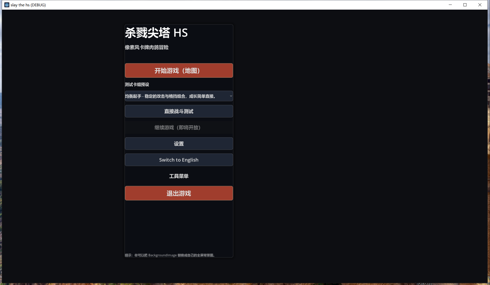
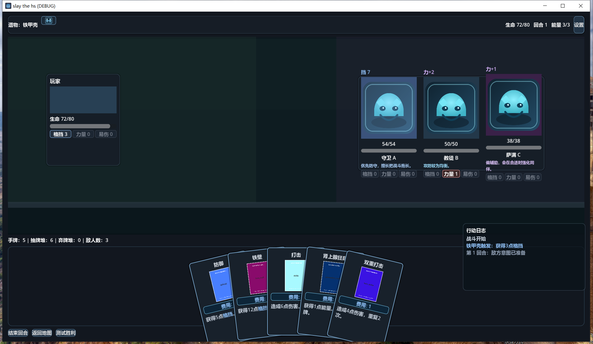

# FishEatFish（千夜）

> 回合制卡牌 roguelike（《杀戮尖塔》玩法参考）。**Godot 4.6.1 + C#**。
> 四名角色组队 → 抽卡出牌 → 探索六边形地图 → 遭遇敌人 / 商店 / 事件 → 带回奖励再出发。




| | |
|---|---|
| 引擎 | Godot 4.6.1-stable **mono**（.NET 8.0 / `net8.0`） |
| 仓库 | <https://github.com/yutuer/shalujianta.git>（分支 `main`） |
| 规模 | 117 个 C# 脚本 / 18,664 行 · 31 个 `.tscn` · 11 张 JSON 数据表 |
| 原始需求 | [`docs/原始策划案.md`](docs/原始策划案.md) |
| 当前迭代 | [`docs/开发计划.md`](docs/开发计划.md) · 14 个条目 |

---

## 📖 给后来者：按这个顺序读

| # | 文件 | 什么时候看 |
| :-: |---|---|
| 1 | **本文** | 主干：现状、架构、下一步、文档地图 |
| 2 | [`.trae/rules/project_rules.md`](.trae/rules/project_rules.md) | **动手前必读**——写代码的铁律 |
| 3 | [`docs/开发计划.md`](docs/开发计划.md) | **正在做什么**——本轮迭代条目 + 三步流程 |
| 4 | [`tasks.md`](tasks.md) | 87 行任务清单，带依赖关系与状态 |
| 5 | [`GameDesign.md`](GameDesign.md) | 完整策划案（18 章 + ✅/🔄/❌ 标记） |
| 6 | [`docs/踩坑记录.md`](docs/踩坑记录.md) | **踩过什么坑**——改代码前扫一眼 |
| 7 | [`docs/调试场景准备器.md`](docs/调试场景准备器.md) | 怎么带着「选人已完成」的状态进场景 |
| 8 | [`CODE_WIKI.md`](CODE_WIKI.md) | 技术档案（自动生成，**已滞后，以源码为准**） |
| 9 | [`checklist.md`](checklist.md) | 12 大类验收清单 |

> ⚠️ **文档会失同步。** 本项目历史上至少 4 处文档与代码脱节（见 [`docs/踩坑记录.md` §1](docs/踩坑记录.md)）。**源码是唯一真相**，冲突时以源码为准，并顺手把文档修掉。

> 📌 **本文是主干**，只回答五个问题：这是什么 / 怎么跑 / 架构长啥样 / 现在啥进度 / 下一步做什么。
> 一切细节都外链到 `docs/` 专题文档，**不在这里展开**——需要时点进去看。

---

## 1. 快速上手

### 1.1 环境

| 依赖 | 版本 | 备注 |
|---|---|---|
| Godot | 4.6.1-stable **mono** | 必须带 .NET 版 |
| .NET SDK | 8.0+ | 本机实测 10.0.201 可用（`net8.0` 目标框架） |
| 显卡 | D3D12 | `project.godot` 已锁定 `rendering_device/driver.windows="d3d12"` |

> 🖥️ **本机 Godot 编辑器不在 PATH**，常见目录也搜不到。所以：
> - **编译** → 用 `dotnet build`（不依赖 Godot 可执行文件）
> - **跑起来看** → 用 `godot-runtime` MCP 的 `run_project` / `take_screenshot`
> - **改场景/布局** → 需要编辑器，目前只能手工编辑 `.tscn` 文本

### 1.2 构建

```powershell
cd E:\trae_Projects\FishEatFish
dotnet build          # 输出到 .godot/mono/temp/bin/Debug/
```

### 1.3 运行（MCP 方式）

```powershell
# 通过 godot-runtime MCP 启动（会自动构建并注入 MCP 桥）
run_project(projectPath="E:/trae_Projects/FishEatFish")
take_screenshot()
```

导出配置见 `export_presets.cfg`（预设名 `Windows Desktop`，输出到 `dabao/qianye.exe`）。

### 1.4 常用命令速查

```powershell
cd E:\trae_Projects\FishEatFish
```

| 目的 | 命令 |
|---|---|
| 编译 | `dotnet build` |
| 清理后重编 | `dotnet clean; dotnet build` |
| **校验任务统计表** | `powershell -ExecutionPolicy Bypass -File tools\check-task-stats.ps1` |
| 导出 Windows 版 | `godot --headless --export-release "Windows Desktop" dabao/qianye.exe` |
| 提交（多行信息） | `git commit -F <消息文件>` ← 多行信息别用 `-m`，PowerShell 会拆参数 |
| 推送 | `git push origin main` |
| GitHub 认证状态 | `gh auth status` |
| 看 CI / PR / Issue | `gh run list` · `gh pr list` · `gh issue list` |
| 查仓库 API | `gh api repos/yutuer/shalujianta` |
| 压参考图入库 | `powershell -ExecutionPolicy Bypass -File tools\convert-reference-images.ps1` |

> 导出产物（`dabao/`、`qianye.*`、`*.tpz`、`*.rar`）已在 `.gitignore` 中，不会误入版本库。

**跑起来看**（本机无 Godot 编辑器，用 MCP）：
`run_project(projectPath=...)` 启动 · `take_screenshot()` 截图 · `simulate_input(...)` 模拟输入 · `run_script(...)` 注入 GDScript

### 1.5 调试场景准备器（速查）

改完 bug 要验证时，**不必走「主菜单 → 选关卡 → 选角色 → 进地图」那一大段**。

```powershell
dotnet build
$godot = 'K:\Godot_v4.6.1-stable_mono_win64\Godot_v4.6.1-stable_mono_win64.exe'
& $godot --path 'E:\trae_Projects\FishEatFish' 'res://Scenes/Dev/DevScenario.tscn' -- --scenario=battle
```

内置 8 个预设：`default` `battle` `near_shop` `half_hp` `elite_battle` `near_boss` `step_on_boss` `boss_battle`。

> ⚠️ **别直接跑 `HexMapScene.tscn`** —— 会跳过选人流程，战斗回退到默认阵容「鼠牛虎兔」而不是你选的队伍。

**预设表、命令行参数、加新预设的方法** → [`docs/调试场景准备器.md`](docs/调试场景准备器.md)

---

## 2. 目录地图

```
FishEatFish/
├─ Data/            11 张 JSON 数据表（卡牌/角色/刻印/造物/buff/效果/大招/敌人波次…）
│                   + dev_scenarios.json —— 调试场景预设表
├─ Scenes/          31 个 .tscn
│  ├─ MainMenu / LevelMap / CharacterSelection / BattleScene / HexMapScene
│  ├─ Dev/           DevScenario.tscn —— 调试场景准备器入口
│  └─ UI/           24 个 UI 组件场景
├─ Scripts/         117 个 .cs，按职责分层
│  ├─ Scenes/       场景驱动（BattleManager 1007 行是核心）
│  ├─ Dev/          DevScenario.cs —— 调试场景准备器逻辑
│  ├─ Battle/       战斗核心
│  │  ├─ Core/          Player / Enemy / IUnit / 敌人波次加载
│  │  ├─ Card/          卡牌数据、等级、描述生成
│  │  ├─ CharacterSystem/ 12 生肖定义、Attacker、终极技能
│  │  ├─ Effects/       效果注册表、效果实现、Buff/Debuff
│  │  ├─ HexMap/        坐标、格子、地图、生成器、事件
│  │  ├─ MapSystem/     MapManager / 地图定义 / 奖励
│  │  ├─ ArtifactSystem/ EngravingSystem/ SilverKeySystem/
│  │  └─ CardLayoutManager / RageManager / BattleTransitionManager …
│  ├─ AI/           敌人 AI（激进/均衡/防守）
│  ├─ Shop/         黑印商店
│  └─ UI/           20+ UI 组件脚本
├─ docs/            专题文档（见 §9 文档索引）+ 原始策划案 + 参考图
├─ tools/           check-task-stats.ps1 校验统计表是否漂移
│                   convert-reference-images.ps1 压参考图入库
├─ .trae/           Trae 的项目规则与历史计划
└─ project.godot    工程配置（含 [autoload]）
```

---

## 3. 架构要点

### 3.1 场景流转

```
MainMenu
  └→ LevelMap（选关卡）
       └→ CharacterSelection（选 4 角色 + 1 钥令）
            ├→ HexMapScene（六边形地图探索）⇄ BattleScene（战斗）
            └→ BattleScene（直接进战斗，测试用）
```

跨场景数据靠两套机制：

- **`GlobalData`**（`Scripts/Scenes/LevelMap.cs` 末尾的静态类）— 已选角色、钥令、当前地图
- **autoload**（见下）— 需要跨场景存活的运行时状态

### 3.2 autoload（跨场景存活，`project.godot`）

| 名称 | 脚本 | 职责 |
|---|---|---|
| `MapManager` | `Scripts/Battle/MapSystem/MapManager.cs` | 当前关卡、进度、造物数量上限 |
| `BattleTransitionManager` | `Scripts/Battle/BattleTransitionManager.cs` | 地图↔战斗切换、**地图存档**（地图对象/位置/生命/黑印）、敌人波次键 |
| `BlackMarkShopManager` | `Scripts/Shop/BlackMarkShopManager.cs` | 黑印余额、商店物品、已购造物、已刻印卡牌 |

> 这三个**必须是 autoload**。历史上它们分别是场景节点 / 子节点，切场景就销毁，导致黑印清零、地图存档丢失。

### 3.3 六边形地图坐标（唯一权威常量）

写在 `.trae/rules/project_rules.md`，实现在 `HexMapUI.HexToWorld/WorldToHex` 与 `HexTileView.UpdateHexShape`：

```
尺寸      180 × 156（Control），多边形本体 x∈[15,165] y∈[0,156]
顶点      V0(90,0) V1(165,39) V2(165,117) V3(90,156) V4(15,117) V5(15,39)
转换      x = 150*Q + 75*R     y = 117*R
反解      R = round(y/117)     Q = round((x - 75*R)/150)
边↔方向   a↔North  b↔NorthWest  c↔SouthWest  d↔South  e↔SouthEast  f↔NorthEast
```

> `docs/六边形地图算法.md` 曾长期停留在旧的 120×104 尺寸，**已于 2026-10-20 对齐**。改尺寸要同步改：规则文件 + `HexTileView.UpdateHexShape()` + `HexMapUI` 两个转换函数 + 该文档，**四处**。

### 3.4 敌人波次配置

`Data/enemies.json` → `Scripts/Battle/Core/EnemyConfigLoader.cs` → `BattleManager.InitializeEnemies()`

| 波次键 | 来源 | 敌人 |
|---|---|---|
| `normal_wave` | 普通战斗格子 | 守卫 / 游兵 / 斥候 |
| `elite_wave` | 精英战斗格子 | 精锐·虎 / 精锐·蛇 |
| `boss_wave` | 终点 BOSS 格子 | 千夜之主 |

格子上的 `EnemyConfig` 字段 → `BattleTransitionManager.CurrentEnemyConfig` → 战斗场景按此加载。**新增敌人只改 JSON，不改代码。**

---

## 4. 开发铁律（摘要，完整版见规则文件）

1. **逻辑与页面分离** —— 布局/尺寸/颜色进 `.tscn`，业务逻辑/动态数据/事件绑定进 `.cs`
2. **UI 优先建独立 `.tscn`**，禁止在代码里硬编码 `PanelContainer` 之类的布局
3. **事件回调首尾必须有日志**：
   ```csharp
   GD.Print($"[类名] 方法名 called");
   // ... 逻辑 ...
   GD.Print($"[类名] 方法名 completed");
   ```
4. **改完代码必须 `dotnet build` 通过**再让用户测
5. **六边形坐标常量见 §3.3**

> 这 5 条之外，历史上踩过的 16 个坑（`.tscn` 漏绑脚本、无头环境模拟点击失效、git push 上传大文件、PowerShell 编码……）都记在 [`docs/踩坑记录.md`](docs/踩坑记录.md)。

---

## 5. 当前进度基线

> **本表是快照，不是活数据。** 权威来源是 [`tasks.md`](tasks.md) 的任务行；下表由脚本实算后同步。
> 统计于 **2026-10-20**，口径：按 `tasks.md` 一~五节任务行逐行实算（共 **119** 行）。

| 分类 | 总数 | ✅ | 🔄 | ⬜ |
|---|:-:|:-:|:-:|:-:|
| 高优先级 | 58 | 4 | 5 | 49 |
| 中优先级 | 15 | 0 | 1 | 14 |
| 低优先级 | 13 | 0 | 0 | 13 |
| 商店系统（已完成） | 28 | 26 | 1 | 1 |
| Bug 修复 | 5 | 3 | 2 | 0 |
| **合计** | **119** | **33** | **9** | **77** |

📌 **改完任务状态别只改表**——跑校验脚本，它一次核对四处（`tasks.md` 实算 / `tasks.md` 统计表 / 本表 / `docs/开发计划.md`）：

```powershell
powershell -ExecutionPolicy Bypass -File tools\check-task-stats.ps1
```

退出码 `0` = 一致；非 `0` = 有漂移，脚本会逐条列出该改哪几个数字。

**已跑通的主循环**：主菜单 → 选图 → 选角色 → 六边形地图 → 踩战斗格子 → 按波次配置生成敌人 → 战斗结束 → 回到地图且地图/位置/生命/黑印完整恢复。

**血量是同一份**：玩家血量 = 队伍总血量（鼠牛虎兔 = 125），战斗胜利写回地图，战败不写回。

**尚未打通的**：刻印效果实际触发 · 大招/钥令实际效果 · 战斗胜利后的奖励选择界面 · Buff/Debuff UI 呈现 · 地图连通性/死锁校验（还没法自动查"走过去了回不来"） · 按配额生成关卡地图（现在是无 seed 随机生成，退出重进同一关卡地图会变） · 地图迷雾系统（还没有战争迷雾 / 相邻高亮 / 探照灯道具） · 多簇地图生成（地图目前是完整网格，只靠「洞穴」格子假断开）。

---

## 6. 已知陷阱与经验

完整的 16 条记在 **[`docs/踩坑记录.md`](docs/踩坑记录.md)**，改代码前建议扫一眼。最要命的几条：

| 坑 | 一句话 | 详见 |
|---|---|---|
| 文档失同步 | 改了任务行忘改统计表 → 数字骗人 | §1 |
| `.tscn` 根节点漏绑 script | 组件一直是空的，但**不崩所以没人发现** | §8 |
| 无头环境模拟点击失效 | 依赖 `GetLocalMousePosition()` 的路径测不到 → 改用临时 C# 集成测试 | §4 |
| `git push` 上传大文件 | 推的是「远端缺失的对象」，不是增量 diff | §5 |
| MCP 污染 `project.godot` | 跑测试期间 `git add .` 会把 `McpBridge` autoload 带进仓库 | §12 |

> 规矩：**跑测试期间只 `git add` 具体文件**。

---

## 7. 下一步做什么

**本轮迭代（UI 对标参考图）** —— 14 个条目，逐条走「需求 → 开发 → 验证」三步流程：
[`docs/开发计划.md`](docs/开发计划.md)

排序按「重要度 ÷ 难度」综合定，不按 ID。头三条是**地图这条线**，其余是界面：

- **① D13「地图可达性与死锁校验」**（🔺 核心 / 难度中）——查"走过去了回不来、通不了关"。本质是**有向图可达性 + 死锁检测**（把单向传送建成有向边，软锁问题就自动成立），换个邻接函数就能用在别的项目上，**是可以直接带走的资产**；同时它是后续一切地图改动的安全网。
- **② D14「按配额生成关卡地图」**（高 / 高）——关卡是**固定内容**（重复进入要一样），但不必逐格手画：用配额参数（多少格、几个战斗/精英/商店/单向门/双向门）+ 种子生成，**确定性**且**同关卡复用同一张**。⚠️ 现状是 `new HexMapGenerator()` 未传 seed，退出重进同一关卡地图会变。
- **③ D12「多簇生成」**（中 / 🔺 最高难度）——并入 D14 阶段 1，不单独排期。

**功能缺口** —— `tasks.md` 高优先级 5 组（战斗奖励界面 / 刻印触发 / 大招 / 钥令 / Buff-Debuff UI）尚未完成，进度见 §5。

**其他待办**（散落在 `tasks.md` 与 `.trae/plans/`，未进本轮迭代）：

- 战斗奖励发放 —— 现在打赢 BOSS 只结算「地图完成」，没发奖（金币/造物/刻印）
- 点击远距离格子移动 —— 现在悬停会高亮整条路径，但点击只接受相邻格子（`HexMapUI.OnTileClicked`）
- 存档持久化到磁盘 —— 所有跨场景状态目前只在内存，重启即丢
- `HexMapUI.cs` 拆分 —— `.trae/plans/hexmapui-refactor-plan.md` 阶段 6（目标 802 行 → <400 行）

---

## 8. 变更记录

| 日期 | 内容 |
|---|---|
| 2026-10-20 | **D12 认知翻转：簇不是生成出来的，是洞消耗后「裂」出来的**（主人澄清：两块区域只靠一个洞格子相连时，初始并不算分离；洞被消耗消失后，才真的分成两块）。据此**生成器不用再造互不相连的区块**——只要生成**连通图 + 在割点位置埋 1~3 个洞**，簇随探索自然出现（参考图 R-05/R-06 的黑色空隙即被消耗掉的洞）。D12 **难度从 🔺 最高降到中**（退化为 D14 阶段 2 的一小步 + D5 的视觉），**重要度升到高**；D13 的**桥树分析从"可选预检"升为核心机制**（簇 = 桥树上的区域，玩家在桥树上只能走简单路径）；D14 配额表**删掉 `clusters` 参数**。`tasks.md` 1.6 重写为 5 行，统计 118 → 119 |
| 2026-10-20 | **草盖地洞规则全部确认**（主人答复）：① 每关 **1~3 个**；② 踩上去格子**还在**但**不许退回进入的那个格子**，**离开洞之后**才把该格子**删除**；③ 消耗**必定、一次性**。据此 D13 的判定定为**两层**：第 1 层桥树静态预检（O(V+E)，快速筛「旁支必需格不可达」），第 2 层**状态空间搜索为主判定**（状态 = 位置 + 已消耗洞集合 + 进入方向，k≤3 时约 3,200 状态，**微秒级、无需剪枝**）。同时澄清「洞不是桥」：只有割点性质的洞才起桥的作用，环上的洞消耗后仍可绕路，交给状态空间确认 |
| 2026-10-20 | **D13 找到更简洁的判定：洞 = 桥 → 纯静态桥树分析**。「草盖地洞」在图论里就是 **cut edge**；移除所有洞边得到**区域**，接回去得到**桥树**。关键：区域内自由往返，跨区只能过桥且**桥消耗后不能回**，桥树是树 → **玩家只能走简单路径，拐进旁支就永远回不来**。于是**充分必要条件**：所有 required（含 BOSS）必须落在桥树 S→E 路径的区域并集内。这是 **O(V+E) 静态算法**（Tarjan 找桥 + 并查集缩点），**状态空间搜索退为兜底**，D13 难度不升反降。另澄清：决定性的是**路径上洞数 m**而非**洞的总数 k**（方向待主人核对） |
| 2026-10-20 | **D13 升级为可处理「消耗型格子」**：参考游戏有一种**盖着草的地洞**——第一次能踩、**不能往回走**、**踩过就变成空格**（格子会消失）。这让**图本身在变**，静态的两次 BFS 不够，必须把不可逆元件并进搜索状态：**状态 = (位置, 已消耗元件集合)**，k=0 时自动退化成普通 BFS。**复杂度取决于 k（每关不可逆元件数）而非地图大小 N**：k≤5 时状态数仅 N×32，微秒级；k≥20 才需要剪枝。本作是单 agent 无谜题分支，只需判「是否存在通关走法」这个**存在性问题**，不需要搜索完整解法。`IMapGraph` 预留 `GetConsumableNodes()`；`tasks.md` 补 1.7.7/1.7.8 与 1.10（消耗型格子机制 4 行），统计 111 → 116 |
| 2026-10-20 | **D5 补充确认项**：探照灯效果定为**驱散半径 3 格**视野（已确认）；**迷雾的视线阻挡**（有格子天生挡视线）等主人后续确认——但架构上先留口子：照亮计算封装成**可插拔 FOV 函数**，不把"半径内全亮"写死，将来加阻挡只换实现。附「待确认」清单三条（视线阻挡 / 初始可见范围 / 迷雾是否每关不同）。`tasks.md` 补 1.9.7，统计 110 → 111 |
| 2026-10-20 | **D5 重写为「地图迷雾系统（战争迷雾 + 可交互高亮 + 探照灯）」**：新增 R-15/R-16/R-17 三张参考图后确认——**是战争迷雾（fog of war），不是"未探索"**。黑色迷雾笼罩地图，边界是**云雾状有机曲线**；驱散后格子分两种：**青边亮色 = 当前可交互**（玩家的相邻格）、**暗色 + 有图标 = 已照亮不可走**；**探照灯**是地图事件（"能驱散四周的黑色迷雾"/"【打开开关】扩大当前视野"），打开后可见区域大幅扩大。已照亮状态**必须进地图存档**。D5 重要度/难度升到高，排序升到第七；`tasks.md` 补 1.9（6 行），统计 104 → 110 |
| 2026-10-20 | **D5 重写为「地图显示三态（高亮 / 暗显 / 纯黑虚空）」**：照 R-04 / R-05 / R-06 修正——**高亮只有玩家周围一圈**（半径 1），更远的格子暗显但保留图标；**黑色是「那里根本没有格子」的虚空，不是"未探索"**（暗 ≠ 黑）。三态互斥。暗显区是"已探索记忆"还是"地图已知"留了一个待确认点，建议先按后者实现 |
| 2026-10-20 | **新增 D14「按配额生成关卡地图（确定性 + 可复用）」置于第二位**：关卡是固定内容（重复进入要一样），但不必逐格手画——用**配额参数**（格子数 / 战斗 / 精英 / 商店 / 单向门 / 双向门）+ 种子生成；流程为「先长树保证连通 → 只在能到终点的格子上加门 → 按配额填事件 → D13 校验收敛」。查证现状：`new HexMapGenerator()` **未传 seed**，退出重进同一关卡地图会变。**D12 并入 D14 阶段 1**；`tasks.md` 补 1.8（7 行），统计 97 → 104 |
| 2026-10-20 | **按「重要度 ÷ 难度」重排开发顺序**，新增 **D13「地图可达性与死锁校验（通用算法模块）」**并置顶：把"传送"建模成有向边，两次 BFS 即能检出通不了关 / 走过去了回不来 / 不可达区域 / 关键格隔断 / 死路 / 孤岛；模块不依赖 Godot，可整目录拷到其他项目。D12 因"关卡可人工配置"重要度下调，排到最后；`tasks.md` 补 1.7（6 行），统计 91 → 97 |
| 2026-10-20 | **D12 标记为全项目最高难度（🔺）**：补 4 个技术难点拆解、4 阶段可回退方案，并确认 `HexMapGenerator`/`HexCoord` 不依赖场景树 → 阶段 1~3 可在 Godot 无头模式下跑断言；总表新增「难度」列，12 个条目全部标注难度 |
| 2026-10-20 | 新增迭代条目 **D12「地图多簇生成（互不连通的区块）」**：地图从完整矩形网格改为 2~4 个互不相连的区块簇，跨簇靠双向传送（隧道）；D5 收敛为纯视觉层；`tasks.md` 补 1.6（4 行） |
| 2026-10-20 | **README 重构为「主干 + 专题文档外链」**：抽出 `docs/踩坑记录.md`（15 条）与 `docs/调试场景准备器.md`；本文只留现状/架构/进度/导航；规模数字校正为 117 cs / 18,664 行 / 31 tscn / 11 JSON |
| 2026-10-20 | 新增 `docs/开发计划.md`：本轮迭代「需求→开发→验证」三步流程 + 11 个条目 + 参考图索引 R-01~R-14；校验器扩到四处互校 |
| 2026-10-20 | 参考图压缩入库：29.8MB PNG → 3.19MB JPG（1920 宽），原 PNG 留本地；新增 `tools/convert-reference-images.ps1` |
| 2026-10-20 | 打通 BOSS 触发（终点格子走上去即打 BOSS，打赢结算地图完成）与血量打通（队伍总血量=地图血量=战斗血量，战斗胜利写回） |
| 2026-10-20 | 修掉战斗场景 3 个 UI 组件静默失效的根因：.tscn 根节点/槽位节点漏绑 script；CharacterSlotUI / RageSlotUI 拆分为独立脚本；RageDisplayUI 槽位路径少一层 VBoxContainer/；HexMapUI 血条初始值手动推送 |
| 2026-10-20 | 文档与代码对齐：`tasks.md` 统计表实算校准、`GameDesign.md` 章节编号去撞号、`docs/六边形地图算法.md` 常量同步、补「边↔方向」对应表 |
| 2026-10-20 | 打通地图→战斗→返回地图闭环；敌人波次配置化；三个管理器改 autoload；修银钥指示器节点路径与 Godot 4 窗口尺寸信号 |
| 2026-10-20 | 仓库瘦身：打包/导出产物移出版本库（`.git` 2.4GB → 1MB，GitHub 仓库 1.1MB） |
| — | 初始需求见 [`docs/原始策划案.md`](docs/原始策划案.md) |

---

## 9. 文档索引

### 主干与规则

| 路径 | 内容 |
|---|---|
| **本文** | 主干：现状 / 架构 / 进度 / 下一步 |
| `.trae/rules/project_rules.md` | **开发铁律**（第一准则、UI 规范、日志规范、六边形常量） |
| `docs/开发计划.md` | **本轮迭代执行计划**：需求→开发→验证三步流程 + 14 个条目 + 重要度/难度排序 + 参考图索引 |
| `tasks.md` | 87 行任务清单 + 依赖 + 状态 |
| `GameDesign.md` | 完整策划案 18 章 + 未完成功能清单 |
| `checklist.md` | 12 大类验收清单 |

### 专题技术文档

| 路径 | 内容 |
|---|---|
| `docs/踩坑记录.md` | **16 条真实踩坑与规矩**（改代码前扫一眼） |
| `docs/调试场景准备器.md` | 调试场景准备器用法、8 个预设、命令行参数、加预设的方法 |
| `docs/六边形地图算法.md` | 六边形坐标权威文档 |
| `docs/手牌预览功能使用说明.md` | 手牌扇形调试面板用法 |
| `docs/原始策划案.md` | 项目立项需求原文 |
| `docs/screenshots/` | 界面参考图（目标效果基准，JPG 版入库；原始 PNG 只留本地） |

### 历史 / 归档

| 路径 | 内容 |
|---|---|
| `CODE_WIKI.md` | 自动生成技术档案（**已滞后**） |
| `plan.md` | 商店 Bug 修复专项计划（历史） |
| `docs/修复六边形地图Bug.md` | 早期 AI 思考过程存档（归档性质） |
| `docs/战斗场景布局.md` | 残稿，未写完 |
| `.trae/plan_hexmap_battle_trigger.md` | 地图战斗触发系统实现计划（部分已完成，勾选框未同步） |
| `.trae/plans/hexmapui-refactor-plan.md` | HexMapUI 组件拆分计划（阶段 1-5 完成，阶段 6 待做） |
